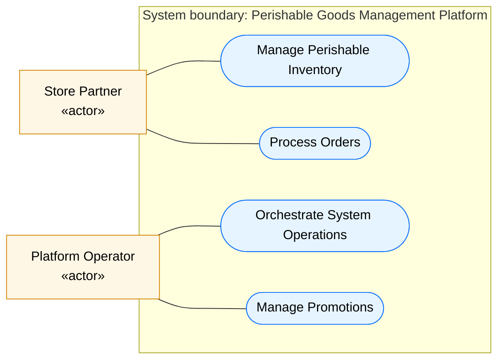

# Use Case Diagram

**System:** Perishable Goods Management Platform

**Actors:** 2

**Use cases:** 4

**Actor relationships:** 4

**Include / extend relationships:** 0

## Diagram



## Diagram Specification

```json
{
  "system_name": "Perishable Goods Management Platform",
  "actors": [
    {
      "id": "ACTOR_001",
      "name": "Store Partner",
      "kind": "primary",
      "inferred": false
    },
    {
      "id": "ACTOR_002",
      "name": "Platform Operator",
      "kind": "primary",
      "inferred": false
    }
  ],
  "use_cases": [
    {
      "id": "UC_001",
      "name": "Manage Perishable Inventory",
      "inferred": false
    },
    {
      "id": "UC_002",
      "name": "Process Orders",
      "inferred": false
    },
    {
      "id": "UC_003",
      "name": "Orchestrate System Operations",
      "inferred": false
    },
    {
      "id": "UC_004",
      "name": "Manage Promotions",
      "inferred": false
    }
  ],
  "links": [
    {
      "actor": "ACTOR_001",
      "use_case": "UC_001",
      "kind": "primary"
    },
    {
      "actor": "ACTOR_001",
      "use_case": "UC_002",
      "kind": "primary"
    },
    {
      "actor": "ACTOR_002",
      "use_case": "UC_003",
      "kind": "primary"
    },
    {
      "actor": "ACTOR_002",
      "use_case": "UC_004",
      "kind": "primary"
    }
  ],
  "includes": []
}
```
