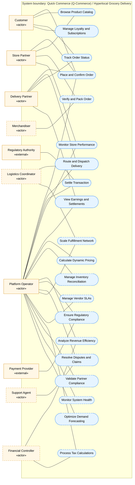

# Use Case Diagram

Actors, system boundary and functional capabilities.

Dashed outlines and elements marked * were added by the AI model (inferred); solid ones come from the repositories.

Generated 2026-11-15T20:21:19.618Z by 8.5.2.DiagramsAI.js using unsloth/Qwen3.5-9B-GGUF. Sources: knowledge base (51 actors, 14 business objects, 11 activities, 11 lifecycle stages, 20 information requirements), requirements schema (62 functional, 28 business requirements), business_rule_discovery (142 rules after merging 168 raw rules, ingestion run 3).

| Unit | Source | Inferred elements |
|---|---|---|
| USECASE-1 Use cases from business activities | AI | 0 |
| USECASE-2 Functional capabilities | AI | 15 |

## USECASE-1: Use cases from business activities

Focus: Each use case is something an actor wants to achieve with the system. Show all actors, including those the baseline misses, and relations between use cases (include / extend).

```mermaid
flowchart LR
  a_a1["Customer<br/>«actor»"]:::actor
  a_a2["Store Partner<br/>«external»"]:::actor
  a_a3["Delivery Partner<br/>«external»"]:::actor
  a_a4["Platform Operator<br/>«actor»"]:::actor
  a_a5["Merchandiser<br/>«actor»"]:::actor
  a_a6["Fulfillment Supervisor<br/>«actor»"]:::actor
  a_a7["Regulatory Authority<br/>«external»"]:::actor
  a_a8["Payment Provider<br/>«external»"]:::actor
  a_a9["Order Allocation Engine<br/>«system»"]:::actor
  a_a10["Dispute Resolution Team<br/>«actor»"]:::actor
  a_a11["Compliance Officer<br/>«actor»"]:::actor
  a_a12["Financial Controller<br/>«actor»"]:::actor
  a_a13["Logistics Coordinator<br/>«actor»"]:::actor
  a_a14["Support Agent<br/>«actor»"]:::actor
  subgraph SYS["System boundary: Quick Commerce (Q-Commerce) / Hyperlocal Grocery Delivery"]
    u_u1(["Market Entry and Partner Onboarding"]):::uc
    u_u2(["Inventory Synchronization and Validation"]):::uc
    u_u3(["Order Initiation and Demand Capture"]):::uc
    u_u4(["Order Validation and Resource Allocation"]):::uc
    u_u5(["Order Fulfillment and Preparation"]):::uc
    u_u6(["Last-Mile Logistics Execution"]):::uc
    u_u7(["Delivery Handover and Proof Generation"]):::uc
    u_u8(["Payment Processing and Financial Settlement"]):::uc
    u_u9(["Post-Transaction Review and Feedback Collection"]):::uc
    u_u10(["Dispute Resolution and Exception Handling"]):::uc
    u_u11(["Product Catalog Curation and Strategy"]):::uc
    u_u12(["Compliance and Safety Audit"]):::uc
    u_u13(["Financial Reconciliation and Settlement"]):::uc
    u_u14(["Logistics Route Optimization"]):::uc
    u_u15(["Customer Support and Inquiry Resolution"]):::uc
    u_u16(["Quality Assurance Verification"]):::uc
    u_u17(["Service Area Definition and Management"]):::uc
    u_u18(["Real-Time Inventory Update"]):::uc
    u_u19(["Delivery Failure and Re-attempt"]):::uc
    u_u20(["Refund and Chargeback Processing"]):::uc
    u_u21(["Loyalty Program Enrollment"]):::uc
    u_u22(["Promotional Campaign Management"]):::uc
    u_u23(["Peak Demand Scaling"]):::uc
    u_u24(["Vendor Onboarding and Vetting"]):::uc
  end
  a_a4 --- u_u1
  a_a7 -.- u_u1
  a_a2 -.- u_u1
  a_a4 --- u_u2
  a_a2 -.- u_u2
  a_a9 -.- u_u2
  a_a1 --- u_u3
  a_a9 --- u_u4
  a_a4 -.- u_u4
  a_a2 --- u_u5
  a_a5 -.- u_u5
  a_a6 -.- u_u5
  a_a3 --- u_u6
  a_a9 -.- u_u6
  a_a13 -.- u_u6
  a_a3 --- u_u7
  a_a1 -.- u_u7
  a_a8 --- u_u8
  a_a4 -.- u_u8
  a_a2 -.- u_u8
  a_a1 --- u_u9
  a_a4 -.- u_u9
  a_a4 --- u_u10
  a_a1 -.- u_u10
  a_a2 -.- u_u10
  a_a5 --- u_u11
  a_a5 --- u_u16
  a_a11 --- u_u12
  a_a4 --- u_u13
  a_a12 -.- u_u13
  a_a8 -.- u_u13
  a_a13 --- u_u14
  a_a9 -.- u_u14
  a_a14 --- u_u15
  a_a1 -.- u_u15
  a_a1 --- u_u19
  a_a3 -.- u_u19
  a_a4 --- u_u20
  a_a8 -.- u_u20
  a_a1 --- u_u21
  a_a4 --- u_u22
  a_a1 --- u_u23
  a_a9 -.- u_u23
  a_a2 --- u_u24
  a_a4 -.- u_u24
  a_a7 --- u_u17
  a_a4 -.- u_u17
  a_a2 --- u_u18
  a_a9 -.- u_u18
  u_u4 -. include .-> u_u9
  u_u4 -. extend .-> u_u10
  u_u5 -. include .-> u_u16
  u_u6 -. include .-> u_u14
  u_u6 -. extend .-> u_u19
  u_u7 -. extend .-> u_u19
  u_u8 -. extend .-> u_u20
  u_u1 -. include .-> u_u17
  u_u1 -. include .-> u_u24
  u_u2 -. include .-> u_u18
  u_u3 -. extend .-> u_u21
  u_u3 -. extend .-> u_u22
  u_u3 -. extend .-> u_u23
  classDef actor fill:#fff7e6,stroke:#d48806,color:#000
  classDef actorInf fill:#fff7e6,stroke:#d48806,stroke-dasharray:5 5,color:#000
  classDef uc fill:#e6f4ff,stroke:#1677ff,color:#000
  classDef ucInf fill:#e6f4ff,stroke:#1677ff,stroke-dasharray:5 5,color:#000
```

## USECASE-2: Functional capabilities

Focus: Group the business requirements into at most 14 functional capabilities (use cases) and connect each to the actors who need it.

