# BPMN-style Business Process Diagram

End-to-end business processes with swimlanes (one per responsible actor), decisions and exception paths.

Dashed outlines and elements marked * were added by the AI model (inferred); solid ones come from the repositories.

Generated 2026-11-15T20:21:19.618Z by 8.5.2.DiagramsAI.js using unsloth/Qwen3.5-9B-GGUF. Sources: knowledge base (51 actors, 14 business objects, 11 activities, 11 lifecycle stages, 20 information requirements), requirements schema (62 functional, 28 business requirements), business_rule_discovery (142 rules after merging 168 raw rules, ingestion run 3).

| Unit | Source | Inferred elements |
|---|---|---|
| PROCESS-1 Main end-to-end process | baseline (not generated yet) | 0 |
| PROCESS-2 Exceptions and disputes | baseline (not generated yet) | 0 |

## PROCESS-1: End-to-end business process

Focus: The main end-to-end business process from its trigger to completion, one lane per responsible actor, with business rule decisions and their exception outcomes.

## PROCESS-2: End-to-end business process

Focus: What can go wrong in this business: failures, rejections, timeouts, disputes, cancellations. For each, how it is detected, who handles it, what is done to put it right and how the process ends.

```mermaid
flowchart LR
  n_start(("Start")):::start
  n_end(("End")):::finish
  subgraph L1["Platform Operator"]
    n_t1["Market Entry and Partner Onboarding"]:::task
    n_d1{"Regulatory Zone Activation Gate?"}:::dec
    n_x1(["The system blocks the activation of the zone and pre..."]):::exc
    n_t2["Inventory Synchronization and Validation"]:::task
    n_d2{"Sync Discrepancy Flagging?"}:::dec
    n_x2(["The system halts order processing for affected store..."]):::exc
    n_t10["Dispute Resolution and Exception Handling"]:::task
    n_d10{"Refund Precondition?"}:::dec
    n_x10(["Revenue leakage or incorrect financial reporting occurs"]):::exc
  end
  subgraph L2["Customer"]
    n_t3["Order Initiation and Demand Capture"]:::task
    n_d3{"Discontinued Item Blocking?"}:::dec
    n_x3(["The system blocks the item selection and displays a ..."]):::exc
    n_t9["Post-Transaction Review and Feedback Collection"]:::task
    n_d9{"Feedback Assignment Binding?"}:::dec
    n_x9(["The feedback is rejected or logged as 'Unattributed'..."]):::exc
  end
  subgraph L3["Order Allocation Engine"]
    n_t4["Order Validation and Resource Allocation"]:::task
    n_d4{"Explicit Acceptance Required?"}:::dec
    n_x4(["The system blocks the start of the delivery task and..."]):::exc
  end
  subgraph L4["Store Partner"]
    n_t5["Order Fulfillment and Preparation"]:::task
    n_d5{"Quality Failure Blocking?"}:::dec
    n_x5(["The system must prevent any further status changes o..."]):::exc
  end
  subgraph L5["Delivery Partner"]
    n_t6["Last-Mile Logistics Execution"]:::task
    n_d6{"Mandatory Status Notification Trigger?"}:::dec
    n_x6(["Customer support inquiries increase and customer ret..."]):::exc
    n_t7["Delivery Handover and Proof Generation"]:::task
    n_d7{"Delivery Proof Rejection for Cancelled Ass...?"}:::dec
    n_x7(["The system rejects the submission and logs an error,..."]):::exc
  end
  subgraph L6["Payment Provider"]
    n_t8["Payment Processing and Financial Settlement"]:::task
    n_d8{"Delivery Verification Mandate?"}:::dec
    n_x8(["The settlement status remains 'Pending' and funds ar..."]):::exc
  end
  subgraph L7["Merchandiser"]
    n_t11["Product Catalog Curation and Strategy"]:::task
    n_d11{"Perishable Expiry Enforcement?"}:::dec
    n_x11(["The system rejects the Order Request and logs a comp..."]):::exc
  end
  n_start -->|Strategic decision to launch in a new...| n_t1
  n_t1 --> n_d1
  n_d1 -.->|No| n_x1
  n_d1 -->|Yes| n_t2
  n_t2 --> n_d2
  n_d2 -.->|No| n_x2
  n_d2 -->|Yes| n_t3
  n_t3 --> n_d3
  n_d3 -.->|No| n_x3
  n_d3 -->|Yes: Order Request| n_t4
  n_t4 --> n_d4
  n_d4 -.->|No| n_x4
  n_d4 -->|Yes: Allocated Fulfillment ...| n_t5
  n_t5 --> n_d5
  n_d5 -.->|No| n_x5
  n_d5 -->|Yes: Completed Fulfillment ...| n_t6
  n_t6 --> n_d6
  n_d6 -.->|No| n_x6
  n_d6 -->|Yes| n_t7
  n_t7 --> n_d7
  n_d7 -.->|No| n_x7
  n_d7 -->|Yes| n_t8
  n_t8 --> n_d8
  n_d8 -.->|No| n_x8
  n_d8 -->|Yes| n_t9
  n_t9 --> n_d9
  n_d9 -.->|No| n_x9
  n_d9 -->|Yes| n_t10
  n_t10 --> n_d10
  n_d10 -.->|No| n_x10
  n_d10 -->|Yes| n_t11
  n_t11 --> n_d11
  n_d11 -.->|No| n_x11
  n_d11 -->|Yes| n_end
  classDef start fill:#d9f7be,stroke:#389e0d,color:#000
  classDef finish fill:#ffd6e7,stroke:#c41d7f,color:#000
  classDef task fill:#e6f4ff,stroke:#1677ff,color:#000
  classDef taskInf fill:#e6f4ff,stroke:#1677ff,stroke-dasharray:5 5,color:#000
  classDef dec fill:#fffbe6,stroke:#d4b106,color:#000
  classDef decInf fill:#fffbe6,stroke:#d4b106,stroke-dasharray:5 5,color:#000
  classDef exc fill:#fff1f0,stroke:#cf1322,color:#000
  classDef excInf fill:#fff1f0,stroke:#cf1322,stroke-dasharray:5 5,color:#000
```

