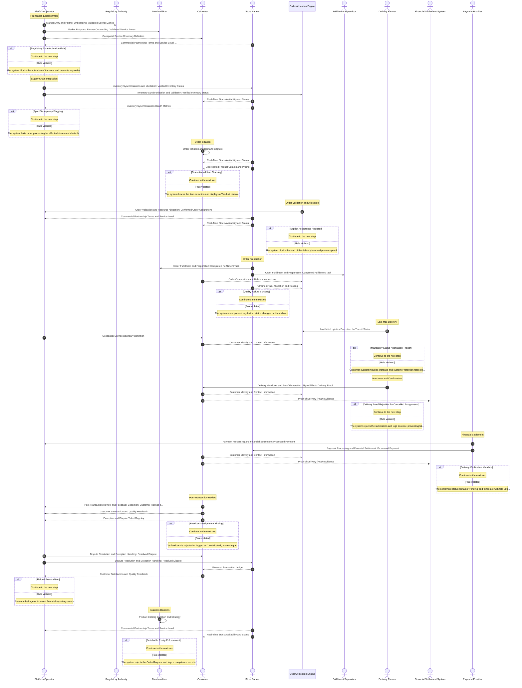

# Sequence Diagram

Interactions between actors and system participants over time.

Dashed outlines and elements marked * were added by the AI model (inferred); solid ones come from the repositories.

Generated 2026-11-15T20:21:19.618Z by 8.5.2.DiagramsAI.js using unsloth/Qwen3.5-9B-GGUF. Sources: knowledge base (51 actors, 14 business objects, 11 activities, 11 lifecycle stages, 20 information requirements), requirements schema (62 functional, 28 business requirements), business_rule_discovery (142 rules after merging 168 raw rules, ingestion run 3).

| Unit | Source | Inferred elements |
|---|---|---|
| SEQ-1 Core transaction | baseline (not generated yet) | 0 |
| SEQ-2 Money and value movement | baseline (not generated yet) | 0 |
| SEQ-3 Failure and dispute handling | baseline (not generated yet) | 0 |

## SEQ-1: End-to-end interaction

Focus: Draw the interactions over time for the main end-to-end transaction, from the first request to completion.

## SEQ-2: End-to-end interaction

Focus: Draw the interactions over time for how money or value moves between the parties and is settled, including checks and confirmations.

## SEQ-3: End-to-end interaction

Focus: Draw the interactions over time for what happens over time when something fails or a party raises a dispute, and how it is resolved.

