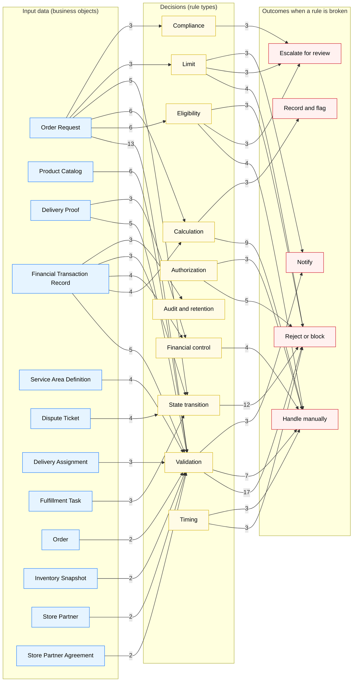

# Decision Table / DMN

Business rules, conditions and decision outcomes. Mermaid has no DMN type, so decisions are Markdown tables plus a decision requirements diagram.

Dashed outlines and elements marked * were added by the AI model (inferred); solid ones come from the repositories.

Generated 2026-11-15T20:21:19.618Z by 8.5.2.DiagramsAI.js using unsloth/Qwen3.5-9B-GGUF. Sources: knowledge base (51 actors, 14 business objects, 11 activities, 11 lifecycle stages, 20 information requirements), requirements schema (62 functional, 28 business requirements), business_rule_discovery (142 rules after merging 168 raw rules, ingestion run 3).

| Unit | Source | Inferred elements |
|---|---|---|
| DEC-001 Order Request decisions | baseline (not generated yet) | 0 |
| DEC-002 Financial Transaction Record decisions | baseline (not generated yet) | 0 |
| DEC-003 Store Partner Agreement decisions | baseline (not generated yet) | 0 |
| DEC-004 Real-Time Inventory Snapshot decisions | baseline (not generated yet) | 0 |
| DEC-005 Dispute Ticket decisions | baseline (not generated yet) | 0 |

## Decision requirements diagram

## Decision tables

### Order Request decisions

Hit policy: C (Collect): every row whose condition holds applies.

| # | When (condition) | Then (rule) | Otherwise (outcome) | Type | Severity | Enforced by | Basis | Rule |
|---|---|---|---|---|---|---|---|---|
| 1 | During the Order Request creation or validation phase | An Order Request must not be successfully created if it contains any item where the current date is later than the item's defined expiry date. | Reject or block: The system automatically rejects the Order Request and notifies the customer that the item is unavailable | Validation | Critical | System-enforced | baseline | R-001 |
| 2 | During order allocation when a customer submits a request with multiple items | The system must not assign an order to a Store Partner if the Real-Time Inventory Snapshot indicates insufficient quantity for any item in the request. | Escalate for review: The order remains unassigned and is flagged for manual review to prevent overselling and customer dissatisfaction | Validation | Critical | System-enforced | baseline | R-002 |
| 3 | During order allocation when a customer submits a request with multiple items | The system must not assign an order to a Store Partner if the Real-Time Inventory Snapshot indicates insufficient quantity for any item in the request. | Escalate for review: The order remains unassigned and is flagged for manual review to prevent overselling and customer dissatisfaction | Validation | Critical | System-enforced | baseline | R-002 |
| 4 | When an incoming order request is received for delivery | Orders originating from addresses outside the active Service Area Definition must be rejected by the Order Allocation Engine. | Handle manually: The business incurs costs for deliveries outside its operational scope and risks regulatory non-compliance | Validation | Medium | System-enforced | baseline | R-005 |
| 5 | When an incoming order request is received for delivery | Orders originating from addresses outside the active Service Area Definition must be rejected by the Order Allocation Engine. | Handle manually: The business incurs costs for deliveries outside its operational scope and risks regulatory non-compliance | Validation | Medium | System-enforced | baseline | R-005 |
| 6 | When an order reaches the Delivery Proof confirmation stage | The system must classify an order as fulfilled only if the total elapsed time from Order Request creation to Delivery Proof confirmation does not exceed the committed target window. | Compensate or reverse: The order is flagged as 'Late' and triggers a service credit workflow for the Customer and a penalty assessment for the Delivery Partner | Validation | High | System-enforced | inferred | R-006 |
| 7 | When a customer or partner initiates an Order Request | The system must prevent the creation of a new Order Request if the associated Service Area Definition is not in an active state. | Reject or block: The Order Request is rejected immediately and the user is notified that the service zone is unavailable | Validation | Critical | System-enforced | baseline | R-007 |
| 8 | at the moment of Order Request submission | The system must reject an Order Request submission if the sum of item prices is strictly less than the minimum order value dynamically retrieved from the Store Partner Agreement. | Reject or block: The system displays a clear error message to the Customer and prevents the Order Request from being submitted to the store. | Validation | High | System-enforced | baseline | R-008 |
| 9 | at the moment of Order Request submission | The system must only apply tax rules corresponding to the precise delivery address jurisdiction, not the store location or user profile. | Reject or block: The Order Request is rejected to prevent incorrect tax collection and regulatory non-compliance | Validation | High | System-enforced | inferred | R-015 |
| 10 | when a delivery proof indicates a delivery exception or missing items | A Dispute Ticket must be created immediately upon receipt of a Delivery Proof indicating a delivery exception or missing items. | Reject or block: the delivery exception is not formally tracked, preventing accurate financial settlement and customer support | Validation | High | System-enforced | inferred | R-018 |
| 11 | When validating inventory availability for an Order Request against a Store Partner | An Order Request must not be assigned to a Store Partner if the primary fulfillment source contains any item flagged as 'nearing expiry'. | Reject or block: The system must automatically reject the Order Request and notify the customer of the inability to fulfill the order | Validation | Critical | System-enforced | inferred | R-019 |
| 12 | When a Delivery Partner attempts to submit a Delivery Proof for an Order Request | A Delivery Proof must not be accepted or processed if the associated Delivery Assignment is marked as cancelled. | Reject or block: The system rejects the submission and logs an error, preventing false settlement triggers | Validation | High | System-enforced | baseline | R-020 |
| 13 | when an Order Request is composed or updated | The system must prevent any Product Catalog item with an active expiry alert from being added to an Order Request. | Reject or block: The system rejects the Order Request and logs a compliance error for the user | Validation | Critical | System-enforced | inferred | R-022 |
| 14 | when a customer or agent attempts to add an item to an order | The system must not allow the inclusion of any Product Catalog item marked as permanently discontinued in a new Order Request. | Reject or block: The system blocks the item selection and displays a 'Product Unavailable' message | Validation | High | System-enforced | inferred | R-023 |
| 15 | When a customer attempts to submit a review for a completed order | A Feedback Record must only be created after a Delivery Proof exists for the associated Order Request. | Reject or block: The submission request is rejected and the customer is prompted to complete delivery first | Validation | High | System-enforced | baseline | R-025 |
| 16 | When allocating stock for a new Order Request containing perishable goods | Perishable items approaching shelf-life limits must be prioritized for allocation to new Order Requests over items with longer remaining shelf life. | Escalate for review: The system must flag the allocation decision for manual review and delay the order assignment | Eligibility | High | System-enforced | inferred | R-031 |
| 17 | When a Delivery Partner completes a batch of deliveries | The system must suspend a Delivery Partner's ability to accept new assignments if their on-time delivery rate falls below the minimum acceptable threshold within a rolling evaluation period. | Record and flag: The Delivery Partner is automatically removed from the active pool and must undergo a re-qualification audit | Eligibility | High | System-enforced | inferred | R-032 |
| 18 | when calculating delivery fees during periods of high demand | Surge pricing may only be applied when the ratio of active orders to available delivery agents exceeds the configured capacity threshold AND the predicted wait time does not exceed the maximum acceptable delay defined in the Service Area Definition. | Handle manually: The surge pricing calculation is bypassed, and standard rates are applied to maintain customer trust | Eligibility | High | System-enforced | baseline | R-036 |
| 19 | when allocating inventory for a new Order Request | The system must not allocate inventory to an Order Request if the predictive demand model forecasts a stockout probability exceeding the configured safety margin within the target delivery window. | Escalate for review: The system rejects the allocation and flags the Order Request for manual review to prevent overselling. | Eligibility | Critical | System-enforced | inferred | R-037 |
| 20 | During order allocation to a specific store partner | Order Requests must not be allocated to a Store Partner unless the associated Store Partner Agreement is in an 'Active' state. | Reject or block: The order allocation is rejected and the customer receives a notification of unavailability | Eligibility | Critical | System-enforced | baseline | R-039 |
| 21 | at the moment of order assignment or validation | An incoming Order Request may only be assigned to a Store Partner if the Real-Time Inventory Snapshot shows available quantity greater than or equal to the requested quantity for all items. | Reject or block: The order assignment must be rejected immediately and the customer notified of stock unavailability | Eligibility | Critical | System-enforced | baseline | R-042 |
| 22 | during order allocation and confirmation phases | The system must adjust delivery fees and commissions in real-time based on current demand, weather, and traffic conditions. | Handle manually: revenue is sub-optimized during peak times and SLA adherence risks increase | Calculation | High | System-enforced | inferred | R-047 |
| 23 | when an external tax service pushes a rate update affecting the transaction | The Financial Transaction Record must be updated immediately upon receiving a new tax rate update from the external service. | Record and flag: The system recalculates the record and triggers a re-billing notification to the customer and store | Calculation | High | System-enforced | baseline | R-050 |
| 24 | when allocating stock to multiple concurrent Order Requests | Perishable items must be prioritized for allocation to Order Requests based on their proximity to the expiration date. | Handle manually: The business incurs increased waste costs and potential food safety violations due to expired goods being sold. | Calculation | High | System-enforced | baseline | R-051 |
| 25 | when multiple stores or items can fulfill an Order Request | The system must prioritize the allocation of 'nearing expiry' items to incoming Order Requests over items with longer remaining shelf life, provided the item is within the configured safety margin. | Record and flag: The system defaults to standard nearest-store logic, potentially increasing waste and reducing store partner margins. | Calculation | High | System-enforced | inferred | R-053 |
| 26 | When allocating an order to multiple eligible stores | The system must prioritize the nearest store based on the shortest estimated preparation and dispatch time when multiple stores have sufficient inventory. | Notify: The system must re-evaluate the allocation logic and notify the operations team | Calculation | High | System-enforced | baseline | R-056 |
| 27 | Upon successful assignment of an Order Request to a Store Partner | Inventory quantities reserved by an automatic Order Request assignment must be immediately deducted from the Real-Time Inventory Snapshot. | Reject or block: The system must prevent further Order Requests from being assigned to the same inventory units, leading to overselling | Calculation | High | System-enforced | inferred | R-057 |
| 28 | When real-time traffic data updates during the order preparation phase | The system must automatically recalculate the delivery fee whenever the real-time traffic data indicates a change in travel time that exceeds the baseline estimate by more than the configured threshold. | Reject or block: The customer receives an updated total cost notification and must accept the new fee or cancel the order | Calculation | Medium | System-enforced | inferred | R-058 |
| 29 | when inventory is insufficient for the full order but sufficient for some items | The system must not allow an order to proceed with partial fulfillment unless the customer explicitly consents to a split shipment. | Reject or block: The order is held in a pending state until full inventory is available or the customer cancels. | Authorization | Medium | System-enforced | inferred | R-063 |
| 30 | during Order Initiation | A Customer Profile must not be used to create an Order Request if the profile is flagged for fraud or suspended. | Reject or block: The Order Request is automatically rejected and the customer is notified of the restriction | Authorization | High | System-enforced | inferred | R-071 |
| 31 | after the allocated confirmation time window expires | Locked stock associated with an Order Request must be automatically released if the Order Request remains unconfirmed within the allocated time window. | Reject or block: The stock is freed for other customers, potentially causing the original order to be fulfilled late or cancelled | Timing | High | System-enforced | baseline | R-073 |
| 32 | upon successful state transition to Ready for Delivery or Assigned to Delivery Partner | The system must automatically send a multi-channel notification to the customer when an order status transitions to 'Ready for Delivery' or 'Assigned to Delivery Partner'. | Reject or block: Customer support inquiries increase and customer retention rates decline due to lack of transparency | Timing | High | System-enforced | inferred | R-079 |
| 33 | When an Order Request is confirmed as cancelled | Inventory locks must be released immediately upon confirmation of an Order Request cancellation, before the Fulfillment Task status changes to 'Ready for Dispatch'. | Notify: The system must automatically revert the inventory to available status and notify the Store Partner | Timing | Critical | System-enforced | baseline | R-080 |
| 34 | when an overselling event is confirmed via audit or customer dispute | The system must escalate any confirmed overselling incident to the Compliance Officer immediately, regardless of the order status. | Record and flag: The incident is recorded as a compliance breach, and the store partner's settlement is held pending investigation. | State transition | Critical | System-enforced | inferred | R-082 |
| 35 | When an Order Request remains in a pending confirmation state | Locked stock must be automatically released if the Order Request is not confirmed within the allocated time window. | Reject or block: The inventory remains locked, causing potential overselling and blocking other valid orders | State transition | Medium | System-enforced | baseline | R-084 |
| 36 | when an order is routed to a specific store | An Order Request may only be allocated to a Store Partner if the associated Partner Agreement is explicitly marked as 'Active' in the system. | Reject or block: The order allocation is rejected and returned to the pool for re-routing. | State transition | High | System-enforced | baseline | R-085 |
| 37 | When an Order Request is cancelled | Inventory locks must be released immediately upon confirmation of cancellation before the Fulfillment Task status changes to 'Ready for Dispatch'. | Reject or block: The system must prevent the status change to 'Ready for Dispatch' and alert the store partner | State transition | High | System-enforced | baseline | R-092 |
| 38 | during the lifecycle of a Dispute Ticket | A Dispute Ticket must remain linked to the original Order Request for the entire duration of the dispute resolution process. | Reject or block: The Dispute Ticket becomes orphaned, preventing accurate tracking of resolution against the specific order | State transition | Medium | System-enforced | baseline | R-095 |
| 39 | When an order is automatically assigned to a store partner | The system must deduct reserved quantities from the Real-Time Inventory Snapshot immediately upon order assignment to prevent overselling. | Reject or block: The business risks selling items that are not in stock, leading to order cancellations and customer dissatisfaction | Limit | Critical | System-enforced | baseline | R-099 |
| 40 | when a customer attempts to apply loyalty points during checkout | A customer must not redeem loyalty points for a single order if the points value exceeds the maximum allowed discount percentage for that order total. | Reject or block: The system rejects the redemption request and displays the maximum allowable discount amount. | Limit | Medium | System-enforced | inferred | R-101 |
| 41 | When an Order Request is created and assigned to a Store Partner | A specific inventory unit must be locked exclusively to a single Order Request until the fulfillment task is completed or the order is cancelled. | Reject or block: The system rejects the order assignment and flags the inventory for manual audit | Limit | Critical | System-enforced | baseline | R-102 |
| 42 | when initiating a fallback assignment to a secondary vendor | The system may only assign an order to a secondary vendor if the total number of active vendors serving that specific order does not exceed the maximum allowed vendor count. | Handle manually: the order becomes unmanageable due to conflicting instructions from multiple vendors | Limit | Medium | System-enforced | inferred | R-105 |
| 43 | When a refund is initiated for an order | No new Delivery Assignment may be created for an Order Request while a refund transaction is actively processing. | Escalate for review: The system prevents the creation of a new assignment and queues the order for manual review | Limit | High | System-enforced | inferred | R-107 |
| 44 | When processing an order request for a specific Store Partner | A Store Partner must not accept new orders unless their food safety certificate is valid and non-expired. | Escalate for review: The system automatically blocks the order and flags the partner for immediate review | Compliance | Critical | System-enforced | baseline | R-115 |
| 45 | during Order Request validation | The system must not finalize an Order Request if the calculated tax rate exceeds the maximum threshold defined by the Regulatory Authority. | Reject or block: The Order Request is rejected and the customer is notified of the non-compliance risk | Compliance | Critical | System-enforced | baseline | R-118 |
| 46 | during financial settlement and audit review | The system must calculate tax liabilities deterministically using the exact same Order Request, Product Catalog snapshot, and Delivery Zone Map data. | Record and flag: The transaction is flagged for manual reconciliation and potential regulatory penalty | Compliance | Critical | System-enforced | inferred | R-120 |
| 47 | During the financial settlement phase of a dispute | Financial adjustments must not be finalized until the Dispute Ticket is marked as Resolved. | Handle manually: Revenue leakage or incorrect financial reporting occurs | Financial control | Critical | System-enforced | baseline | R-124 |
| 48 | when an order has been reassigned to a fallback logistics provider | Financial settlement for a fallback-assigned order must only proceed after confirming that the new logistics provider has successfully recorded a valid Delivery Proof. | Handle manually: funds are distributed without proof of delivery, resulting in financial loss and fraud risk | Financial control | Critical | System-enforced | inferred | R-126 |
| 49 | When an Order Request reaches the Financial Settlement Handover confirmation stage | Financial settlement for an Order Request must only occur after a valid Delivery Proof is recorded and verified as successful. | Reject or block: The settlement batch is rejected and funds are held in escrow until proof is provided | Financial control | Critical | System-enforced | baseline | R-129 |
| 50 | when a system failure or data corruption is detected during order preparation or allocation | The system must immediately release all stock locks associated with an Order Request upon detection of a system outage or data corruption event. | Handle manually: The business risks overselling inventory, causing order fulfillment failures, and incurring regulatory penalties for inaccurate stock reporting. | Exception handling | Critical | System-enforced | inferred | R-132 |
| 51 | when the primary external logistics provider or mapping service returns an error or timeout during order allocation | The Order Allocation Engine must automatically reassign an order to an alternative logistics provider when the primary external provider fails to confirm availability within the timeout window. | Reject or block: the system proceeds with a failed allocation, leading to order cancellation and potential revenue loss | Exception handling | High | System-enforced | inferred | R-134 |
| 52 | When a Delivery Proof is submitted with indicators of delivery failure or discrepancy | A Dispute Ticket must be created immediately upon receipt of a Delivery Proof indicating a missing item, damaged goods, or lack of valid timestamp/signature. | Reject or block: The Order Request remains in a pending state, blocking closure and potentially causing customer dissatisfaction | Exception handling | High | System-enforced | baseline | R-136 |

### Financial Transaction Record decisions

Hit policy: C (Collect): every row whose condition holds applies.

| # | When (condition) | Then (rule) | Otherwise (outcome) | Type | Severity | Enforced by | Basis | Rule |
|---|---|---|---|---|---|---|---|---|
| 1 | when an order is marked as delivered for payment processing | A financial transaction record must be linked to verifiable evidence of delivery before finalizing the settlement status. | Handle manually: The settlement status remains 'Pending' and funds are withheld until valid proof is uploaded | Validation | High | System-enforced | baseline | R-009 |
| 2 | during the financial settlement handover phase | The system must prevent the finalization of a Financial Transaction Record if no valid Store Partner Agreement exists for the involved Store Partner. | Handle manually: the transaction fails to settle, resulting in revenue loss and potential legal liability | Validation | Critical | System-enforced | baseline | R-010 |
| 3 | when processing a status update for an order or refund request | The system must only send a notification regarding a status change if the new status differs from the status of the most recent notification for that specific transaction. | Handle manually: the customer receives redundant or conflicting messages, causing confusion and eroding trust in the platform's communication reliability | Validation | Medium | System-enforced | baseline | R-013 |
| 4 | when composing a notification message triggered by a refund status change | The system must verify that the content of any notification accurately reflects the current state of the Financial Transaction Record before transmission. | Notify: the customer receives incorrect financial information, leading to disputes, chargebacks, and regulatory compliance issues | Validation | Critical | System-enforced | baseline | R-014 |
| 5 | during Financial Transaction Record generation or validation | The sum of all distributed amounts must equal the total value of the Financial Transaction Record. | Record and flag: The transaction record remains in pending status and cannot be finalized until the discrepancy is resolved | Validation | Critical | System-enforced | baseline | R-029 |
| 6 | When a transaction risk score exceeds the high-risk threshold defined in the risk model | Transactions involving high-risk indicators must be paused for manual verification before settlement. | Compensate or reverse: The system must automatically reverse the pending settlement and initiate a fraud investigation workflow | Eligibility | High | System-enforced | baseline | R-034 |
| 7 | During financial settlement and revenue calculation | Financial Transaction Records must calculate revenue shares using the commission rate from the most recently active Store Partner Agreement valid at the time of transaction finalization. | Escalate for review: Settlement records are flagged for manual review and potential financial reclamation | Calculation | Critical | System-enforced | baseline | R-045 |
| 8 | During every financial settlement cycle for a transaction | Platform revenue shares must be reconciled against store partner settlements in real-time. | Handle manually: The system must halt further settlements for the affected store partner until the discrepancy is resolved | Calculation | High | System-enforced | inferred | R-049 |
| 9 | when an external tax service pushes a rate update affecting the transaction | The Financial Transaction Record must be updated immediately upon receiving a new tax rate update from the external service. | Record and flag: The system recalculates the record and triggers a re-billing notification to the customer and store | Calculation | High | System-enforced | baseline | R-050 |
| 10 | When processing a Financial Transaction Record involving multiple currencies | Multi-currency transactions must only be settled using real-time exchange rates provided by the Payment Provider at the moment of settlement. | Compensate or reverse: The settlement amount is recalculated and corrected, potentially triggering a refund or additional charge | Calculation | High | System-enforced | inferred | R-052 |
| 11 | When a transaction is flagged with high-risk indicators by the system | Transactions exhibiting high-risk indicators may only proceed to settlement after manual verification by a Fulfillment Supervisor. | Handle manually: The transaction is automatically paused and the settlement cycle is interrupted | Authorization | High | Both | inferred | R-068 |
| 12 | at the moment of attempting to finalize a Financial Transaction Record | A Financial Transaction Record must not be finalized if no valid Store Partner Agreement exists for the involved Store Partner. | Escalate for review: The system blocks the settlement process and flags the transaction for manual review | Authorization | High | System-enforced | baseline | R-072 |
| 13 | when a dispute is flagged during the settlement cycle | Unresolved financial disputes must be escalated to a senior support tier within a maximum allowed duration. | Reject or block: revenue distribution is blocked and regulatory penalties may be applied | Timing | High | System-enforced | inferred | R-078 |
| 14 | when a Financial Transaction Record has an active dispute | Final settlement status must not transition to 'Completed' until the associated dispute ticket is resolved to a final state. | Handle manually: incorrect funds are distributed leading to reconciliation errors | State transition | High | System-enforced | inferred | R-087 |
| 15 | When initiating revenue distribution for a delivered order | Financial distribution must not occur until a valid Delivery Proof is recorded. | Escalate for review: The settlement process is automatically halted and flagged for manual review | State transition | Critical | System-enforced | baseline | R-090 |
| 16 | when a Store Partner Agreement is in 'Active' status and a Financial Transaction Record has been generated for the current settlement cycle | The system must prevent any modification to an active Store Partner Agreement version once a financial settlement has been finalized for that period. | Reject or block: the system rejects the change request and alerts the Platform Operator of a potential compliance violation | State transition | Critical | System-enforced | inferred | R-091 |
| 17 | When calculating settlement amounts for a completed delivery order | Financial distribution must only occur after a valid Delivery Proof is recorded. | Escalate for review: The system must block the settlement transaction and flag the event for manual audit review | Limit | Critical | System-enforced | baseline | R-103 |
| 18 | when a transaction is identified as high-risk | Settlement processing must not proceed for any transaction flagged with high-risk indicators until manual verification is complete. | Handle manually: revenue leakage occurs and regulatory compliance is breached | Limit | Critical | System-enforced | inferred | R-104 |
| 19 | when calculating revenue share for a transaction | The system must not apply a transaction commission rate that exceeds the maximum cap defined in the active Store Partner Agreement for that specific merchant category. | Record and flag: The transaction settlement is automatically halted, and the system flags the calculation for immediate manual audit and correction. | Compliance | High | System-enforced | baseline | R-114 |
| 20 | At the moment of Financial Settlement Handover confirmation | Funds must not be released to the Store Partner until a valid delivery proof containing a timestamp and signature is recorded in the system. | Compensate or reverse: The transaction is automatically reversed and funds are held in escrow pending manual verification | Financial control | High | System-enforced | baseline | R-121 |
| 21 | when a delivery transaction is finalized for payout | A financial settlement record must include item costs, delivery fees, taxes, platform commissions, and net settlement amounts to be considered complete. | Reject or block: The settlement is rejected and the payout process is halted until discrepancies are resolved | Financial control | Critical | System-enforced | baseline | R-123 |
| 22 | when an order has been reassigned to a fallback logistics provider | Financial settlement for a fallback-assigned order must only proceed after confirming that the new logistics provider has successfully recorded a valid Delivery Proof. | Handle manually: funds are distributed without proof of delivery, resulting in financial loss and fraud risk | Financial control | Critical | System-enforced | inferred | R-126 |
| 23 | when a third-party vendor fails to meet guaranteed uptime or response time thresholds defined in the SLA | The system must deduct financial penalties from the Store Partner's settlement amount when a verified SLA breach occurs. | Record and flag: the system automatically reduces the payable settlement amount and logs the deduction reason in the immutable audit trail | Financial control | High | System-enforced | inferred | R-127 |
| 24 | when a refund is requested for a specific order | A refund must be initiated only after a Dispute Ticket is marked as validated or a delivery failure is explicitly confirmed. | Handle manually: funds are returned prematurely or incorrectly, causing revenue loss and inventory reconciliation errors | Financial control | Critical | System-enforced | inferred | R-128 |
| 25 | during Financial Transaction Record generation | The system must automatically generate a Dispute Ticket whenever a discrepancy is detected between the calculated tax amount and the amount collected during Financial Transaction Record generation. | Record and flag: A formal dispute record is created to initiate a reconciliation process between the platform and the tax authority | Exception handling | Medium | System-enforced | baseline | R-131 |
| 26 | when a calculated SLA penalty for a specific incident exceeds the maximum financial cap defined in the SLA | The system must escalate a service degradation incident to the Platform Operator for manual review when a vendor breach exceeds the maximum allowable penalty cap. | Record and flag: the system pauses automatic penalty deduction and flags the record for manual adjudication by the Platform Operator | Exception handling | Medium | System-enforced | inferred | R-135 |
| 27 | upon finalization of a delivery and reconciliation of actual costs | The system must generate an immediate high-priority alert whenever the actual operational cost of a completed delivery deviates from the estimated cost by more than the allowed variance percentage. | Suspend or revoke: The system logs the anomaly, suspends further automated settlements for that specific delivery partner until the variance is explained, and notifies the Logistics Coordinator. | Audit and retention | Medium | System-enforced | inferred | R-137 |
| 28 | for every financial transaction and settlement event | Every Financial Transaction Record and Settlement event must generate an immutable audit trail that cannot be altered or deleted. | Record and flag: The business loses the ability to prove compliance during audits, risking severe legal penalties and loss of trust. | Audit and retention | Critical | System-enforced | baseline | R-138 |
| 29 | when a dispute is created, modified, or resolved | Every dispute event and its resolution action must be recorded in an immutable audit trail. | Record and flag: inability to prove compliance during regulatory audits | Audit and retention | Medium | System-enforced | inferred | R-139 |

### Store Partner Agreement decisions

Hit policy: C (Collect): every row whose condition holds applies.

| # | When (condition) | Then (rule) | Otherwise (outcome) | Type | Severity | Enforced by | Basis | Rule |
|---|---|---|---|---|---|---|---|---|
| 1 | During order allocation when a customer submits a request with multiple items | The system must not assign an order to a Store Partner if the Real-Time Inventory Snapshot indicates insufficient quantity for any item in the request. | Escalate for review: The order remains unassigned and is flagged for manual review to prevent overselling and customer dissatisfaction | Validation | Critical | System-enforced | baseline | R-002 |
| 2 | at the moment of Order Request submission | The system must reject an Order Request submission if the sum of item prices is strictly less than the minimum order value dynamically retrieved from the Store Partner Agreement. | Reject or block: The system displays a clear error message to the Customer and prevents the Order Request from being submitted to the store. | Validation | High | System-enforced | baseline | R-008 |
| 3 | during the financial settlement handover phase | The system must prevent the finalization of a Financial Transaction Record if no valid Store Partner Agreement exists for the involved Store Partner. | Handle manually: the transaction fails to settle, resulting in revenue loss and potential legal liability | Validation | Critical | System-enforced | baseline | R-010 |
| 4 | When validating a customer's delivery address against the Delivery Zone Map | The system must not assign an order to a Delivery Zone unless the customer's address falls strictly within the defined polygon or radius boundaries of a Store Partner's service area. | Reject or block: The order is rejected immediately and the customer is notified that the location is outside the service area | Validation | Critical | System-enforced | inferred | R-024 |
| 5 | during the new partner onboarding process | A Store Partner must not be granted operational access until all required regulatory licenses and food safety certificates are validated as current and authentic. | Suspend or revoke: The onboarding process is terminated and the partner is barred from the marketplace until compliance is achieved. | Eligibility | Critical | System-enforced | inferred | R-035 |
| 6 | During order allocation to a specific store partner | Order Requests must not be allocated to a Store Partner unless the associated Store Partner Agreement is in an 'Active' state. | Reject or block: The order allocation is rejected and the customer receives a notification of unavailability | Eligibility | Critical | System-enforced | baseline | R-039 |
| 7 | During financial settlement and revenue calculation | Financial Transaction Records must calculate revenue shares using the commission rate from the most recently active Store Partner Agreement valid at the time of transaction finalization. | Escalate for review: Settlement records are flagged for manual review and potential financial reclamation | Calculation | Critical | System-enforced | baseline | R-045 |
| 8 | when calculating the amount due for a specific delivery batch | A payout schedule must be generated based on the contractual agreement version active at the time of the transaction. | Handle manually: The payout calculation is invalidated and the batch is re-queued for recalculation using the correct contract version | Calculation | Critical | System-enforced | inferred | R-046 |
| 9 | When allocating an order to multiple eligible stores | The system must prioritize the nearest store based on the shortest estimated preparation and dispatch time when multiple stores have sufficient inventory. | Notify: The system must re-evaluate the allocation logic and notify the operations team | Calculation | High | System-enforced | baseline | R-056 |
| 10 | When a new Feedback Record is submitted for a completed task | A Feedback Record with a negative rating regarding product quality must reduce the overall quality score of the Store Partner. | Record and flag: The quality score calculation is skipped for this record, potentially inflating the partner's score | Calculation | High | System-enforced | baseline | R-059 |
| 11 | at the moment of attempting to finalize a Financial Transaction Record | A Financial Transaction Record must not be finalized if no valid Store Partner Agreement exists for the involved Store Partner. | Escalate for review: The system blocks the settlement process and flags the transaction for manual review | Authorization | High | System-enforced | baseline | R-072 |
| 12 | when an order is routed to a specific store | An Order Request may only be allocated to a Store Partner if the associated Partner Agreement is explicitly marked as 'Active' in the system. | Reject or block: The order allocation is rejected and returned to the pool for re-routing. | State transition | High | System-enforced | baseline | R-085 |
| 13 | when a Partner Agreement is amended | An amendment to an active Partner Agreement must immediately create a new version number while marking the previous version as historical and read-only. | Escalate for review: The system rejects the amendment request and logs the error for manual review. | State transition | Medium | System-enforced | baseline | R-086 |
| 14 | when a Store Partner Agreement is in 'Active' status and a Financial Transaction Record has been generated for the current settlement cycle | The system must prevent any modification to an active Store Partner Agreement version once a financial settlement has been finalized for that period. | Reject or block: the system rejects the change request and alerts the Platform Operator of a potential compliance violation | State transition | Critical | System-enforced | inferred | R-091 |
| 15 | During order allocation and at the start of each business day | The system must block order allocation to a Store Partner if their primary operating license is flagged as invalid or expired. | Suspend or revoke: The Store Partner is immediately suspended from receiving orders until compliance is restored | Compliance | Critical | System-enforced | baseline | R-113 |
| 16 | when calculating revenue share for a transaction | The system must not apply a transaction commission rate that exceeds the maximum cap defined in the active Store Partner Agreement for that specific merchant category. | Record and flag: The transaction settlement is automatically halted, and the system flags the calculation for immediate manual audit and correction. | Compliance | High | System-enforced | baseline | R-114 |
| 17 | When processing an order request for a specific Store Partner | A Store Partner must not accept new orders unless their food safety certificate is valid and non-expired. | Escalate for review: The system automatically blocks the order and flags the partner for immediate review | Compliance | Critical | System-enforced | baseline | R-115 |
| 18 | When a contractual dispute or exception occurs between platform and partner | Dispute resolution regarding Store Partner Agreements must strictly follow the escalation path defined within the agreement document. | Escalate for review: The dispute ticket is escalated to senior management for policy review and potential contract amendment | Compliance | Medium | Manual | inferred | R-119 |

### Real-Time Inventory Snapshot decisions

Hit policy: C (Collect): every row whose condition holds applies.

| # | When (condition) | Then (rule) | Otherwise (outcome) | Type | Severity | Enforced by | Basis | Rule |
|---|---|---|---|---|---|---|---|---|
| 1 | During order allocation when a customer submits a request with multiple items | The system must not assign an order to a Store Partner if the Real-Time Inventory Snapshot indicates insufficient quantity for any item in the request. | Escalate for review: The order remains unassigned and is flagged for manual review to prevent overselling and customer dissatisfaction | Validation | Critical | System-enforced | baseline | R-002 |
| 2 | During order allocation when a customer submits a request with multiple items | The system must not assign an order to a Store Partner if the Real-Time Inventory Snapshot indicates insufficient quantity for any item in the request. | Escalate for review: The order remains unassigned and is flagged for manual review to prevent overselling and customer dissatisfaction | Validation | Critical | System-enforced | baseline | R-002 |
| 3 | During continuous reconciliation between POS systems and the digital platform | The system must flag a synchronization discrepancy if the data link latency exceeds the defined threshold or if a sync failure is detected. | Notify: The system halts new order assignments and triggers an immediate alert for manual intervention | Validation | High | System-enforced | baseline | R-011 |
| 4 | when allocating inventory for a new Order Request | The system must not allocate inventory to an Order Request if the predictive demand model forecasts a stockout probability exceeding the configured safety margin within the target delivery window. | Escalate for review: The system rejects the allocation and flags the Order Request for manual review to prevent overselling. | Eligibility | Critical | System-enforced | inferred | R-037 |
| 5 | at the moment of order assignment or validation | An incoming Order Request may only be assigned to a Store Partner if the Real-Time Inventory Snapshot shows available quantity greater than or equal to the requested quantity for all items. | Reject or block: The order assignment must be rejected immediately and the customer notified of stock unavailability | Eligibility | Critical | System-enforced | baseline | R-042 |
| 6 | when multiple stores or items can fulfill an Order Request | The system must prioritize the allocation of 'nearing expiry' items to incoming Order Requests over items with longer remaining shelf life, provided the item is within the configured safety margin. | Record and flag: The system defaults to standard nearest-store logic, potentially increasing waste and reducing store partner margins. | Calculation | High | System-enforced | inferred | R-053 |
| 7 | when updating inventory forecasts based on real-time sales velocity | The system must generate a replenishment alert for an item when the projected demand for the next delivery window exceeds the current inventory level by the configured safety stock percentage. | Handle manually: The system continues to accept orders for insufficient stock, leading to potential overselling and customer dissatisfaction. | Calculation | Medium | System-enforced | inferred | R-054 |
| 8 | Upon successful assignment of an Order Request to a Store Partner | Inventory quantities reserved by an automatic Order Request assignment must be immediately deducted from the Real-Time Inventory Snapshot. | Reject or block: The system must prevent further Order Requests from being assigned to the same inventory units, leading to overselling | Calculation | High | System-enforced | inferred | R-057 |
| 9 | at the start of every daily forecasting cycle | Predictive demand forecasts must be recalculated exclusively using the latest validated Real-Time Inventory Snapshot data. | Notify: The forecast generation process must halt and generate a warning log indicating data source staleness | Calculation | Medium | System-enforced | inferred | R-061 |
| 10 | when inventory is insufficient for the full order but sufficient for some items | The system must not allow an order to proceed with partial fulfillment unless the customer explicitly consents to a split shipment. | Reject or block: The order is held in a pending state until full inventory is available or the customer cancels. | Authorization | Medium | System-enforced | inferred | R-063 |
| 11 | after the allocated confirmation time window expires | Locked stock associated with an Order Request must be automatically released if the Order Request remains unconfirmed within the allocated time window. | Reject or block: The stock is freed for other customers, potentially causing the original order to be fulfilled late or cancelled | Timing | High | System-enforced | baseline | R-073 |
| 12 | when external network status indicates a route constraint or latency threshold is exceeded | The Real-Time Inventory Snapshot must be updated to mark items as unavailable if the logistics link status indicates a network disruption or route constraint. | Reject or block: Customers may receive orders that cannot be fulfilled, leading to cancellations and reputational damage | State transition | High | System-enforced | inferred | R-089 |
| 13 | when a Fulfillment Task fails, is cancelled, or times out | Inventory reserved for a pending Fulfillment Task must be automatically released from the Real-Time Inventory Snapshot if the task status transitions to failed or cancelled. | Reject or block: The system must flag the inventory record as 'stale' and prevent further order processing for that SKU until the reservation is manually cleared | State transition | High | System-enforced | inferred | R-098 |
| 14 | When an order is automatically assigned to a store partner | The system must deduct reserved quantities from the Real-Time Inventory Snapshot immediately upon order assignment to prevent overselling. | Reject or block: The business risks selling items that are not in stock, leading to order cancellations and customer dissatisfaction | Limit | Critical | System-enforced | baseline | R-099 |
| 15 | during any order allocation or validation activity | The Real-Time Inventory Snapshot must reflect the actual physical stock count at the specific store location within a maximum allowed latency of 30 seconds (proposed). | Reject or block: The system must block new order allocations and trigger an immediate manual audit of the store's physical inventory | Limit | Critical | System-enforced | inferred | R-110 |

### Dispute Ticket decisions

Hit policy: C (Collect): every row whose condition holds applies.

| # | When (condition) | Then (rule) | Otherwise (outcome) | Type | Severity | Enforced by | Basis | Rule |
|---|---|---|---|---|---|---|---|---|
| 1 | when a delivery proof indicates a delivery exception or missing items | A Dispute Ticket must be created immediately upon receipt of a Delivery Proof indicating a delivery exception or missing items. | Reject or block: the delivery exception is not formally tracked, preventing accurate financial settlement and customer support | Validation | High | System-enforced | inferred | R-018 |
| 2 | when an actor is assigned to approve a Dispute Ticket | An actor must not approve a Dispute Ticket where they are the accused party or the party responsible for the alleged failure. | Handle manually: conflict of interest compromises the integrity of the dispute resolution process and invites fraud | Authorization | High | System-enforced | inferred | R-066 |
| 3 | When a Dispute Ticket involves product quality issues | Disputes regarding product quality must be approved by the Store Partner. | Handle manually: Incorrect quality claims lead to inventory discrepancies or reputational damage | Authorization | Medium | System-enforced | baseline | R-067 |
| 4 | when a dispute is flagged during the settlement cycle | Unresolved financial disputes must be escalated to a senior support tier within a maximum allowed duration. | Reject or block: revenue distribution is blocked and regulatory penalties may be applied | Timing | High | System-enforced | inferred | R-078 |
| 5 | when a Dispute Ticket remains in 'Open' status beyond the initial assignment deadline | Unresolved Dispute Tickets must be escalated to a Fulfillment Supervisor after the initial assignment deadline expires. | Handle manually: resolution delays increase customer dissatisfaction and breach service level agreements | Timing | Medium | System-enforced | inferred | R-081 |
| 6 | when an overselling event is confirmed via audit or customer dispute | The system must escalate any confirmed overselling incident to the Compliance Officer immediately, regardless of the order status. | Record and flag: The incident is recorded as a compliance breach, and the store partner's settlement is held pending investigation. | State transition | Critical | System-enforced | inferred | R-082 |
| 7 | when a Financial Transaction Record has an active dispute | Final settlement status must not transition to 'Completed' until the associated dispute ticket is resolved to a final state. | Handle manually: incorrect funds are distributed leading to reconciliation errors | State transition | High | System-enforced | inferred | R-087 |
| 8 | When a user or agent attempts to close a feedback record | A Feedback Record must not be closed if the associated Dispute Ticket is still active. | Reject or block: The closure action is blocked and the user is notified that the dispute must be resolved first | State transition | Critical | System-enforced | baseline | R-094 |
| 9 | during the lifecycle of a Dispute Ticket | A Dispute Ticket must remain linked to the original Order Request for the entire duration of the dispute resolution process. | Reject or block: The Dispute Ticket becomes orphaned, preventing accurate tracking of resolution against the specific order | State transition | Medium | System-enforced | baseline | R-095 |
| 10 | When a contractual dispute or exception occurs between platform and partner | Dispute resolution regarding Store Partner Agreements must strictly follow the escalation path defined within the agreement document. | Escalate for review: The dispute ticket is escalated to senior management for policy review and potential contract amendment | Compliance | Medium | Manual | inferred | R-119 |
| 11 | During the financial settlement phase of a dispute | Financial adjustments must not be finalized until the Dispute Ticket is marked as Resolved. | Handle manually: Revenue leakage or incorrect financial reporting occurs | Financial control | Critical | System-enforced | baseline | R-124 |
| 12 | when a refund is requested for a specific order | A refund must be initiated only after a Dispute Ticket is marked as validated or a delivery failure is explicitly confirmed. | Handle manually: funds are returned prematurely or incorrectly, causing revenue loss and inventory reconciliation errors | Financial control | Critical | System-enforced | inferred | R-128 |
| 13 | during Financial Transaction Record generation | The system must automatically generate a Dispute Ticket whenever a discrepancy is detected between the calculated tax amount and the amount collected during Financial Transaction Record generation. | Record and flag: A formal dispute record is created to initiate a reconciliation process between the platform and the tax authority | Exception handling | Medium | System-enforced | baseline | R-131 |
| 14 | When a Delivery Proof is submitted with indicators of delivery failure or discrepancy | A Dispute Ticket must be created immediately upon receipt of a Delivery Proof indicating a missing item, damaged goods, or lack of valid timestamp/signature. | Reject or block: The Order Request remains in a pending state, blocking closure and potentially causing customer dissatisfaction | Exception handling | High | System-enforced | baseline | R-136 |
| 15 | when a dispute is created, modified, or resolved | Every dispute event and its resolution action must be recorded in an immutable audit trail. | Record and flag: inability to prove compliance during regulatory audits | Audit and retention | Medium | System-enforced | inferred | R-139 |

### Delivery Proof decisions

Hit policy: C (Collect): every row whose condition holds applies.

| # | When (condition) | Then (rule) | Otherwise (outcome) | Type | Severity | Enforced by | Basis | Rule |
|---|---|---|---|---|---|---|---|---|
| 1 | When validating delivery proof regardless of source | Delivery proof retrieved via external API must be treated with the same verification standards as locally captured proof. | Reject or block: The delivery proof is rejected and the order status remains 'In Transit' or 'Pending Proof' | Validation | High | System-enforced | baseline | R-003 |
| 2 | When an order reaches the Delivery Proof confirmation stage | The system must classify an order as fulfilled only if the total elapsed time from Order Request creation to Delivery Proof confirmation does not exceed the committed target window. | Compensate or reverse: The order is flagged as 'Late' and triggers a service credit workflow for the Customer and a penalty assessment for the Delivery Partner | Validation | High | System-enforced | inferred | R-006 |
| 3 | when a delivery proof indicates a delivery exception or missing items | A Dispute Ticket must be created immediately upon receipt of a Delivery Proof indicating a delivery exception or missing items. | Reject or block: the delivery exception is not formally tracked, preventing accurate financial settlement and customer support | Validation | High | System-enforced | inferred | R-018 |
| 4 | When a Delivery Partner attempts to submit a Delivery Proof for an Order Request | A Delivery Proof must not be accepted or processed if the associated Delivery Assignment is marked as cancelled. | Reject or block: The system rejects the submission and logs an error, preventing false settlement triggers | Validation | High | System-enforced | baseline | R-020 |
| 5 | When a customer attempts to submit a review for a completed order | A Feedback Record must only be created after a Delivery Proof exists for the associated Order Request. | Reject or block: The submission request is rejected and the customer is prompted to complete delivery first | Validation | High | System-enforced | baseline | R-025 |
| 6 | When a Delivery Proof is successfully submitted and validated | A Delivery Partner's performance score must be updated immediately upon the submission of a Delivery Proof record. | Compensate or reverse: The partner's performance metrics remain stale, affecting future order allocation and compensation | Calculation | Medium | System-enforced | inferred | R-060 |
| 7 | when initiating the Financial Settlement Handover confirmation | Financial settlement funds must not be transferred to the Store Partner until a valid Delivery Proof is recorded and verified. | Handle manually: The business risks paying for undelivered goods and losing revenue control. | Timing | Critical | System-enforced | baseline | R-074 |
| 8 | When initiating revenue distribution for a delivered order | Financial distribution must not occur until a valid Delivery Proof is recorded. | Escalate for review: The settlement process is automatically halted and flagged for manual review | State transition | Critical | System-enforced | baseline | R-090 |
| 9 | When calculating settlement amounts for a completed delivery order | Financial distribution must only occur after a valid Delivery Proof is recorded. | Escalate for review: The system must block the settlement transaction and flag the event for manual audit review | Limit | Critical | System-enforced | baseline | R-103 |
| 10 | At the moment of Financial Settlement Handover confirmation | Funds must not be released to the Store Partner until a valid delivery proof containing a timestamp and signature is recorded in the system. | Compensate or reverse: The transaction is automatically reversed and funds are held in escrow pending manual verification | Financial control | High | System-enforced | baseline | R-121 |
| 11 | when an order has been reassigned to a fallback logistics provider | Financial settlement for a fallback-assigned order must only proceed after confirming that the new logistics provider has successfully recorded a valid Delivery Proof. | Handle manually: funds are distributed without proof of delivery, resulting in financial loss and fraud risk | Financial control | Critical | System-enforced | inferred | R-126 |
| 12 | When an Order Request reaches the Financial Settlement Handover confirmation stage | Financial settlement for an Order Request must only occur after a valid Delivery Proof is recorded and verified as successful. | Reject or block: The settlement batch is rejected and funds are held in escrow until proof is provided | Financial control | Critical | System-enforced | baseline | R-129 |
| 13 | When a Delivery Proof is submitted with indicators of delivery failure or discrepancy | A Dispute Ticket must be created immediately upon receipt of a Delivery Proof indicating a missing item, damaged goods, or lack of valid timestamp/signature. | Reject or block: The Order Request remains in a pending state, blocking closure and potentially causing customer dissatisfaction | Exception handling | High | System-enforced | baseline | R-136 |
| 14 | upon finalization of a delivery and reconciliation of actual costs | The system must generate an immediate high-priority alert whenever the actual operational cost of a completed delivery deviates from the estimated cost by more than the allowed variance percentage. | Suspend or revoke: The system logs the anomaly, suspends further automated settlements for that specific delivery partner until the variance is explained, and notifies the Logistics Coordinator. | Audit and retention | Medium | System-enforced | inferred | R-137 |
_Baseline table, not AI-enhanced._

### Product Catalog decisions

Hit policy: C (Collect): every row whose condition holds applies.

| # | When (condition) | Then (rule) | Otherwise (outcome) | Type | Severity | Enforced by | Basis | Rule |
|---|---|---|---|---|---|---|---|---|
| 1 | During the Order Request creation or validation phase | An Order Request must not be successfully created if it contains any item where the current date is later than the item's defined expiry date. | Reject or block: The system automatically rejects the Order Request and notifies the customer that the item is unavailable | Validation | Critical | System-enforced | baseline | R-001 |
| 2 | at the moment of Order Request submission | The system must reject an Order Request submission if the sum of item prices is strictly less than the minimum order value dynamically retrieved from the Store Partner Agreement. | Reject or block: The system displays a clear error message to the Customer and prevents the Order Request from being submitted to the store. | Validation | High | System-enforced | baseline | R-008 |
| 3 | when calculating inventory availability for high-velocity products against projected demand | The system must only flag a synchronization discrepancy for high-velocity items when the projected demand exceeds current inventory by the defined safety margin. | Reject or block: the system may oversell critical stock or fail to alert on genuine shortages, causing order cancellations and customer churn | Validation | Critical | System-enforced | inferred | R-012 |
| 4 | When validating inventory availability for an Order Request against a Store Partner | An Order Request must not be assigned to a Store Partner if the primary fulfillment source contains any item flagged as 'nearing expiry'. | Reject or block: The system must automatically reject the Order Request and notify the customer of the inability to fulfill the order | Validation | Critical | System-enforced | inferred | R-019 |
| 5 | when an Order Request is composed or updated | The system must prevent any Product Catalog item with an active expiry alert from being added to an Order Request. | Reject or block: The system rejects the Order Request and logs a compliance error for the user | Validation | Critical | System-enforced | inferred | R-022 |
| 6 | when a customer or agent attempts to add an item to an order | The system must not allow the inclusion of any Product Catalog item marked as permanently discontinued in a new Order Request. | Reject or block: The system blocks the item selection and displays a 'Product Unavailable' message | Validation | High | System-enforced | inferred | R-023 |
| 7 | when running inventory forecasting algorithms | The system may only generate predictive inventory replenishment alerts for items explicitly classified as high-velocity in the Product Catalog. | Notify: Alert fatigue occurs, causing critical stockouts for key items to be missed | Limit | Medium | System-enforced | inferred | R-108 |
| 8 | During real-time inventory synchronization cycles | The system must flag a synchronization discrepancy if the data link latency exceeds the defined threshold or if a sync failure is detected. | Notify: The system halts order processing for affected stores and alerts the operations team | Compliance | Medium | System-enforced | baseline | R-112 |
| 9 | during financial settlement and audit review | The system must calculate tax liabilities deterministically using the exact same Order Request, Product Catalog snapshot, and Delivery Zone Map data. | Record and flag: The transaction is flagged for manual reconciliation and potential regulatory penalty | Compliance | Critical | System-enforced | inferred | R-120 |
_Baseline table, not AI-enhanced._

### Service Area Definition decisions

Hit policy: C (Collect): every row whose condition holds applies.

| # | When (condition) | Then (rule) | Otherwise (outcome) | Type | Severity | Enforced by | Basis | Rule |
|---|---|---|---|---|---|---|---|---|
| 1 | When an incoming order request is received for delivery | Orders originating from addresses outside the active Service Area Definition must be rejected by the Order Allocation Engine. | Handle manually: The business incurs costs for deliveries outside its operational scope and risks regulatory non-compliance | Validation | Medium | System-enforced | baseline | R-005 |
| 2 | When an order reaches the Delivery Proof confirmation stage | The system must classify an order as fulfilled only if the total elapsed time from Order Request creation to Delivery Proof confirmation does not exceed the committed target window. | Compensate or reverse: The order is flagged as 'Late' and triggers a service credit workflow for the Customer and a penalty assessment for the Delivery Partner | Validation | High | System-enforced | inferred | R-006 |
| 3 | When a customer or partner initiates an Order Request | The system must prevent the creation of a new Order Request if the associated Service Area Definition is not in an active state. | Reject or block: The Order Request is rejected immediately and the user is notified that the service zone is unavailable | Validation | Critical | System-enforced | baseline | R-007 |
| 4 | during creation or modification of a Service Area Definition | A Service Area Definition must not contain internal gaps or disconnected regions that exceed a maximum allowed distance threshold. | Reject or block: The definition is rejected to prevent routing failures and delivery delays. | Validation | High | System-enforced | inferred | R-028 |
| 5 | immediately upon publication of a new Service Area Definition version | The system must recalculate estimated arrival times and optimal delivery paths whenever a Service Area Definition is modified. | Handle manually: delivery estimates become inaccurate leading to SLA breaches and customer dissatisfaction | Calculation | High | System-enforced | baseline | R-048 |
| 6 | when a new version is published for an active Service Area Definition | A new version of a Service Area Definition must immediately supersede the previous active version upon publication without a grace period. | Reject or block: The system automatically archives the previous version and activates the new one, potentially causing order rejection for addresses in the changed area. | State transition | Medium | System-enforced | baseline | R-097 |
| 7 | When a new Store Partner or Service Area Definition is created or modified | A Delivery Zone Map must not be activated for commercial use until the defined service boundaries have been legally validated and approved by the relevant regulatory authorities. | Reject or block: The system blocks the activation of the zone and prevents any orders from being placed in that area | Compliance | Critical | System-enforced | inferred | R-117 |
_Baseline table, not AI-enhanced._

### Customer Profile decisions

Hit policy: C (Collect): every row whose condition holds applies.

| # | When (condition) | Then (rule) | Otherwise (outcome) | Type | Severity | Enforced by | Basis | Rule |
|---|---|---|---|---|---|---|---|---|
| 1 | during the Customer Profile activation process | A Customer Profile must not be activated if the provided contact details do not exactly match the verified identity document. | Handle manually: The business faces regulatory non-compliance risks and potential fraud due to unverified user identities. | Validation | High | System-enforced | baseline | R-016 |
| 2 | during notification dispatch for critical events | All critical notifications regarding Order Request status or Payment Settlement must be sent via the primary contact method defined in the Customer Profile. | Notify: The notification is queued for retry; if retry fails, a secondary channel is used with a warning flag | Validation | Medium | System-enforced | inferred | R-027 |
| 3 | during onboarding or profile status change to active | A Customer Profile must not be activated until a valid government-issued identity document is verified. | Handle manually: The profile remains in pending status and cannot initiate any Order Request | Eligibility | Critical | System-enforced | inferred | R-041 |
| 4 | when a subscription term is approaching expiration | A customer may only have a subscription automatically renewed if they have explicitly opted in to recurring billing within the portal. | Reject or block: The system blocks the renewal transaction and notifies the customer that the service will lapse at the end of the current term. | Authorization | High | System-enforced | inferred | R-065 |
| 5 | during Order Initiation | A Customer Profile must not be used to create an Order Request if the profile is flagged for fraud or suspended. | Reject or block: The Order Request is automatically rejected and the customer is notified of the restriction | Authorization | High | System-enforced | inferred | R-071 |
| 6 | when a customer profile is moved to an archived state | Archived customer profiles must retain all historical order and interaction data and must never be modified after the archival status is confirmed. | Reject or block: The system rejects the archival command and logs the attempt as a compliance violation. | State transition | Critical | System-enforced | inferred | R-083 |
| 7 | after the profile status transitions to Archived | Archived Customer Profiles must not be modified, and all historical data must be retained indefinitely. | Notify: The system logs the unauthorized attempt and triggers an audit alert to the Security Team | Limit | High | System-enforced | inferred | R-109 |
_Baseline table, not AI-enhanced._

### Fulfillment Task decisions

Hit policy: C (Collect): every row whose condition holds applies.

| # | When (condition) | Then (rule) | Otherwise (outcome) | Type | Severity | Enforced by | Basis | Rule |
|---|---|---|---|---|---|---|---|---|
| 1 | When a quality verification record indicates a failure for any item | If a quality check fails for any item, the Fulfillment Task must be flagged as 'Requires Correction' and dispatch must be blocked. | Reject or block: The system must prevent any further status changes or dispatch actions until the issue is resolved | Validation | High | System-enforced | baseline | R-026 |
| 2 | When external logistics data signals a route constraint for the assigned path | The system must invalidate an Assigned Delivery Slot if external network data indicates a route constraint. | Reject or block: The delivery task is re-allocated to an alternative agent or the order is cancelled | Validation | High | System-enforced | inferred | R-030 |
| 3 | When an Order Request is confirmed as cancelled | Inventory locks must be released immediately upon confirmation of an Order Request cancellation, before the Fulfillment Task status changes to 'Ready for Dispatch'. | Notify: The system must automatically revert the inventory to available status and notify the Store Partner | Timing | Critical | System-enforced | baseline | R-080 |
| 4 | When an Order Request is cancelled | Inventory locks must be released immediately upon confirmation of cancellation before the Fulfillment Task status changes to 'Ready for Dispatch'. | Reject or block: The system must prevent the status change to 'Ready for Dispatch' and alert the store partner | State transition | High | System-enforced | baseline | R-092 |
| 5 | When attempting to change Fulfillment Task status to 'Ready for Dispatch' | A Fulfillment Task may only transition to a 'Ready for Dispatch' status if a valid quality verification record exists for every item in the task. | Reject or block: The system must block the status transition and display an error message requiring quality completion | State transition | High | System-enforced | baseline | R-096 |
| 6 | when a Fulfillment Task fails, is cancelled, or times out | Inventory reserved for a pending Fulfillment Task must be automatically released from the Real-Time Inventory Snapshot if the task status transitions to failed or cancelled. | Reject or block: The system must flag the inventory record as 'stale' and prevent further order processing for that SKU until the reservation is manually cleared | State transition | High | System-enforced | inferred | R-098 |
| 7 | When an Order Request is created and assigned to a Store Partner | A specific inventory unit must be locked exclusively to a single Order Request until the fulfillment task is completed or the order is cancelled. | Reject or block: The system rejects the order assignment and flags the inventory for manual audit | Limit | Critical | System-enforced | baseline | R-102 |
_Baseline table, not AI-enhanced._

### Assigned Delivery Slot decisions

Hit policy: C (Collect): every row whose condition holds applies.

| # | When (condition) | Then (rule) | Otherwise (outcome) | Type | Severity | Enforced by | Basis | Rule |
|---|---|---|---|---|---|---|---|---|
| 1 | When the Order Allocation Engine attempts to assign a new order to a gig worker | The system must not assign a new delivery slot to an agent if their current workload exceeds the maximum capacity defined for their service zone. | Handle manually: Agent becomes overloaded, leading to delayed deliveries and potential order abandonment | Validation | High | System-enforced | baseline | R-004 |
| 2 | When external logistics data signals a route constraint for the assigned path | The system must invalidate an Assigned Delivery Slot if external network data indicates a route constraint. | Reject or block: The delivery task is re-allocated to an alternative agent or the order is cancelled | Validation | High | System-enforced | inferred | R-030 |
| 3 | When congestion alerts are triggered due to supply-demand imbalance | The system must reject new Assigned Delivery Slot requests when demand exceeds supply in a specific zone. | Reject or block: New orders are queued or rejected, increasing wait times | Eligibility | High | System-enforced | inferred | R-043 |
| 4 | During the active delivery window for an Assigned Delivery Slot | The system must update agent capacity metrics continuously based on live location and speed data. | Handle manually: Overbooking occurs, leading to missed delivery SLAs and customer dissatisfaction | Calculation | Critical | System-enforced | inferred | R-062 |
| 5 | When a delivery slot is allocated to a specific agent | A Delivery Assignment must not transition to an active state until the assigned Delivery Partner explicitly accepts the assignment. | Reject or block: The system blocks the start of the delivery task and prevents proof of delivery submission | Authorization | High | System-enforced | baseline | R-069 |
| 6 | At the moment the slot is created or extended | An Assigned Delivery Slot must not exceed a maximum allowed duration defined by the delivery zone configuration. | Escalate for review: The slot is automatically truncated or the order is flagged for review | Limit | Medium | System-enforced | inferred | R-111 |
_Baseline table, not AI-enhanced._

### Delivery Assignment decisions

Hit policy: C (Collect): every row whose condition holds applies.

| # | When (condition) | Then (rule) | Otherwise (outcome) | Type | Severity | Enforced by | Basis | Rule |
|---|---|---|---|---|---|---|---|---|
| 1 | When validating delivery proof regardless of source | Delivery proof retrieved via external API must be treated with the same verification standards as locally captured proof. | Reject or block: The delivery proof is rejected and the order status remains 'In Transit' or 'Pending Proof' | Validation | High | System-enforced | baseline | R-003 |
| 2 | When a Delivery Partner attempts to submit a Delivery Proof for an Order Request | A Delivery Proof must not be accepted or processed if the associated Delivery Assignment is marked as cancelled. | Reject or block: The system rejects the submission and logs an error, preventing false settlement triggers | Validation | High | System-enforced | baseline | R-020 |
| 3 | When a customer submits a delivery rating or complaint | A Feedback Record must only be linked to a specific Delivery Assignment to attribute performance metrics to the correct partner. | Reject or block: The feedback is rejected or logged as 'Unattributed', preventing accurate agent performance tracking | Validation | Medium | System-enforced | baseline | R-021 |
| 4 | When a delivery slot is allocated to a specific agent | A Delivery Assignment must not transition to an active state until the assigned Delivery Partner explicitly accepts the assignment. | Reject or block: The system blocks the start of the delivery task and prevents proof of delivery submission | Authorization | High | System-enforced | baseline | R-069 |
| 5 | When a refund is initiated for an order | No new Delivery Assignment may be created for an Order Request while a refund transaction is actively processing. | Escalate for review: The system prevents the creation of a new assignment and queues the order for manual review | Limit | High | System-enforced | inferred | R-107 |
_Baseline table, not AI-enhanced._

### Feedback Record decisions

Hit policy: C (Collect): every row whose condition holds applies.

| # | When (condition) | Then (rule) | Otherwise (outcome) | Type | Severity | Enforced by | Basis | Rule |
|---|---|---|---|---|---|---|---|---|
| 1 | When a customer submits a delivery rating or complaint | A Feedback Record must only be linked to a specific Delivery Assignment to attribute performance metrics to the correct partner. | Reject or block: The feedback is rejected or logged as 'Unattributed', preventing accurate agent performance tracking | Validation | Medium | System-enforced | baseline | R-021 |
| 2 | When a customer attempts to submit a review for a completed order | A Feedback Record must only be created after a Delivery Proof exists for the associated Order Request. | Reject or block: The submission request is rejected and the customer is prompted to complete delivery first | Validation | High | System-enforced | baseline | R-025 |
| 3 | When a new Feedback Record is submitted for a completed task | A Feedback Record with a negative rating regarding product quality must reduce the overall quality score of the Store Partner. | Record and flag: The quality score calculation is skipped for this record, potentially inflating the partner's score | Calculation | High | System-enforced | baseline | R-059 |
| 4 | Immediately after a Feedback Record is successfully submitted | A Feedback Record with a rating below the defined acceptable level must be routed to a Fulfillment Supervisor for investigation. | Record and flag: The record remains in the general queue, delaying necessary quality intervention | Authorization | Medium | System-enforced | baseline | R-070 |
| 5 | When a user or agent attempts to close a feedback record | A Feedback Record must not be closed if the associated Dispute Ticket is still active. | Reject or block: The closure action is blocked and the user is notified that the dispute must be resolved first | State transition | Critical | System-enforced | baseline | R-094 |
_Baseline table, not AI-enhanced._

### Delivery Zone Map decisions

Hit policy: C (Collect): every row whose condition holds applies.

| # | When (condition) | Then (rule) | Otherwise (outcome) | Type | Severity | Enforced by | Basis | Rule |
|---|---|---|---|---|---|---|---|---|
| 1 | When validating a customer's delivery address against the Delivery Zone Map | The system must not assign an order to a Delivery Zone unless the customer's address falls strictly within the defined polygon or radius boundaries of a Store Partner's service area. | Reject or block: The order is rejected immediately and the customer is notified that the location is outside the service area | Validation | Critical | System-enforced | inferred | R-024 |
| 2 | When congestion alerts are triggered due to supply-demand imbalance | The system must reject new Assigned Delivery Slot requests when demand exceeds supply in a specific zone. | Reject or block: New orders are queued or rejected, increasing wait times | Eligibility | High | System-enforced | inferred | R-043 |
| 3 | During the active delivery window for an Assigned Delivery Slot | The system must update agent capacity metrics continuously based on live location and speed data. | Handle manually: Overbooking occurs, leading to missed delivery SLAs and customer dissatisfaction | Calculation | Critical | System-enforced | inferred | R-062 |
| 4 | When a new Store Partner or Service Area Definition is created or modified | A Delivery Zone Map must not be activated for commercial use until the defined service boundaries have been legally validated and approved by the relevant regulatory authorities. | Reject or block: The system blocks the activation of the zone and prevents any orders from being placed in that area | Compliance | Critical | System-enforced | inferred | R-117 |
| 5 | during financial settlement and audit review | The system must calculate tax liabilities deterministically using the exact same Order Request, Product Catalog snapshot, and Delivery Zone Map data. | Record and flag: The transaction is flagged for manual reconciliation and potential regulatory penalty | Compliance | Critical | System-enforced | inferred | R-120 |
_Baseline table, not AI-enhanced._

### Demand Forecast decisions

Hit policy: C (Collect): every row whose condition holds applies.

| # | When (condition) | Then (rule) | Otherwise (outcome) | Type | Severity | Enforced by | Basis | Rule |
|---|---|---|---|---|---|---|---|---|
| 1 | when calculating inventory availability for high-velocity products against projected demand | The system must only flag a synchronization discrepancy for high-velocity items when the projected demand exceeds current inventory by the defined safety margin. | Reject or block: the system may oversell critical stock or fail to alert on genuine shortages, causing order cancellations and customer churn | Validation | Critical | System-enforced | inferred | R-012 |
| 2 | when updating inventory forecasts based on real-time sales velocity | The system must generate a replenishment alert for an item when the projected demand for the next delivery window exceeds the current inventory level by the configured safety stock percentage. | Handle manually: The system continues to accept orders for insufficient stock, leading to potential overselling and customer dissatisfaction. | Calculation | Medium | System-enforced | inferred | R-054 |
| 3 | at the start of every daily forecasting cycle | Predictive demand forecasts must be recalculated exclusively using the latest validated Real-Time Inventory Snapshot data. | Notify: The forecast generation process must halt and generate a warning log indicating data source staleness | Calculation | Medium | System-enforced | inferred | R-061 |
_Baseline table, not AI-enhanced._

### Anomaly Record decisions

Hit policy: C (Collect): every row whose condition holds applies.

| # | When (condition) | Then (rule) | Otherwise (outcome) | Type | Severity | Enforced by | Basis | Rule |
|---|---|---|---|---|---|---|---|---|
| 1 | when an operator attempts to change an anomaly status to 'Resolved' | An anomaly record may only be marked as 'Resolved' if it is linked to verifiable evidence proving the issue was addressed. | Handle manually: False closure of anomalies hides recurring risks and violates food safety or labor law mandates | Validation | High | System-enforced | inferred | R-017 |
| 2 | when an anomaly record changes state from one lifecycle stage to another | A status transition for an anomaly record is valid only if the new status logically follows the previous status in the defined lifecycle. | Reject or block: The audit trail becomes unreliable, leading to potential rejection of compliance evidence by regulators | State transition | High | System-enforced | inferred | R-088 |
| 3 | when an anomaly is detected regarding a Store Partner's license validity | The system must automatically escalate an anomaly related to a Store Partner's license expiration to a Compliance Officer if the expiration date is within 30 days. | Handle manually: The business risks accepting orders from unlicensed partners, leading to severe legal penalties | Exception handling | Critical | System-enforced | inferred | R-133 |
_Baseline table, not AI-enhanced._

### Perishable Inventory decisions

Hit policy: C (Collect): every row whose condition holds applies.

| # | When (condition) | Then (rule) | Otherwise (outcome) | Type | Severity | Enforced by | Basis | Rule |
|---|---|---|---|---|---|---|---|---|
| 1 | When validating inventory availability for an Order Request against a Store Partner | An Order Request must not be assigned to a Store Partner if the primary fulfillment source contains any item flagged as 'nearing expiry'. | Reject or block: The system must automatically reject the Order Request and notify the customer of the inability to fulfill the order | Validation | Critical | System-enforced | inferred | R-019 |
| 2 | When allocating stock for a new Order Request containing perishable goods | Perishable items approaching shelf-life limits must be prioritized for allocation to new Order Requests over items with longer remaining shelf life. | Escalate for review: The system must flag the allocation decision for manual review and delay the order assignment | Eligibility | High | System-enforced | inferred | R-031 |
| 3 | When an item's remaining shelf life falls below the configured safety margin | The system must generate real-time alerts for inventory items approaching their shelf-life limits to prioritize fulfillment or trigger removal. | Handle manually: The business loses the opportunity to proactively manage waste, potentially leading to increased loss costs and quality issues | Audit and retention | Medium | System-enforced | inferred | R-142 |
_Baseline table, not AI-enhanced._

### Service Level Agreement decisions

Hit policy: C (Collect): every row whose condition holds applies.

| # | When (condition) | Then (rule) | Otherwise (outcome) | Type | Severity | Enforced by | Basis | Rule |
|---|---|---|---|---|---|---|---|---|
| 1 | when evaluating a vendor for inclusion in the active marketplace or for processing a new settlement batch | A third-party vendor may only be eligible for revenue sharing if their historical uptime meets the minimum threshold defined in the active SLA. | Escalate for review: the system automatically suspends order allocation to the vendor until the next review cycle or manual reinstatement | Eligibility | High | System-enforced | inferred | R-038 |
| 2 | when a third-party vendor fails to meet guaranteed uptime or response time thresholds defined in the SLA | The system must deduct financial penalties from the Store Partner's settlement amount when a verified SLA breach occurs. | Record and flag: the system automatically reduces the payable settlement amount and logs the deduction reason in the immutable audit trail | Financial control | High | System-enforced | inferred | R-127 |
| 3 | when a calculated SLA penalty for a specific incident exceeds the maximum financial cap defined in the SLA | The system must escalate a service degradation incident to the Platform Operator for manual review when a vendor breach exceeds the maximum allowable penalty cap. | Record and flag: the system pauses automatic penalty deduction and flags the record for manual adjudication by the Platform Operator | Exception handling | Medium | System-enforced | inferred | R-135 |
_Baseline table, not AI-enhanced._

### Delivery Route decisions

Hit policy: C (Collect): every row whose condition holds applies.

| # | When (condition) | Then (rule) | Otherwise (outcome) | Type | Severity | Enforced by | Basis | Rule |
|---|---|---|---|---|---|---|---|---|
| 1 | When live traffic data indicates a significant deviation from the initial route estimate | The system must recalculate estimated arrival times and delivery paths if live traffic patterns change significantly after initial assignment. | Handle manually: Delivery times exceed the 60-minute target, risking service failure and penalties | Calculation | High | System-enforced | baseline | R-044 |
| 2 | when the primary mapping service data is flagged as unreliable or the service connection is lost | The system must recalculate the optimal delivery path using an alternative mapping service whenever the primary mapping service data is deemed unreliable or unavailable. | Handle manually: delivery estimates become inaccurate, causing missed delivery windows and customer dissatisfaction | Calculation | High | System-enforced | inferred | R-055 |
| 3 | when calculating projected profitability for a route or order batch | The system must prevent the initiation of a new delivery route or order batch if the projected unit economics (revenue minus operational costs) falls below the minimum profitability threshold. | Escalate for review: The system blocks the allocation of orders to that route and alerts the Financial Controller for manual review and threshold adjustment. | Financial control | Critical | System-enforced | inferred | R-122 |
_Baseline table, not AI-enhanced._

### Delivery Fee decisions

Hit policy: C (Collect): every row whose condition holds applies.

| # | When (condition) | Then (rule) | Otherwise (outcome) | Type | Severity | Enforced by | Basis | Rule |
|---|---|---|---|---|---|---|---|---|
| 1 | during order allocation and confirmation phases | The system must adjust delivery fees and commissions in real-time based on current demand, weather, and traffic conditions. | Handle manually: revenue is sub-optimized during peak times and SLA adherence risks increase | Calculation | High | System-enforced | inferred | R-047 |
| 2 | When real-time traffic data updates during the order preparation phase | The system must automatically recalculate the delivery fee whenever the real-time traffic data indicates a change in travel time that exceeds the baseline estimate by more than the configured threshold. | Reject or block: The customer receives an updated total cost notification and must accept the new fee or cancel the order | Calculation | Medium | System-enforced | inferred | R-058 |
| 3 | when real-time network data indicates high order volume relative to agent capacity | The system must increase delivery fees and commissions for a specific Store Partner if the predictive model indicates network congestion will cause delivery times to exceed the target window. | Handle manually: The system accepts orders at standard rates, risking SLA breaches and increased operational costs. | Financial control | High | System-enforced | inferred | R-125 |
_Baseline table, not AI-enhanced._

### Commission Rate decisions

Hit policy: C (Collect): every row whose condition holds applies.

| # | When (condition) | Then (rule) | Otherwise (outcome) | Type | Severity | Enforced by | Basis | Rule |
|---|---|---|---|---|---|---|---|---|
| 1 | during order allocation and confirmation phases | The system must adjust delivery fees and commissions in real-time based on current demand, weather, and traffic conditions. | Handle manually: revenue is sub-optimized during peak times and SLA adherence risks increase | Calculation | High | System-enforced | inferred | R-047 |
| 2 | when calculating revenue share for a transaction | The system must not apply a transaction commission rate that exceeds the maximum cap defined in the active Store Partner Agreement for that specific merchant category. | Record and flag: The transaction settlement is automatically halted, and the system flags the calculation for immediate manual audit and correction. | Compliance | High | System-enforced | baseline | R-114 |
| 3 | when real-time network data indicates high order volume relative to agent capacity | The system must increase delivery fees and commissions for a specific Store Partner if the predictive model indicates network congestion will cause delivery times to exceed the target window. | Handle manually: The system accepts orders at standard rates, risking SLA breaches and increased operational costs. | Financial control | High | System-enforced | inferred | R-125 |
_Baseline table, not AI-enhanced._

### Inventory Record decisions

Hit policy: C (Collect): every row whose condition holds applies.

| # | When (condition) | Then (rule) | Otherwise (outcome) | Type | Severity | Enforced by | Basis | Rule |
|---|---|---|---|---|---|---|---|---|
| 1 | when calculating inventory availability for high-velocity products against projected demand | The system must only flag a synchronization discrepancy for high-velocity items when the projected demand exceeds current inventory by the defined safety margin. | Reject or block: the system may oversell critical stock or fail to alert on genuine shortages, causing order cancellations and customer churn | Validation | Critical | System-enforced | inferred | R-012 |
| 2 | during periodic inventory reconciliation or upon manual count upload | The system must automatically trigger a Discrepancy Alert when the difference between physical stock counts and system records exceeds the configured tolerance limit. | Record and flag: The discrepancy is logged, and the store partner is notified to initiate a physical audit before further sales of that SKU. | Limit | High | System-enforced | inferred | R-100 |
_Baseline table, not AI-enhanced._

### Order Status decisions

Hit policy: C (Collect): every row whose condition holds applies.

| # | When (condition) | Then (rule) | Otherwise (outcome) | Type | Severity | Enforced by | Basis | Rule |
|---|---|---|---|---|---|---|---|---|
| 1 | when processing a status update for an order or refund request | The system must only send a notification regarding a status change if the new status differs from the status of the most recent notification for that specific transaction. | Handle manually: the customer receives redundant or conflicting messages, causing confusion and eroding trust in the platform's communication reliability | Validation | Medium | System-enforced | baseline | R-013 |
| 2 | when composing a notification message triggered by a refund status change | The system must verify that the content of any notification accurately reflects the current state of the Financial Transaction Record before transmission. | Notify: the customer receives incorrect financial information, leading to disputes, chargebacks, and regulatory compliance issues | Validation | Critical | System-enforced | baseline | R-014 |
_Baseline table, not AI-enhanced._

### Notification Message decisions

Hit policy: C (Collect): every row whose condition holds applies.

| # | When (condition) | Then (rule) | Otherwise (outcome) | Type | Severity | Enforced by | Basis | Rule |
|---|---|---|---|---|---|---|---|---|
| 1 | when composing a notification message triggered by a refund status change | The system must verify that the content of any notification accurately reflects the current state of the Financial Transaction Record before transmission. | Notify: the customer receives incorrect financial information, leading to disputes, chargebacks, and regulatory compliance issues | Validation | Critical | System-enforced | baseline | R-014 |
| 2 | during notification dispatch for critical events | All critical notifications regarding Order Request status or Payment Settlement must be sent via the primary contact method defined in the Customer Profile. | Notify: The notification is queued for retry; if retry fails, a secondary channel is used with a warning flag | Validation | Medium | System-enforced | inferred | R-027 |
_Baseline table, not AI-enhanced._

### Identity Document decisions

Hit policy: C (Collect): every row whose condition holds applies.

| # | When (condition) | Then (rule) | Otherwise (outcome) | Type | Severity | Enforced by | Basis | Rule |
|---|---|---|---|---|---|---|---|---|
| 1 | during the Customer Profile activation process | A Customer Profile must not be activated if the provided contact details do not exactly match the verified identity document. | Handle manually: The business faces regulatory non-compliance risks and potential fraud due to unverified user identities. | Validation | High | System-enforced | baseline | R-016 |
| 2 | during onboarding or profile status change to active | A Customer Profile must not be activated until a valid government-issued identity document is verified. | Handle manually: The profile remains in pending status and cannot initiate any Order Request | Eligibility | Critical | System-enforced | inferred | R-041 |
_Baseline table, not AI-enhanced._

### Perishable Items decisions

Hit policy: C (Collect): every row whose condition holds applies.

| # | When (condition) | Then (rule) | Otherwise (outcome) | Type | Severity | Enforced by | Basis | Rule |
|---|---|---|---|---|---|---|---|---|
| 1 | When allocating stock for a new Order Request containing perishable goods | Perishable items approaching shelf-life limits must be prioritized for allocation to new Order Requests over items with longer remaining shelf life. | Escalate for review: The system must flag the allocation decision for manual review and delay the order assignment | Eligibility | High | System-enforced | inferred | R-031 |
| 2 | when allocating stock to multiple concurrent Order Requests | Perishable items must be prioritized for allocation to Order Requests based on their proximity to the expiration date. | Handle manually: The business incurs increased waste costs and potential food safety violations due to expired goods being sold. | Calculation | High | System-enforced | baseline | R-051 |
_Baseline table, not AI-enhanced._

### Delivery Partner decisions

Hit policy: C (Collect): every row whose condition holds applies.

| # | When (condition) | Then (rule) | Otherwise (outcome) | Type | Severity | Enforced by | Basis | Rule |
|---|---|---|---|---|---|---|---|---|
| 1 | When a Delivery Partner completes a batch of deliveries | The system must suspend a Delivery Partner's ability to accept new assignments if their on-time delivery rate falls below the minimum acceptable threshold within a rolling evaluation period. | Record and flag: The Delivery Partner is automatically removed from the active pool and must undergo a re-qualification audit | Eligibility | High | System-enforced | inferred | R-032 |
| 2 | When allocating a delivery task to a Delivery Partner | A Delivery Partner may only be assigned to a gig-economy task if their labor law compliance status is verified and active. | Escalate for review: The allocation request is rejected and the partner is suspended pending compliance review | Compliance | Critical | System-enforced | inferred | R-116 |
_Baseline table, not AI-enhanced._

### Quality Score decisions

Hit policy: C (Collect): every row whose condition holds applies.

| # | When (condition) | Then (rule) | Otherwise (outcome) | Type | Severity | Enforced by | Basis | Rule |
|---|---|---|---|---|---|---|---|---|
| 1 | when generating the Real-Time Store Partner Performance Dashboard | A Store Partner may only maintain active status if their calculated quality score remains above the minimum acceptable threshold. | Handle manually: The partner is restricted from receiving new orders until performance improves. | Eligibility | High | System-enforced | inferred | R-033 |
| 2 | When a new Feedback Record is submitted for a completed task | A Feedback Record with a negative rating regarding product quality must reduce the overall quality score of the Store Partner. | Record and flag: The quality score calculation is skipped for this record, potentially inflating the partner's score | Calculation | High | System-enforced | baseline | R-059 |
_Baseline table, not AI-enhanced._

### Food Safety Certificate decisions

Hit policy: C (Collect): every row whose condition holds applies.

| # | When (condition) | Then (rule) | Otherwise (outcome) | Type | Severity | Enforced by | Basis | Rule |
|---|---|---|---|---|---|---|---|---|
| 1 | during the new partner onboarding process | A Store Partner must not be granted operational access until all required regulatory licenses and food safety certificates are validated as current and authentic. | Suspend or revoke: The onboarding process is terminated and the partner is barred from the marketplace until compliance is achieved. | Eligibility | Critical | System-enforced | inferred | R-035 |
| 2 | When processing an order request for a specific Store Partner | A Store Partner must not accept new orders unless their food safety certificate is valid and non-expired. | Escalate for review: The system automatically blocks the order and flags the partner for immediate review | Compliance | Critical | System-enforced | baseline | R-115 |
_Baseline table, not AI-enhanced._

### Order Allocation decisions

Hit policy: C (Collect): every row whose condition holds applies.

| # | When (condition) | Then (rule) | Otherwise (outcome) | Type | Severity | Enforced by | Basis | Rule |
|---|---|---|---|---|---|---|---|---|
| 1 | when evaluating a vendor for inclusion in the active marketplace or for processing a new settlement batch | A third-party vendor may only be eligible for revenue sharing if their historical uptime meets the minimum threshold defined in the active SLA. | Escalate for review: the system automatically suspends order allocation to the vendor until the next review cycle or manual reinstatement | Eligibility | High | System-enforced | inferred | R-038 |
| 2 | During order allocation and at the start of each business day | The system must block order allocation to a Store Partner if their primary operating license is flagged as invalid or expired. | Suspend or revoke: The Store Partner is immediately suspended from receiving orders until compliance is restored | Compliance | Critical | System-enforced | baseline | R-113 |
_Baseline table, not AI-enhanced._

### Revenue Share decisions

Hit policy: C (Collect): every row whose condition holds applies.

| # | When (condition) | Then (rule) | Otherwise (outcome) | Type | Severity | Enforced by | Basis | Rule |
|---|---|---|---|---|---|---|---|---|
| 1 | During financial settlement and revenue calculation | Financial Transaction Records must calculate revenue shares using the commission rate from the most recently active Store Partner Agreement valid at the time of transaction finalization. | Escalate for review: Settlement records are flagged for manual review and potential financial reclamation | Calculation | Critical | System-enforced | baseline | R-045 |
| 2 | During every financial settlement cycle for a transaction | Platform revenue shares must be reconciled against store partner settlements in real-time. | Handle manually: The system must halt further settlements for the affected store partner until the discrepancy is resolved | Calculation | High | System-enforced | inferred | R-049 |
_Baseline table, not AI-enhanced._

### Mapping Service decisions

Hit policy: C (Collect): every row whose condition holds applies.

| # | When (condition) | Then (rule) | Otherwise (outcome) | Type | Severity | Enforced by | Basis | Rule |
|---|---|---|---|---|---|---|---|---|
| 1 | when the primary mapping service data is flagged as unreliable or the service connection is lost | The system must recalculate the optimal delivery path using an alternative mapping service whenever the primary mapping service data is deemed unreliable or unavailable. | Handle manually: delivery estimates become inaccurate, causing missed delivery windows and customer dissatisfaction | Calculation | High | System-enforced | inferred | R-055 |
| 2 | when the primary external logistics provider or mapping service returns an error or timeout during order allocation | The Order Allocation Engine must automatically reassign an order to an alternative logistics provider when the primary external provider fails to confirm availability within the timeout window. | Reject or block: the system proceeds with a failed allocation, leading to order cancellation and potential revenue loss | Exception handling | High | System-enforced | inferred | R-134 |
_Baseline table, not AI-enhanced._

### Settlement Record decisions

Hit policy: C (Collect): every row whose condition holds applies.

| # | When (condition) | Then (rule) | Otherwise (outcome) | Type | Severity | Enforced by | Basis | Rule |
|---|---|---|---|---|---|---|---|---|
| 1 | when a Delivery Partner accesses the financial transparency portal | A Delivery Partner may only view their historical earnings summary if the data is derived from finalized settlement records. | Reject or block: Access to the earnings view is denied to prevent unauthorized data manipulation or premature viewing | Authorization | High | System-enforced | inferred | R-064 |
| 2 | when a delivery transaction is finalized for payout | A financial settlement record must include item costs, delivery fees, taxes, platform commissions, and net settlement amounts to be considered complete. | Reject or block: The settlement is rejected and the payout process is halted until discrepancies are resolved | Financial control | Critical | System-enforced | baseline | R-123 |
_Baseline table, not AI-enhanced._

### Subscription decisions

Hit policy: C (Collect): every row whose condition holds applies.

| # | When (condition) | Then (rule) | Otherwise (outcome) | Type | Severity | Enforced by | Basis | Rule |
|---|---|---|---|---|---|---|---|---|
| 1 | when a subscription term is approaching expiration | A customer may only have a subscription automatically renewed if they have explicitly opted in to recurring billing within the portal. | Reject or block: The system blocks the renewal transaction and notifies the customer that the service will lapse at the end of the current term. | Authorization | High | System-enforced | inferred | R-065 |
| 2 | when a customer requests a change to their active subscription plan | A customer may only downgrade their subscription tier immediately after the current billing cycle concludes, not mid-cycle. | Handle manually: The system queues the downgrade request to take effect at the start of the next billing period. | Timing | Medium | System-enforced | inferred | R-075 |
_Baseline table, not AI-enhanced._

### Fulfillment Supervisor decisions

Hit policy: C (Collect): every row whose condition holds applies.

| # | When (condition) | Then (rule) | Otherwise (outcome) | Type | Severity | Enforced by | Basis | Rule |
|---|---|---|---|---|---|---|---|---|
| 1 | Immediately after a Feedback Record is successfully submitted | A Feedback Record with a rating below the defined acceptable level must be routed to a Fulfillment Supervisor for investigation. | Record and flag: The record remains in the general queue, delaying necessary quality intervention | Authorization | Medium | System-enforced | baseline | R-070 |
| 2 | when a Dispute Ticket remains in 'Open' status beyond the initial assignment deadline | Unresolved Dispute Tickets must be escalated to a Fulfillment Supervisor after the initial assignment deadline expires. | Handle manually: resolution delays increase customer dissatisfaction and breach service level agreements | Timing | Medium | System-enforced | inferred | R-081 |
_Baseline table, not AI-enhanced._

### Stock Quantity decisions

Hit policy: C (Collect): every row whose condition holds applies.

| # | When (condition) | Then (rule) | Otherwise (outcome) | Type | Severity | Enforced by | Basis | Rule |
|---|---|---|---|---|---|---|---|---|
| 1 | after the allocated confirmation time window expires | Locked stock associated with an Order Request must be automatically released if the Order Request remains unconfirmed within the allocated time window. | Reject or block: The stock is freed for other customers, potentially causing the original order to be fulfilled late or cancelled | Timing | High | System-enforced | baseline | R-073 |
| 2 | When an Order Request is created and assigned to a Store Partner | A specific inventory unit must be locked exclusively to a single Order Request until the fulfillment task is completed or the order is cancelled. | Reject or block: The system rejects the order assignment and flags the inventory for manual audit | Limit | Critical | System-enforced | baseline | R-102 |
_Baseline table, not AI-enhanced._

### Operating License decisions

Hit policy: C (Collect): every row whose condition holds applies.

| # | When (condition) | Then (rule) | Otherwise (outcome) | Type | Severity | Enforced by | Basis | Rule |
|---|---|---|---|---|---|---|---|---|
| 1 | when the system detects an upcoming license expiration | A Store Partner must be notified immediately if their primary operating license expiration date is within a configurable warning period. | Suspend or revoke: The partner's ability to accept new orders is automatically suspended until the license is renewed. | Timing | High | System-enforced | baseline | R-077 |
| 2 | During order allocation and at the start of each business day | The system must block order allocation to a Store Partner if their primary operating license is flagged as invalid or expired. | Suspend or revoke: The Store Partner is immediately suspended from receiving orders until compliance is restored | Compliance | Critical | System-enforced | baseline | R-113 |
_Baseline table, not AI-enhanced._

### Notification Channel decisions

Hit policy: C (Collect): every row whose condition holds applies.

| # | When (condition) | Then (rule) | Otherwise (outcome) | Type | Severity | Enforced by | Basis | Rule |
|---|---|---|---|---|---|---|---|---|
| 1 | upon successful state transition to Ready for Delivery or Assigned to Delivery Partner | The system must automatically send a multi-channel notification to the customer when an order status transitions to 'Ready for Delivery' or 'Assigned to Delivery Partner'. | Reject or block: Customer support inquiries increase and customer retention rates decline due to lack of transparency | Timing | High | System-enforced | inferred | R-079 |
| 2 | immediately following the trigger event | The system must ensure that a notification is successfully delivered via at least one configured channel within the maximum allowed duration. | Notify: Customer remains uninformed despite the status change, negating the value of the notification feature | Limit | High | System-enforced | inferred | R-106 |
_Baseline table, not AI-enhanced._

### Inventory Lock decisions

Hit policy: C (Collect): every row whose condition holds applies.

| # | When (condition) | Then (rule) | Otherwise (outcome) | Type | Severity | Enforced by | Basis | Rule |
|---|---|---|---|---|---|---|---|---|
| 1 | When an Order Request is confirmed as cancelled | Inventory locks must be released immediately upon confirmation of an Order Request cancellation, before the Fulfillment Task status changes to 'Ready for Dispatch'. | Notify: The system must automatically revert the inventory to available status and notify the Store Partner | Timing | Critical | System-enforced | baseline | R-080 |
| 2 | When an Order Request is cancelled | Inventory locks must be released immediately upon confirmation of cancellation before the Fulfillment Task status changes to 'Ready for Dispatch'. | Reject or block: The system must prevent the status change to 'Ready for Dispatch' and alert the store partner | State transition | High | System-enforced | baseline | R-092 |
_Baseline table, not AI-enhanced._

### Inventory Unit decisions

Hit policy: C (Collect): every row whose condition holds applies.

| # | When (condition) | Then (rule) | Otherwise (outcome) | Type | Severity | Enforced by | Basis | Rule |
|---|---|---|---|---|---|---|---|---|
| 1 | When an Order Request remains in a pending confirmation state | Locked stock must be automatically released if the Order Request is not confirmed within the allocated time window. | Reject or block: The inventory remains locked, causing potential overselling and blocking other valid orders | State transition | Medium | System-enforced | baseline | R-084 |
| 2 | When an Order Request is created and assigned to a Store Partner | A specific inventory unit must be locked exclusively to a single Order Request until the fulfillment task is completed or the order is cancelled. | Reject or block: The system rejects the order assignment and flags the inventory for manual audit | Limit | Critical | System-enforced | baseline | R-102 |
_Baseline table, not AI-enhanced._

### Delivery Task decisions

Hit policy: C (Collect): every row whose condition holds applies.

| # | When (condition) | Then (rule) | Otherwise (outcome) | Type | Severity | Enforced by | Basis | Rule |
|---|---|---|---|---|---|---|---|---|
| 1 | during the order allocation process | The system must not trigger an 'Assigned to Delivery Partner' notification until the Delivery Partner has explicitly accepted the task. | Handle manually: Customer receives notification for a task the driver has not yet accepted, leading to false expectations and complaints | State transition | Critical | System-enforced | inferred | R-093 |
| 2 | When allocating a delivery task to a Delivery Partner | A Delivery Partner may only be assigned to a gig-economy task if their labor law compliance status is verified and active. | Escalate for review: The allocation request is rejected and the partner is suspended pending compliance review | Compliance | Critical | System-enforced | inferred | R-116 |
_Baseline table, not AI-enhanced._

### Settlement Event decisions

Hit policy: C (Collect): every row whose condition holds applies.

| # | When (condition) | Then (rule) | Otherwise (outcome) | Type | Severity | Enforced by | Basis | Rule |
|---|---|---|---|---|---|---|---|---|
| 1 | when a transaction is identified as high-risk | Settlement processing must not proceed for any transaction flagged with high-risk indicators until manual verification is complete. | Handle manually: revenue leakage occurs and regulatory compliance is breached | Limit | Critical | System-enforced | inferred | R-104 |
| 2 | for every financial transaction and settlement event | Every Financial Transaction Record and Settlement event must generate an immutable audit trail that cannot be altered or deleted. | Record and flag: The business loses the ability to prove compliance during audits, risking severe legal penalties and loss of trust. | Audit and retention | Critical | System-enforced | baseline | R-138 |
_Baseline table, not AI-enhanced._

### External API decisions

Hit policy: C (Collect): every row whose condition holds applies.

| # | When (condition) | Then (rule) | Otherwise (outcome) | Type | Severity | Enforced by | Basis | Rule |
|---|---|---|---|---|---|---|---|---|
| 1 | When validating delivery proof regardless of source | Delivery proof retrieved via external API must be treated with the same verification standards as locally captured proof. | Reject or block: The delivery proof is rejected and the order status remains 'In Transit' or 'Pending Proof' | Validation | High | System-enforced | baseline | R-003 |
_Baseline table, not AI-enhanced._

### Agent Workload decisions

Hit policy: C (Collect): every row whose condition holds applies.

| # | When (condition) | Then (rule) | Otherwise (outcome) | Type | Severity | Enforced by | Basis | Rule |
|---|---|---|---|---|---|---|---|---|
| 1 | When the Order Allocation Engine attempts to assign a new order to a gig worker | The system must not assign a new delivery slot to an agent if their current workload exceeds the maximum capacity defined for their service zone. | Handle manually: Agent becomes overloaded, leading to delayed deliveries and potential order abandonment | Validation | High | System-enforced | baseline | R-004 |
_Baseline table, not AI-enhanced._

### Address decisions

Hit policy: C (Collect): every row whose condition holds applies.

| # | When (condition) | Then (rule) | Otherwise (outcome) | Type | Severity | Enforced by | Basis | Rule |
|---|---|---|---|---|---|---|---|---|
| 1 | When an incoming order request is received for delivery | Orders originating from addresses outside the active Service Area Definition must be rejected by the Order Allocation Engine. | Handle manually: The business incurs costs for deliveries outside its operational scope and risks regulatory non-compliance | Validation | Medium | System-enforced | baseline | R-005 |
_Baseline table, not AI-enhanced._

### Cart Total decisions

Hit policy: C (Collect): every row whose condition holds applies.

| # | When (condition) | Then (rule) | Otherwise (outcome) | Type | Severity | Enforced by | Basis | Rule |
|---|---|---|---|---|---|---|---|---|
| 1 | at the moment of Order Request submission | The system must reject an Order Request submission if the sum of item prices is strictly less than the minimum order value dynamically retrieved from the Store Partner Agreement. | Reject or block: The system displays a clear error message to the Customer and prevents the Order Request from being submitted to the store. | Validation | High | System-enforced | baseline | R-008 |
_Baseline table, not AI-enhanced._

### Delivery Evidence decisions

Hit policy: C (Collect): every row whose condition holds applies.

| # | When (condition) | Then (rule) | Otherwise (outcome) | Type | Severity | Enforced by | Basis | Rule |
|---|---|---|---|---|---|---|---|---|
| 1 | when an order is marked as delivered for payment processing | A financial transaction record must be linked to verifiable evidence of delivery before finalizing the settlement status. | Handle manually: The settlement status remains 'Pending' and funds are withheld until valid proof is uploaded | Validation | High | System-enforced | baseline | R-009 |
_Baseline table, not AI-enhanced._

### POS System decisions

Hit policy: C (Collect): every row whose condition holds applies.

| # | When (condition) | Then (rule) | Otherwise (outcome) | Type | Severity | Enforced by | Basis | Rule |
|---|---|---|---|---|---|---|---|---|
| 1 | During continuous reconciliation between POS systems and the digital platform | The system must flag a synchronization discrepancy if the data link latency exceeds the defined threshold or if a sync failure is detected. | Notify: The system halts new order assignments and triggers an immediate alert for manual intervention | Validation | High | System-enforced | baseline | R-011 |
_Baseline table, not AI-enhanced._

### Notification Record decisions

Hit policy: C (Collect): every row whose condition holds applies.

| # | When (condition) | Then (rule) | Otherwise (outcome) | Type | Severity | Enforced by | Basis | Rule |
|---|---|---|---|---|---|---|---|---|
| 1 | when processing a status update for an order or refund request | The system must only send a notification regarding a status change if the new status differs from the status of the most recent notification for that specific transaction. | Handle manually: the customer receives redundant or conflicting messages, causing confusion and eroding trust in the platform's communication reliability | Validation | Medium | System-enforced | baseline | R-013 |
_Baseline table, not AI-enhanced._

### Delivery Address decisions

Hit policy: C (Collect): every row whose condition holds applies.

| # | When (condition) | Then (rule) | Otherwise (outcome) | Type | Severity | Enforced by | Basis | Rule |
|---|---|---|---|---|---|---|---|---|
| 1 | at the moment of Order Request submission | The system must only apply tax rules corresponding to the precise delivery address jurisdiction, not the store location or user profile. | Reject or block: The Order Request is rejected to prevent incorrect tax collection and regulatory non-compliance | Validation | High | System-enforced | inferred | R-015 |
_Baseline table, not AI-enhanced._

### Tax Rule decisions

Hit policy: C (Collect): every row whose condition holds applies.

| # | When (condition) | Then (rule) | Otherwise (outcome) | Type | Severity | Enforced by | Basis | Rule |
|---|---|---|---|---|---|---|---|---|
| 1 | at the moment of Order Request submission | The system must only apply tax rules corresponding to the precise delivery address jurisdiction, not the store location or user profile. | Reject or block: The Order Request is rejected to prevent incorrect tax collection and regulatory non-compliance | Validation | High | System-enforced | inferred | R-015 |
_Baseline table, not AI-enhanced._

### Evidence Document decisions

Hit policy: C (Collect): every row whose condition holds applies.

| # | When (condition) | Then (rule) | Otherwise (outcome) | Type | Severity | Enforced by | Basis | Rule |
|---|---|---|---|---|---|---|---|---|
| 1 | when an operator attempts to change an anomaly status to 'Resolved' | An anomaly record may only be marked as 'Resolved' if it is linked to verifiable evidence proving the issue was addressed. | Handle manually: False closure of anomalies hides recurring risks and violates food safety or labor law mandates | Validation | High | System-enforced | inferred | R-017 |
_Baseline table, not AI-enhanced._

### Proof of Delivery decisions

Hit policy: C (Collect): every row whose condition holds applies.

| # | When (condition) | Then (rule) | Otherwise (outcome) | Type | Severity | Enforced by | Basis | Rule |
|---|---|---|---|---|---|---|---|---|
| 1 | When a Delivery Partner attempts to submit a Delivery Proof for an Order Request | A Delivery Proof must not be accepted or processed if the associated Delivery Assignment is marked as cancelled. | Reject or block: The system rejects the submission and logs an error, preventing false settlement triggers | Validation | High | System-enforced | baseline | R-020 |
_Baseline table, not AI-enhanced._

### Customer Address decisions

Hit policy: C (Collect): every row whose condition holds applies.

| # | When (condition) | Then (rule) | Otherwise (outcome) | Type | Severity | Enforced by | Basis | Rule |
|---|---|---|---|---|---|---|---|---|
| 1 | When validating a customer's delivery address against the Delivery Zone Map | The system must not assign an order to a Delivery Zone unless the customer's address falls strictly within the defined polygon or radius boundaries of a Store Partner's service area. | Reject or block: The order is rejected immediately and the customer is notified that the location is outside the service area | Validation | Critical | System-enforced | inferred | R-024 |
_Baseline table, not AI-enhanced._

### Quality Check Result decisions

Hit policy: C (Collect): every row whose condition holds applies.

| # | When (condition) | Then (rule) | Otherwise (outcome) | Type | Severity | Enforced by | Basis | Rule |
|---|---|---|---|---|---|---|---|---|
| 1 | When a quality verification record indicates a failure for any item | If a quality check fails for any item, the Fulfillment Task must be flagged as 'Requires Correction' and dispatch must be blocked. | Reject or block: The system must prevent any further status changes or dispatch actions until the issue is resolved | Validation | High | System-enforced | baseline | R-026 |
_Baseline table, not AI-enhanced._

### Geographic Boundary decisions

Hit policy: C (Collect): every row whose condition holds applies.

| # | When (condition) | Then (rule) | Otherwise (outcome) | Type | Severity | Enforced by | Basis | Rule |
|---|---|---|---|---|---|---|---|---|
| 1 | during creation or modification of a Service Area Definition | A Service Area Definition must not contain internal gaps or disconnected regions that exceed a maximum allowed distance threshold. | Reject or block: The definition is rejected to prevent routing failures and delivery delays. | Validation | High | System-enforced | inferred | R-028 |
_Baseline table, not AI-enhanced._

### Settlement Amount decisions

Hit policy: C (Collect): every row whose condition holds applies.

| # | When (condition) | Then (rule) | Otherwise (outcome) | Type | Severity | Enforced by | Basis | Rule |
|---|---|---|---|---|---|---|---|---|
| 1 | during Financial Transaction Record generation or validation | The sum of all distributed amounts must equal the total value of the Financial Transaction Record. | Record and flag: The transaction record remains in pending status and cannot be finalized until the discrepancy is resolved | Validation | Critical | System-enforced | baseline | R-029 |
_Baseline table, not AI-enhanced._

### Store Partner Status decisions

Hit policy: C (Collect): every row whose condition holds applies.

| # | When (condition) | Then (rule) | Otherwise (outcome) | Type | Severity | Enforced by | Basis | Rule |
|---|---|---|---|---|---|---|---|---|
| 1 | when generating the Real-Time Store Partner Performance Dashboard | A Store Partner may only maintain active status if their calculated quality score remains above the minimum acceptable threshold. | Handle manually: The partner is restricted from receiving new orders until performance improves. | Eligibility | High | System-enforced | inferred | R-033 |
_Baseline table, not AI-enhanced._

### Risk Score decisions

Hit policy: C (Collect): every row whose condition holds applies.

| # | When (condition) | Then (rule) | Otherwise (outcome) | Type | Severity | Enforced by | Basis | Rule |
|---|---|---|---|---|---|---|---|---|
| 1 | When a transaction risk score exceeds the high-risk threshold defined in the risk model | Transactions involving high-risk indicators must be paused for manual verification before settlement. | Compensate or reverse: The system must automatically reverse the pending settlement and initiate a fraud investigation workflow | Eligibility | High | System-enforced | baseline | R-034 |
_Baseline table, not AI-enhanced._

### Regulatory License decisions

Hit policy: C (Collect): every row whose condition holds applies.

| # | When (condition) | Then (rule) | Otherwise (outcome) | Type | Severity | Enforced by | Basis | Rule |
|---|---|---|---|---|---|---|---|---|
| 1 | during the new partner onboarding process | A Store Partner must not be granted operational access until all required regulatory licenses and food safety certificates are validated as current and authentic. | Suspend or revoke: The onboarding process is terminated and the partner is barred from the marketplace until compliance is achieved. | Eligibility | Critical | System-enforced | inferred | R-035 |
_Baseline table, not AI-enhanced._

### Surge Pricing decisions

Hit policy: C (Collect): every row whose condition holds applies.

| # | When (condition) | Then (rule) | Otherwise (outcome) | Type | Severity | Enforced by | Basis | Rule |
|---|---|---|---|---|---|---|---|---|
| 1 | when calculating delivery fees during periods of high demand | Surge pricing may only be applied when the ratio of active orders to available delivery agents exceeds the configured capacity threshold AND the predicted wait time does not exceed the maximum acceptable delay defined in the Service Area Definition. | Handle manually: The surge pricing calculation is bypassed, and standard rates are applied to maintain customer trust | Eligibility | High | System-enforced | baseline | R-036 |
_Baseline table, not AI-enhanced._

### Predictive Demand Model decisions

Hit policy: C (Collect): every row whose condition holds applies.

| # | When (condition) | Then (rule) | Otherwise (outcome) | Type | Severity | Enforced by | Basis | Rule |
|---|---|---|---|---|---|---|---|---|
| 1 | when allocating inventory for a new Order Request | The system must not allocate inventory to an Order Request if the predictive demand model forecasts a stockout probability exceeding the configured safety margin within the target delivery window. | Escalate for review: The system rejects the allocation and flags the Order Request for manual review to prevent overselling. | Eligibility | Critical | System-enforced | inferred | R-037 |
_Baseline table, not AI-enhanced._

### Vendor Profile decisions

Hit policy: C (Collect): every row whose condition holds applies.

| # | When (condition) | Then (rule) | Otherwise (outcome) | Type | Severity | Enforced by | Basis | Rule |
|---|---|---|---|---|---|---|---|---|
| 1 | when evaluating a vendor for inclusion in the active marketplace or for processing a new settlement batch | A third-party vendor may only be eligible for revenue sharing if their historical uptime meets the minimum threshold defined in the active SLA. | Escalate for review: the system automatically suspends order allocation to the vendor until the next review cycle or manual reinstatement | Eligibility | High | System-enforced | inferred | R-038 |
_Baseline table, not AI-enhanced._

### Delivery Time Estimate decisions

Hit policy: C (Collect): every row whose condition holds applies.

| # | When (condition) | Then (rule) | Otherwise (outcome) | Type | Severity | Enforced by | Basis | Rule |
|---|---|---|---|---|---|---|---|---|
| 1 | When generating a delivery time estimate for an order request | The system must only publish a delivery time estimate if the calculated travel time based on real-time traffic and road constraints remains within the Store Partner's agreed Service Level Agreement (SLA). | Handle manually: The system must not confirm the order and must prompt the customer to select a later time slot or a different store | Eligibility | High | System-enforced | inferred | R-040 |
_Baseline table, not AI-enhanced._

### Travel Time Calculation decisions

Hit policy: C (Collect): every row whose condition holds applies.

| # | When (condition) | Then (rule) | Otherwise (outcome) | Type | Severity | Enforced by | Basis | Rule |
|---|---|---|---|---|---|---|---|---|
| 1 | When generating a delivery time estimate for an order request | The system must only publish a delivery time estimate if the calculated travel time based on real-time traffic and road constraints remains within the Store Partner's agreed Service Level Agreement (SLA). | Handle manually: The system must not confirm the order and must prompt the customer to select a later time slot or a different store | Eligibility | High | System-enforced | inferred | R-040 |
_Baseline table, not AI-enhanced._

### SLA decisions

Hit policy: C (Collect): every row whose condition holds applies.

| # | When (condition) | Then (rule) | Otherwise (outcome) | Type | Severity | Enforced by | Basis | Rule |
|---|---|---|---|---|---|---|---|---|
| 1 | When generating a delivery time estimate for an order request | The system must only publish a delivery time estimate if the calculated travel time based on real-time traffic and road constraints remains within the Store Partner's agreed Service Level Agreement (SLA). | Handle manually: The system must not confirm the order and must prompt the customer to select a later time slot or a different store | Eligibility | High | System-enforced | inferred | R-040 |
_Baseline table, not AI-enhanced._

### SKU decisions

Hit policy: C (Collect): every row whose condition holds applies.

| # | When (condition) | Then (rule) | Otherwise (outcome) | Type | Severity | Enforced by | Basis | Rule |
|---|---|---|---|---|---|---|---|---|
| 1 | at the moment of order assignment or validation | An incoming Order Request may only be assigned to a Store Partner if the Real-Time Inventory Snapshot shows available quantity greater than or equal to the requested quantity for all items. | Reject or block: The order assignment must be rejected immediately and the customer notified of stock unavailability | Eligibility | Critical | System-enforced | baseline | R-042 |
_Baseline table, not AI-enhanced._

### Estimated Arrival Time decisions

Hit policy: C (Collect): every row whose condition holds applies.

| # | When (condition) | Then (rule) | Otherwise (outcome) | Type | Severity | Enforced by | Basis | Rule |
|---|---|---|---|---|---|---|---|---|
| 1 | When live traffic data indicates a significant deviation from the initial route estimate | The system must recalculate estimated arrival times and delivery paths if live traffic patterns change significantly after initial assignment. | Handle manually: Delivery times exceed the 60-minute target, risking service failure and penalties | Calculation | High | System-enforced | baseline | R-044 |
_Baseline table, not AI-enhanced._

### Payout Schedule decisions

Hit policy: C (Collect): every row whose condition holds applies.

| # | When (condition) | Then (rule) | Otherwise (outcome) | Type | Severity | Enforced by | Basis | Rule |
|---|---|---|---|---|---|---|---|---|
| 1 | when calculating the amount due for a specific delivery batch | A payout schedule must be generated based on the contractual agreement version active at the time of the transaction. | Handle manually: The payout calculation is invalidated and the batch is re-queued for recalculation using the correct contract version | Calculation | Critical | System-enforced | inferred | R-046 |
_Baseline table, not AI-enhanced._

### Travel Time Matrix decisions

Hit policy: C (Collect): every row whose condition holds applies.

| # | When (condition) | Then (rule) | Otherwise (outcome) | Type | Severity | Enforced by | Basis | Rule |
|---|---|---|---|---|---|---|---|---|
| 1 | immediately upon publication of a new Service Area Definition version | The system must recalculate estimated arrival times and optimal delivery paths whenever a Service Area Definition is modified. | Handle manually: delivery estimates become inaccurate leading to SLA breaches and customer dissatisfaction | Calculation | High | System-enforced | baseline | R-048 |
_Baseline table, not AI-enhanced._

### Delivery Path decisions

Hit policy: C (Collect): every row whose condition holds applies.

| # | When (condition) | Then (rule) | Otherwise (outcome) | Type | Severity | Enforced by | Basis | Rule |
|---|---|---|---|---|---|---|---|---|
| 1 | immediately upon publication of a new Service Area Definition version | The system must recalculate estimated arrival times and optimal delivery paths whenever a Service Area Definition is modified. | Handle manually: delivery estimates become inaccurate leading to SLA breaches and customer dissatisfaction | Calculation | High | System-enforced | baseline | R-048 |
_Baseline table, not AI-enhanced._

### Tax Rate decisions

Hit policy: C (Collect): every row whose condition holds applies.

| # | When (condition) | Then (rule) | Otherwise (outcome) | Type | Severity | Enforced by | Basis | Rule |
|---|---|---|---|---|---|---|---|---|
| 1 | when an external tax service pushes a rate update affecting the transaction | The Financial Transaction Record must be updated immediately upon receiving a new tax rate update from the external service. | Record and flag: The system recalculates the record and triggers a re-billing notification to the customer and store | Calculation | High | System-enforced | baseline | R-050 |
_Baseline table, not AI-enhanced._

### Currency decisions

Hit policy: C (Collect): every row whose condition holds applies.

| # | When (condition) | Then (rule) | Otherwise (outcome) | Type | Severity | Enforced by | Basis | Rule |
|---|---|---|---|---|---|---|---|---|
| 1 | When processing a Financial Transaction Record involving multiple currencies | Multi-currency transactions must only be settled using real-time exchange rates provided by the Payment Provider at the moment of settlement. | Compensate or reverse: The settlement amount is recalculated and corrected, potentially triggering a refund or additional charge | Calculation | High | System-enforced | inferred | R-052 |
_Baseline table, not AI-enhanced._

### Real-time Traffic Data decisions

Hit policy: C (Collect): every row whose condition holds applies.

| # | When (condition) | Then (rule) | Otherwise (outcome) | Type | Severity | Enforced by | Basis | Rule |
|---|---|---|---|---|---|---|---|---|
| 1 | When real-time traffic data updates during the order preparation phase | The system must automatically recalculate the delivery fee whenever the real-time traffic data indicates a change in travel time that exceeds the baseline estimate by more than the configured threshold. | Reject or block: The customer receives an updated total cost notification and must accept the new fee or cancel the order | Calculation | Medium | System-enforced | inferred | R-058 |
_Baseline table, not AI-enhanced._

### Delivery Partner Profile decisions

Hit policy: C (Collect): every row whose condition holds applies.

| # | When (condition) | Then (rule) | Otherwise (outcome) | Type | Severity | Enforced by | Basis | Rule |
|---|---|---|---|---|---|---|---|---|
| 1 | When a Delivery Proof is successfully submitted and validated | A Delivery Partner's performance score must be updated immediately upon the submission of a Delivery Proof record. | Compensate or reverse: The partner's performance metrics remain stale, affecting future order allocation and compensation | Calculation | Medium | System-enforced | inferred | R-060 |
_Baseline table, not AI-enhanced._

### Performance Score decisions

Hit policy: C (Collect): every row whose condition holds applies.

| # | When (condition) | Then (rule) | Otherwise (outcome) | Type | Severity | Enforced by | Basis | Rule |
|---|---|---|---|---|---|---|---|---|
| 1 | When a Delivery Proof is successfully submitted and validated | A Delivery Partner's performance score must be updated immediately upon the submission of a Delivery Proof record. | Compensate or reverse: The partner's performance metrics remain stale, affecting future order allocation and compensation | Calculation | Medium | System-enforced | inferred | R-060 |
_Baseline table, not AI-enhanced._

### Earnings Summary decisions

Hit policy: C (Collect): every row whose condition holds applies.

| # | When (condition) | Then (rule) | Otherwise (outcome) | Type | Severity | Enforced by | Basis | Rule |
|---|---|---|---|---|---|---|---|---|
| 1 | when a Delivery Partner accesses the financial transparency portal | A Delivery Partner may only view their historical earnings summary if the data is derived from finalized settlement records. | Reject or block: Access to the earnings view is denied to prevent unauthorized data manipulation or premature viewing | Authorization | High | System-enforced | inferred | R-064 |
_Baseline table, not AI-enhanced._

### Actor decisions

Hit policy: C (Collect): every row whose condition holds applies.

| # | When (condition) | Then (rule) | Otherwise (outcome) | Type | Severity | Enforced by | Basis | Rule |
|---|---|---|---|---|---|---|---|---|
| 1 | when an actor is assigned to approve a Dispute Ticket | An actor must not approve a Dispute Ticket where they are the accused party or the party responsible for the alleged failure. | Handle manually: conflict of interest compromises the integrity of the dispute resolution process and invites fraud | Authorization | High | System-enforced | inferred | R-066 |
_Baseline table, not AI-enhanced._

### Product Quality decisions

Hit policy: C (Collect): every row whose condition holds applies.

| # | When (condition) | Then (rule) | Otherwise (outcome) | Type | Severity | Enforced by | Basis | Rule |
|---|---|---|---|---|---|---|---|---|
| 1 | When a Dispute Ticket involves product quality issues | Disputes regarding product quality must be approved by the Store Partner. | Handle manually: Incorrect quality claims lead to inventory discrepancies or reputational damage | Authorization | Medium | System-enforced | baseline | R-067 |
_Baseline table, not AI-enhanced._

### Financial Settlement decisions

Hit policy: C (Collect): every row whose condition holds applies.

| # | When (condition) | Then (rule) | Otherwise (outcome) | Type | Severity | Enforced by | Basis | Rule |
|---|---|---|---|---|---|---|---|---|
| 1 | when initiating the Financial Settlement Handover confirmation | Financial settlement funds must not be transferred to the Store Partner until a valid Delivery Proof is recorded and verified. | Handle manually: The business risks paying for undelivered goods and losing revenue control. | Timing | Critical | System-enforced | baseline | R-074 |
_Baseline table, not AI-enhanced._

### Billing Cycle decisions

Hit policy: C (Collect): every row whose condition holds applies.

| # | When (condition) | Then (rule) | Otherwise (outcome) | Type | Severity | Enforced by | Basis | Rule |
|---|---|---|---|---|---|---|---|---|
| 1 | when a customer requests a change to their active subscription plan | A customer may only downgrade their subscription tier immediately after the current billing cycle concludes, not mid-cycle. | Handle manually: The system queues the downgrade request to take effect at the start of the next billing period. | Timing | Medium | System-enforced | inferred | R-075 |
_Baseline table, not AI-enhanced._

### Regulatory Compliance Status decisions

Hit policy: C (Collect): every row whose condition holds applies.

| # | When (condition) | Then (rule) | Otherwise (outcome) | Type | Severity | Enforced by | Basis | Rule |
|---|---|---|---|---|---|---|---|---|
| 1 | When external regulatory data sources provide updates | Regulatory compliance status must be updated within a maximum allowed duration of receiving new data from external sources. | Escalate for review: The system generates a compliance alert and escalates to the operations team for manual intervention | Timing | High | System-enforced | baseline | R-076 |
_Baseline table, not AI-enhanced._

### External Data Source decisions

Hit policy: C (Collect): every row whose condition holds applies.

| # | When (condition) | Then (rule) | Otherwise (outcome) | Type | Severity | Enforced by | Basis | Rule |
|---|---|---|---|---|---|---|---|---|
| 1 | When external regulatory data sources provide updates | Regulatory compliance status must be updated within a maximum allowed duration of receiving new data from external sources. | Escalate for review: The system generates a compliance alert and escalates to the operations team for manual intervention | Timing | High | System-enforced | baseline | R-076 |
_Baseline table, not AI-enhanced._

### Customer Preference decisions

Hit policy: C (Collect): every row whose condition holds applies.

| # | When (condition) | Then (rule) | Otherwise (outcome) | Type | Severity | Enforced by | Basis | Rule |
|---|---|---|---|---|---|---|---|---|
| 1 | upon successful state transition to Ready for Delivery or Assigned to Delivery Partner | The system must automatically send a multi-channel notification to the customer when an order status transitions to 'Ready for Delivery' or 'Assigned to Delivery Partner'. | Reject or block: Customer support inquiries increase and customer retention rates decline due to lack of transparency | Timing | High | System-enforced | inferred | R-079 |
_Baseline table, not AI-enhanced._

### Order History decisions

Hit policy: C (Collect): every row whose condition holds applies.

| # | When (condition) | Then (rule) | Otherwise (outcome) | Type | Severity | Enforced by | Basis | Rule |
|---|---|---|---|---|---|---|---|---|
| 1 | when a customer profile is moved to an archived state | Archived customer profiles must retain all historical order and interaction data and must never be modified after the archival status is confirmed. | Reject or block: The system rejects the archival command and logs the attempt as a compliance violation. | State transition | Critical | System-enforced | inferred | R-083 |
_Baseline table, not AI-enhanced._

### Agreement Version decisions

Hit policy: C (Collect): every row whose condition holds applies.

| # | When (condition) | Then (rule) | Otherwise (outcome) | Type | Severity | Enforced by | Basis | Rule |
|---|---|---|---|---|---|---|---|---|
| 1 | when a Partner Agreement is amended | An amendment to an active Partner Agreement must immediately create a new version number while marking the previous version as historical and read-only. | Escalate for review: The system rejects the amendment request and logs the error for manual review. | State transition | Medium | System-enforced | baseline | R-086 |
_Baseline table, not AI-enhanced._

### Status Lifecycle decisions

Hit policy: C (Collect): every row whose condition holds applies.

| # | When (condition) | Then (rule) | Otherwise (outcome) | Type | Severity | Enforced by | Basis | Rule |
|---|---|---|---|---|---|---|---|---|
| 1 | when an anomaly record changes state from one lifecycle stage to another | A status transition for an anomaly record is valid only if the new status logically follows the previous status in the defined lifecycle. | Reject or block: The audit trail becomes unreliable, leading to potential rejection of compliance evidence by regulators | State transition | High | System-enforced | inferred | R-088 |
_Baseline table, not AI-enhanced._

### Logistics Link decisions

Hit policy: C (Collect): every row whose condition holds applies.

| # | When (condition) | Then (rule) | Otherwise (outcome) | Type | Severity | Enforced by | Basis | Rule |
|---|---|---|---|---|---|---|---|---|
| 1 | when external network status indicates a route constraint or latency threshold is exceeded | The Real-Time Inventory Snapshot must be updated to mark items as unavailable if the logistics link status indicates a network disruption or route constraint. | Reject or block: Customers may receive orders that cannot be fulfilled, leading to cancellations and reputational damage | State transition | High | System-enforced | inferred | R-089 |
_Baseline table, not AI-enhanced._

### Order Assignment decisions

Hit policy: C (Collect): every row whose condition holds applies.

| # | When (condition) | Then (rule) | Otherwise (outcome) | Type | Severity | Enforced by | Basis | Rule |
|---|---|---|---|---|---|---|---|---|
| 1 | during the order allocation process | The system must not trigger an 'Assigned to Delivery Partner' notification until the Delivery Partner has explicitly accepted the task. | Handle manually: Customer receives notification for a task the driver has not yet accepted, leading to false expectations and complaints | State transition | Critical | System-enforced | inferred | R-093 |
_Baseline table, not AI-enhanced._

### Quality Verification Record decisions

Hit policy: C (Collect): every row whose condition holds applies.

| # | When (condition) | Then (rule) | Otherwise (outcome) | Type | Severity | Enforced by | Basis | Rule |
|---|---|---|---|---|---|---|---|---|
| 1 | When attempting to change Fulfillment Task status to 'Ready for Dispatch' | A Fulfillment Task may only transition to a 'Ready for Dispatch' status if a valid quality verification record exists for every item in the task. | Reject or block: The system must block the status transition and display an error message requiring quality completion | State transition | High | System-enforced | baseline | R-096 |
_Baseline table, not AI-enhanced._

### Version History decisions

Hit policy: C (Collect): every row whose condition holds applies.

| # | When (condition) | Then (rule) | Otherwise (outcome) | Type | Severity | Enforced by | Basis | Rule |
|---|---|---|---|---|---|---|---|---|
| 1 | when a new version is published for an active Service Area Definition | A new version of a Service Area Definition must immediately supersede the previous active version upon publication without a grace period. | Reject or block: The system automatically archives the previous version and activates the new one, potentially causing order rejection for addresses in the changed area. | State transition | Medium | System-enforced | baseline | R-097 |
_Baseline table, not AI-enhanced._

### Physical Stock decisions

Hit policy: C (Collect): every row whose condition holds applies.

| # | When (condition) | Then (rule) | Otherwise (outcome) | Type | Severity | Enforced by | Basis | Rule |
|---|---|---|---|---|---|---|---|---|
| 1 | during periodic inventory reconciliation or upon manual count upload | The system must automatically trigger a Discrepancy Alert when the difference between physical stock counts and system records exceeds the configured tolerance limit. | Record and flag: The discrepancy is logged, and the store partner is notified to initiate a physical audit before further sales of that SKU. | Limit | High | System-enforced | inferred | R-100 |
_Baseline table, not AI-enhanced._

### Loyalty Points decisions

Hit policy: C (Collect): every row whose condition holds applies.

| # | When (condition) | Then (rule) | Otherwise (outcome) | Type | Severity | Enforced by | Basis | Rule |
|---|---|---|---|---|---|---|---|---|
| 1 | when a customer attempts to apply loyalty points during checkout | A customer must not redeem loyalty points for a single order if the points value exceeds the maximum allowed discount percentage for that order total. | Reject or block: The system rejects the redemption request and displays the maximum allowable discount amount. | Limit | Medium | System-enforced | inferred | R-101 |
_Baseline table, not AI-enhanced._

### Vendor decisions

Hit policy: C (Collect): every row whose condition holds applies.

| # | When (condition) | Then (rule) | Otherwise (outcome) | Type | Severity | Enforced by | Basis | Rule |
|---|---|---|---|---|---|---|---|---|
| 1 | when initiating a fallback assignment to a secondary vendor | The system may only assign an order to a secondary vendor if the total number of active vendors serving that specific order does not exceed the maximum allowed vendor count. | Handle manually: the order becomes unmanageable due to conflicting instructions from multiple vendors | Limit | Medium | System-enforced | inferred | R-105 |
_Baseline table, not AI-enhanced._

### Delivery Queue decisions

Hit policy: C (Collect): every row whose condition holds applies.

| # | When (condition) | Then (rule) | Otherwise (outcome) | Type | Severity | Enforced by | Basis | Rule |
|---|---|---|---|---|---|---|---|---|
| 1 | immediately following the trigger event | The system must ensure that a notification is successfully delivered via at least one configured channel within the maximum allowed duration. | Notify: Customer remains uninformed despite the status change, negating the value of the notification feature | Limit | High | System-enforced | inferred | R-106 |
_Baseline table, not AI-enhanced._

### Refund Transaction decisions

Hit policy: C (Collect): every row whose condition holds applies.

| # | When (condition) | Then (rule) | Otherwise (outcome) | Type | Severity | Enforced by | Basis | Rule |
|---|---|---|---|---|---|---|---|---|
| 1 | When a refund is initiated for an order | No new Delivery Assignment may be created for an Order Request while a refund transaction is actively processing. | Escalate for review: The system prevents the creation of a new assignment and queues the order for manual review | Limit | High | System-enforced | inferred | R-107 |
_Baseline table, not AI-enhanced._

### Inventory Alert decisions

Hit policy: C (Collect): every row whose condition holds applies.

| # | When (condition) | Then (rule) | Otherwise (outcome) | Type | Severity | Enforced by | Basis | Rule |
|---|---|---|---|---|---|---|---|---|
| 1 | when running inventory forecasting algorithms | The system may only generate predictive inventory replenishment alerts for items explicitly classified as high-velocity in the Product Catalog. | Notify: Alert fatigue occurs, causing critical stockouts for key items to be missed | Limit | Medium | System-enforced | inferred | R-108 |
_Baseline table, not AI-enhanced._

### Historical Data decisions

Hit policy: C (Collect): every row whose condition holds applies.

| # | When (condition) | Then (rule) | Otherwise (outcome) | Type | Severity | Enforced by | Basis | Rule |
|---|---|---|---|---|---|---|---|---|
| 1 | after the profile status transitions to Archived | Archived Customer Profiles must not be modified, and all historical data must be retained indefinitely. | Notify: The system logs the unauthorized attempt and triggers an audit alert to the Security Team | Limit | High | System-enforced | inferred | R-109 |
_Baseline table, not AI-enhanced._

### SKU Stock decisions

Hit policy: C (Collect): every row whose condition holds applies.

| # | When (condition) | Then (rule) | Otherwise (outcome) | Type | Severity | Enforced by | Basis | Rule |
|---|---|---|---|---|---|---|---|---|
| 1 | during any order allocation or validation activity | The Real-Time Inventory Snapshot must reflect the actual physical stock count at the specific store location within a maximum allowed latency of 30 seconds (proposed). | Reject or block: The system must block new order allocations and trigger an immediate manual audit of the store's physical inventory | Limit | Critical | System-enforced | inferred | R-110 |
_Baseline table, not AI-enhanced._

### Store Inventory decisions

Hit policy: C (Collect): every row whose condition holds applies.

| # | When (condition) | Then (rule) | Otherwise (outcome) | Type | Severity | Enforced by | Basis | Rule |
|---|---|---|---|---|---|---|---|---|
| 1 | During real-time inventory synchronization cycles | The system must flag a synchronization discrepancy if the data link latency exceeds the defined threshold or if a sync failure is detected. | Notify: The system halts order processing for affected stores and alerts the operations team | Compliance | Medium | System-enforced | baseline | R-112 |
_Baseline table, not AI-enhanced._

### Labor Law Compliance Status decisions

Hit policy: C (Collect): every row whose condition holds applies.

| # | When (condition) | Then (rule) | Otherwise (outcome) | Type | Severity | Enforced by | Basis | Rule |
|---|---|---|---|---|---|---|---|---|
| 1 | When allocating a delivery task to a Delivery Partner | A Delivery Partner may only be assigned to a gig-economy task if their labor law compliance status is verified and active. | Escalate for review: The allocation request is rejected and the partner is suspended pending compliance review | Compliance | Critical | System-enforced | inferred | R-116 |
_Baseline table, not AI-enhanced._

### Restricted Zone decisions

Hit policy: C (Collect): every row whose condition holds applies.

| # | When (condition) | Then (rule) | Otherwise (outcome) | Type | Severity | Enforced by | Basis | Rule |
|---|---|---|---|---|---|---|---|---|
| 1 | When a new Store Partner or Service Area Definition is created or modified | A Delivery Zone Map must not be activated for commercial use until the defined service boundaries have been legally validated and approved by the relevant regulatory authorities. | Reject or block: The system blocks the activation of the zone and prevents any orders from being placed in that area | Compliance | Critical | System-enforced | inferred | R-117 |
_Baseline table, not AI-enhanced._

### Regulatory Zone decisions

Hit policy: C (Collect): every row whose condition holds applies.

| # | When (condition) | Then (rule) | Otherwise (outcome) | Type | Severity | Enforced by | Basis | Rule |
|---|---|---|---|---|---|---|---|---|
| 1 | When a new Store Partner or Service Area Definition is created or modified | A Delivery Zone Map must not be activated for commercial use until the defined service boundaries have been legally validated and approved by the relevant regulatory authorities. | Reject or block: The system blocks the activation of the zone and prevents any orders from being placed in that area | Compliance | Critical | System-enforced | inferred | R-117 |
_Baseline table, not AI-enhanced._

### Regulatory Approval decisions

Hit policy: C (Collect): every row whose condition holds applies.

| # | When (condition) | Then (rule) | Otherwise (outcome) | Type | Severity | Enforced by | Basis | Rule |
|---|---|---|---|---|---|---|---|---|
| 1 | When a new Store Partner or Service Area Definition is created or modified | A Delivery Zone Map must not be activated for commercial use until the defined service boundaries have been legally validated and approved by the relevant regulatory authorities. | Reject or block: The system blocks the activation of the zone and prevents any orders from being placed in that area | Compliance | Critical | System-enforced | inferred | R-117 |
_Baseline table, not AI-enhanced._

### Tax Calculation decisions

Hit policy: C (Collect): every row whose condition holds applies.

| # | When (condition) | Then (rule) | Otherwise (outcome) | Type | Severity | Enforced by | Basis | Rule |
|---|---|---|---|---|---|---|---|---|
| 1 | during Order Request validation | The system must not finalize an Order Request if the calculated tax rate exceeds the maximum threshold defined by the Regulatory Authority. | Reject or block: The Order Request is rejected and the customer is notified of the non-compliance risk | Compliance | Critical | System-enforced | baseline | R-118 |
_Baseline table, not AI-enhanced._

### Settlement decisions

Hit policy: C (Collect): every row whose condition holds applies.

| # | When (condition) | Then (rule) | Otherwise (outcome) | Type | Severity | Enforced by | Basis | Rule |
|---|---|---|---|---|---|---|---|---|
| 1 | At the moment of Financial Settlement Handover confirmation | Funds must not be released to the Store Partner until a valid delivery proof containing a timestamp and signature is recorded in the system. | Compensate or reverse: The transaction is automatically reversed and funds are held in escrow pending manual verification | Financial control | High | System-enforced | baseline | R-121 |
_Baseline table, not AI-enhanced._

### Order Batch decisions

Hit policy: C (Collect): every row whose condition holds applies.

| # | When (condition) | Then (rule) | Otherwise (outcome) | Type | Severity | Enforced by | Basis | Rule |
|---|---|---|---|---|---|---|---|---|
| 1 | when calculating projected profitability for a route or order batch | The system must prevent the initiation of a new delivery route or order batch if the projected unit economics (revenue minus operational costs) falls below the minimum profitability threshold. | Escalate for review: The system blocks the allocation of orders to that route and alerts the Financial Controller for manual review and threshold adjustment. | Financial control | Critical | System-enforced | inferred | R-122 |
_Baseline table, not AI-enhanced._

### Unit Economics Model decisions

Hit policy: C (Collect): every row whose condition holds applies.

| # | When (condition) | Then (rule) | Otherwise (outcome) | Type | Severity | Enforced by | Basis | Rule |
|---|---|---|---|---|---|---|---|---|
| 1 | when calculating projected profitability for a route or order batch | The system must prevent the initiation of a new delivery route or order batch if the projected unit economics (revenue minus operational costs) falls below the minimum profitability threshold. | Escalate for review: The system blocks the allocation of orders to that route and alerts the Financial Controller for manual review and threshold adjustment. | Financial control | Critical | System-enforced | inferred | R-122 |
_Baseline table, not AI-enhanced._

### Financial Adjustment decisions

Hit policy: C (Collect): every row whose condition holds applies.

| # | When (condition) | Then (rule) | Otherwise (outcome) | Type | Severity | Enforced by | Basis | Rule |
|---|---|---|---|---|---|---|---|---|
| 1 | During the financial settlement phase of a dispute | Financial adjustments must not be finalized until the Dispute Ticket is marked as Resolved. | Handle manually: Revenue leakage or incorrect financial reporting occurs | Financial control | Critical | System-enforced | baseline | R-124 |
_Baseline table, not AI-enhanced._

### Network Congestion Metric decisions

Hit policy: C (Collect): every row whose condition holds applies.

| # | When (condition) | Then (rule) | Otherwise (outcome) | Type | Severity | Enforced by | Basis | Rule |
|---|---|---|---|---|---|---|---|---|
| 1 | when real-time network data indicates high order volume relative to agent capacity | The system must increase delivery fees and commissions for a specific Store Partner if the predictive model indicates network congestion will cause delivery times to exceed the target window. | Handle manually: The system accepts orders at standard rates, risking SLA breaches and increased operational costs. | Financial control | High | System-enforced | inferred | R-125 |
_Baseline table, not AI-enhanced._

### Settlement Calculation decisions

Hit policy: C (Collect): every row whose condition holds applies.

| # | When (condition) | Then (rule) | Otherwise (outcome) | Type | Severity | Enforced by | Basis | Rule |
|---|---|---|---|---|---|---|---|---|
| 1 | when a third-party vendor fails to meet guaranteed uptime or response time thresholds defined in the SLA | The system must deduct financial penalties from the Store Partner's settlement amount when a verified SLA breach occurs. | Record and flag: the system automatically reduces the payable settlement amount and logs the deduction reason in the immutable audit trail | Financial control | High | System-enforced | inferred | R-127 |
_Baseline table, not AI-enhanced._

### Refund decisions

Hit policy: C (Collect): every row whose condition holds applies.

| # | When (condition) | Then (rule) | Otherwise (outcome) | Type | Severity | Enforced by | Basis | Rule |
|---|---|---|---|---|---|---|---|---|
| 1 | when a refund is requested for a specific order | A refund must be initiated only after a Dispute Ticket is marked as validated or a delivery failure is explicitly confirmed. | Handle manually: funds are returned prematurely or incorrectly, causing revenue loss and inventory reconciliation errors | Financial control | Critical | System-enforced | inferred | R-128 |
_Baseline table, not AI-enhanced._

### Settlement Batch decisions

Hit policy: C (Collect): every row whose condition holds applies.

| # | When (condition) | Then (rule) | Otherwise (outcome) | Type | Severity | Enforced by | Basis | Rule |
|---|---|---|---|---|---|---|---|---|
| 1 | When an Order Request reaches the Financial Settlement Handover confirmation stage | Financial settlement for an Order Request must only occur after a valid Delivery Proof is recorded and verified as successful. | Reject or block: The settlement batch is rejected and funds are held in escrow until proof is provided | Financial control | Critical | System-enforced | baseline | R-129 |
_Baseline table, not AI-enhanced._

### Risk Alert Record decisions

Hit policy: C (Collect): every row whose condition holds applies.

| # | When (condition) | Then (rule) | Otherwise (outcome) | Type | Severity | Enforced by | Basis | Rule |
|---|---|---|---|---|---|---|---|---|
| 1 | when predictive analytics correlate delivery delays, inventory errors, and customer sentiment to indicate imminent brand or SLA risk | The system must generate a proactive risk alert when correlated data indicates a high probability of SLA breach or inventory error within the defined prediction window. | Notify: the system fails to notify stakeholders of impending operational failures, leading to unmitigated reputational damage and potential order loss | Exception handling | High | System-enforced | inferred | R-130 |
_Baseline table, not AI-enhanced._

### SLA Performance Metric decisions

Hit policy: C (Collect): every row whose condition holds applies.

| # | When (condition) | Then (rule) | Otherwise (outcome) | Type | Severity | Enforced by | Basis | Rule |
|---|---|---|---|---|---|---|---|---|
| 1 | when predictive analytics correlate delivery delays, inventory errors, and customer sentiment to indicate imminent brand or SLA risk | The system must generate a proactive risk alert when correlated data indicates a high probability of SLA breach or inventory error within the defined prediction window. | Notify: the system fails to notify stakeholders of impending operational failures, leading to unmitigated reputational damage and potential order loss | Exception handling | High | System-enforced | inferred | R-130 |
_Baseline table, not AI-enhanced._

### Inventory Status Record decisions

Hit policy: C (Collect): every row whose condition holds applies.

| # | When (condition) | Then (rule) | Otherwise (outcome) | Type | Severity | Enforced by | Basis | Rule |
|---|---|---|---|---|---|---|---|---|
| 1 | when predictive analytics correlate delivery delays, inventory errors, and customer sentiment to indicate imminent brand or SLA risk | The system must generate a proactive risk alert when correlated data indicates a high probability of SLA breach or inventory error within the defined prediction window. | Notify: the system fails to notify stakeholders of impending operational failures, leading to unmitigated reputational damage and potential order loss | Exception handling | High | System-enforced | inferred | R-130 |
_Baseline table, not AI-enhanced._

### Stock Inventory decisions

Hit policy: C (Collect): every row whose condition holds applies.

| # | When (condition) | Then (rule) | Otherwise (outcome) | Type | Severity | Enforced by | Basis | Rule |
|---|---|---|---|---|---|---|---|---|
| 1 | when a system failure or data corruption is detected during order preparation or allocation | The system must immediately release all stock locks associated with an Order Request upon detection of a system outage or data corruption event. | Handle manually: The business risks overselling inventory, causing order fulfillment failures, and incurring regulatory penalties for inaccurate stock reporting. | Exception handling | Critical | System-enforced | inferred | R-132 |
_Baseline table, not AI-enhanced._

### Store Partner License decisions

Hit policy: C (Collect): every row whose condition holds applies.

| # | When (condition) | Then (rule) | Otherwise (outcome) | Type | Severity | Enforced by | Basis | Rule |
|---|---|---|---|---|---|---|---|---|
| 1 | when an anomaly is detected regarding a Store Partner's license validity | The system must automatically escalate an anomaly related to a Store Partner's license expiration to a Compliance Officer if the expiration date is within 30 days. | Handle manually: The business risks accepting orders from unlicensed partners, leading to severe legal penalties | Exception handling | Critical | System-enforced | inferred | R-133 |
_Baseline table, not AI-enhanced._

### Logistics Provider decisions

Hit policy: C (Collect): every row whose condition holds applies.

| # | When (condition) | Then (rule) | Otherwise (outcome) | Type | Severity | Enforced by | Basis | Rule |
|---|---|---|---|---|---|---|---|---|
| 1 | when the primary external logistics provider or mapping service returns an error or timeout during order allocation | The Order Allocation Engine must automatically reassign an order to an alternative logistics provider when the primary external provider fails to confirm availability within the timeout window. | Reject or block: the system proceeds with a failed allocation, leading to order cancellation and potential revenue loss | Exception handling | High | System-enforced | inferred | R-134 |
_Baseline table, not AI-enhanced._

### Incident Record decisions

Hit policy: C (Collect): every row whose condition holds applies.

| # | When (condition) | Then (rule) | Otherwise (outcome) | Type | Severity | Enforced by | Basis | Rule |
|---|---|---|---|---|---|---|---|---|
| 1 | when a calculated SLA penalty for a specific incident exceeds the maximum financial cap defined in the SLA | The system must escalate a service degradation incident to the Platform Operator for manual review when a vendor breach exceeds the maximum allowable penalty cap. | Record and flag: the system pauses automatic penalty deduction and flags the record for manual adjudication by the Platform Operator | Exception handling | Medium | System-enforced | inferred | R-135 |
_Baseline table, not AI-enhanced._

### Operational Cost Report decisions

Hit policy: C (Collect): every row whose condition holds applies.

| # | When (condition) | Then (rule) | Otherwise (outcome) | Type | Severity | Enforced by | Basis | Rule |
|---|---|---|---|---|---|---|---|---|
| 1 | upon finalization of a delivery and reconciliation of actual costs | The system must generate an immediate high-priority alert whenever the actual operational cost of a completed delivery deviates from the estimated cost by more than the allowed variance percentage. | Suspend or revoke: The system logs the anomaly, suspends further automated settlements for that specific delivery partner until the variance is explained, and notifies the Logistics Coordinator. | Audit and retention | Medium | System-enforced | inferred | R-137 |
_Baseline table, not AI-enhanced._

### Operational Anomaly Record decisions

Hit policy: C (Collect): every row whose condition holds applies.

| # | When (condition) | Then (rule) | Otherwise (outcome) | Type | Severity | Enforced by | Basis | Rule |
|---|---|---|---|---|---|---|---|---|
| 1 | when an operational anomaly occurs during order preparation, allocation, or fulfillment | The system must append every operational anomaly to a cryptographically secured, immutable audit log that cannot be altered or deleted. | Handle manually: The business faces regulatory fines, legal liability, and loss of trust due to inability to prove compliance | Audit and retention | Critical | System-enforced | inferred | R-140 |
_Baseline table, not AI-enhanced._

### Audit Log decisions

Hit policy: C (Collect): every row whose condition holds applies.

| # | When (condition) | Then (rule) | Otherwise (outcome) | Type | Severity | Enforced by | Basis | Rule |
|---|---|---|---|---|---|---|---|---|
| 1 | when an operational anomaly occurs during order preparation, allocation, or fulfillment | The system must append every operational anomaly to a cryptographically secured, immutable audit log that cannot be altered or deleted. | Handle manually: The business faces regulatory fines, legal liability, and loss of trust due to inability to prove compliance | Audit and retention | Critical | System-enforced | inferred | R-140 |
_Baseline table, not AI-enhanced._

### Product Entry decisions

Hit policy: C (Collect): every row whose condition holds applies.

| # | When (condition) | Then (rule) | Otherwise (outcome) | Type | Severity | Enforced by | Basis | Rule |
|---|---|---|---|---|---|---|---|---|
| 1 | Whenever a product entry is created, updated, or archived | All product updates must include a timestamp and the identifier of the user making the change. | Reject or block: The system must reject the update and log the attempt as an audit anomaly | Audit and retention | Medium | System-enforced | baseline | R-141 |
_Baseline table, not AI-enhanced._

### Alert Notification decisions

Hit policy: C (Collect): every row whose condition holds applies.

| # | When (condition) | Then (rule) | Otherwise (outcome) | Type | Severity | Enforced by | Basis | Rule |
|---|---|---|---|---|---|---|---|---|
| 1 | When an item's remaining shelf life falls below the configured safety margin | The system must generate real-time alerts for inventory items approaching their shelf-life limits to prioritize fulfillment or trigger removal. | Handle manually: The business loses the opportunity to proactively manage waste, potentially leading to increased loss costs and quality issues | Audit and retention | Medium | System-enforced | inferred | R-142 |
_Baseline table, not AI-enhanced._

