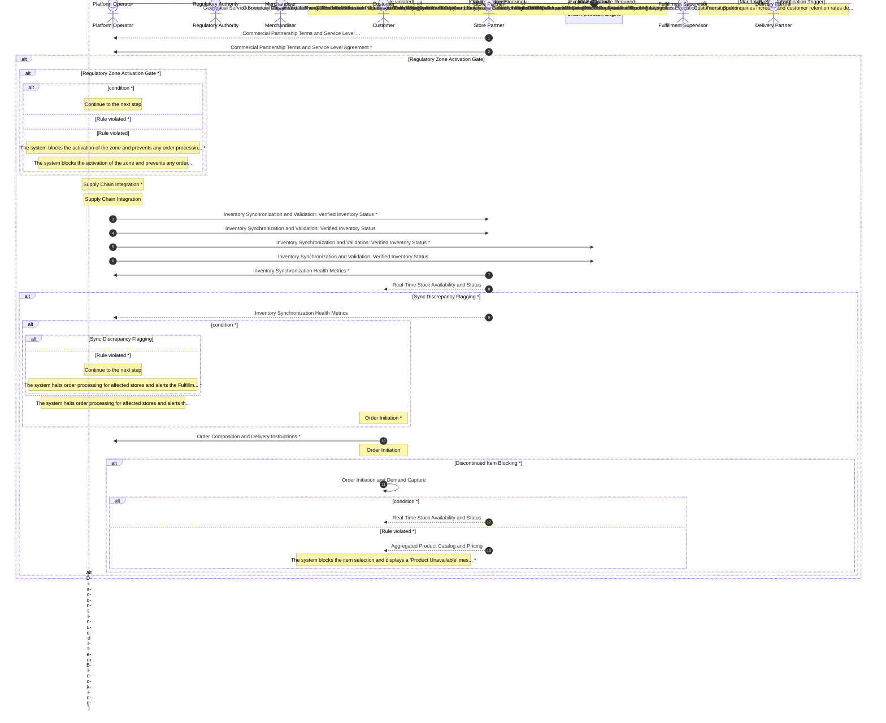
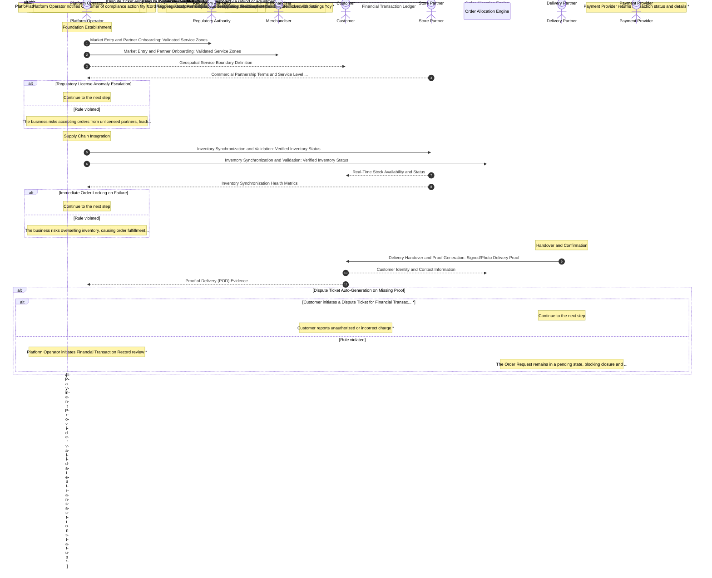

# Sequence Diagrams

Interactions between actors and system participants over time.

Dashed outlines and elements marked * were added by AI. Solid elements come from the repositories.

Generated 2026-11-17T18:18:20.523Z by 8.0.13.DiagramsAI.js using unsloth/Qwen3.5-9B-GGUF. Sources: knowledge base (10 actors, 14 business objects, 11 activities, 11 lifecycle stages, 20 information requirements), requirements schema (62 functional, 28 business requirements), business_rule_discovery (142 rules after merging 168 raw rules, ingestion run 3).

| Unit | Covers | Source | New elements |
|---|---|---|---|
| SEQ-1 | Foundation Establishment to Last-Mile Delivery | AI complete | 21 |
| SEQ-2 | Handover & Confirmation to Business Decision | AI complete | 48 |
| SEQ-3 | Exception paths: Dispute Ticket and Financial Transaction... | AI complete | 21 |

## SEQ-1: Foundation Establishment to Last-Mile Delivery

Focus: Interactions, handovers, confirmations, checks and alternatives for Foundation Establishment to Last-Mile Delivery.

## SEQ-2: Handover & Confirmation to Business Decision

Focus: Interactions, handovers, confirmations, checks and alternatives for Handover & Confirmation to Business Decision.

```mermaid
sequenceDiagram
  autonumber
  actor P_p1 as Delivery Partner
  actor P_p2 as Customer
  participant P_p3 as Order Allocation Engine
  actor P_p4 as Platform Operator
  actor P_p5 as Payment Provider
  actor P_p6 as Store Partner
  actor P_p7 as Merchandiser
  actor P_q8 as Regulatory Authority
  actor P_q9 as Fulfillment Supervisor
  Note over P_p1: Handover and Confirmation
  Note over P_p1: Handover and Confirmation to Business Decision: Initiate handover process *
  P_p1->>P_p2: Delivery Handover and Proof Generation: Signed/Photo Delivery Proof
  alt Delivery Proof Rejection for Cancelled Assignments *
  P_p2-->>P_p3: Customer Identity and Contact Information
  alt Delivery Proof Rejection for Cancelled Assignments *
  P_p2-->>P_p4: Proof of Delivery (POD) Evidence
  alt Delivery Proof Rejection for Cancelled Assignments *
  alt Delivery Proof Rejection for Cancelled Assignments
  alt Delivery Proof Rejection for Cancelled Assignments *
  Note over P_p1: Continue to the next step
  alt Delivery Proof Rejection for Cancelled Assignments *
  else Rule violated
  alt Delivery Proof Rejection for Cancelled Assignments *
  Note over P_p1: The system rejects the submission and logs an error, preventing fal...
  alt Delivery Proof Rejection for Cancelled Assignments *
  end
  alt Delivery Proof Rejection for Cancelled Assignments *
  Note over P_p5: Financial Settlement
  alt Delivery Proof Rejection for Cancelled Assignments *
  P_p5->>P_p4: Payment Processing and Financial Settlement: Processed Payment
  alt Delivery Proof Rejection for Cancelled Assignments *
  P_p5->>P_p6: Payment Processing and Financial Settlement: Processed Payment
  alt Delivery Proof Rejection for Cancelled Assignments *
  P_p2-->>P_p3: Customer Identity and Contact Information
  alt Delivery Proof Rejection for Cancelled Assignments *
  P_p2-->>P_p4: Proof of Delivery (POD) Evidence
  alt Delivery Proof Rejection for Cancelled Assignments *
  alt Delivery Verification Mandate
  alt Delivery Proof Rejection for Cancelled Assignments *
  Note over P_p5: Continue to the next step
  alt Delivery Proof Rejection for Cancelled Assignments *
  else Rule violated
  alt Delivery Proof Rejection for Cancelled Assignments *
  Note over P_p5: The settlement status remains 'Pending' and funds are withheld unti...
  alt Delivery Proof Rejection for Cancelled Assignments *
  end
  alt Delivery Proof Rejection for Cancelled Assignments *
  Note over P_p2: Post-Transaction Review
  alt Delivery Proof Rejection for Cancelled Assignments *
  P_p2->>P_p4: Post-Transaction Review and Feedback Collection: Customer Ratings a...
  alt Delivery Proof Rejection for Cancelled Assignments *
  P_p2-->>P_p4: Customer Satisfaction and Quality Feedback
  alt Delivery Proof Rejection for Cancelled Assignments *
  P_p2-->>P_p4: Exception and Dispute Ticket Registry
  alt Delivery Proof Rejection for Cancelled Assignments *
  alt Feedback Assignment Binding
  alt Delivery Proof Rejection for Cancelled Assignments *
  Note over P_p2: Continue to the next step
  alt Delivery Proof Rejection for Cancelled Assignments *
  else Rule violated
  alt Delivery Proof Rejection for Cancelled Assignments *
  Note over P_p2: The feedback is rejected or logged as 'Unattributed', preventing ac...
  alt Delivery Proof Rejection for Cancelled Assignments *
  end
  alt Delivery Proof Rejection for Cancelled Assignments *
  P_p4->>P_p2: Dispute Resolution and Exception Handling: Resolved Dispute
  alt Delivery Proof Rejection for Cancelled Assignments *
  P_p4->>P_p6: Dispute Resolution and Exception Handling: Resolved Dispute
  alt Delivery Proof Rejection for Cancelled Assignments *
  P_p6-->>P_p2: Financial Transaction Ledger
  alt Delivery Proof Rejection for Cancelled Assignments *
  P_p2-->>P_p4: Customer Satisfaction and Quality Feedback
  alt Delivery Proof Rejection for Cancelled Assignments *
  alt Refund Precondition
  alt Delivery Proof Rejection for Cancelled Assignments *
  Note over P_p4: Continue to the next step
  alt Delivery Proof Rejection for Cancelled Assignments *
  else Rule violated
  alt Delivery Proof Rejection for Cancelled Assignments *
  Note over P_p4: Revenue leakage or incorrect financial reporting occurs
  alt Delivery Proof Rejection for Cancelled Assignments *
  end
  alt Delivery Proof Rejection for Cancelled Assignments *
  Note over P_p7: Business Decision
  alt Delivery Proof Rejection for Cancelled Assignments *
  P_p7->>P_p7: Product Catalog Curation and Strategy
  alt Delivery Proof Rejection for Cancelled Assignments *
  P_p6-->>P_p4: Commercial Partnership Terms and Service Level ...
  alt Delivery Proof Rejection for Cancelled Assignments *
  P_p6-->>P_p2: Real-Time Stock Availability and Status
  alt Delivery Proof Rejection for Cancelled Assignments *
  alt Perishable Expiry Enforcement
  alt Delivery Proof Rejection for Cancelled Assignments *
  Note over P_p7: Continue to the next step
  alt Delivery Proof Rejection for Cancelled Assignments *
  else Rule violated
  alt Delivery Proof Rejection for Cancelled Assignments *
  Note over P_p7: The system rejects the Order Request and logs a compliance error fo...
  alt Delivery Proof Rejection for Cancelled Assignments *
  end
  end
  end
  end
  end
  end
  end
  end
  end
  end
  end
  end
  end
  end
  end
  end
  end
  end
  end
  end
  end
  end
  end
  end
  end
  end
  end
  end
  end
  end
  end
  end
  end
  end
  end
  end
  end
  end
  end
  end
  end
  end
  end
  end
  end
```

## SEQ-3: Exception paths: Dispute Ticket and Financial Transaction Record

Focus: Interactions when something goes wrong in Exception paths: Dispute Ticket and Financial Transaction Record.

