# State Machine Diagrams

Business-object lifecycles: object states, transitions, guards and abnormal endings.

Dashed outlines and elements marked * were added by AI. Solid elements come from the repositories.

Generated 2026-11-17T18:18:20.523Z by 8.0.13.DiagramsAI.js using unsloth/Qwen3.5-9B-GGUF. Sources: knowledge base (10 actors, 14 business objects, 11 activities, 11 lifecycle stages, 20 information requirements), requirements schema (62 functional, 28 business requirements), business_rule_discovery (142 rules after merging 168 raw rules, ingestion run 3).

| Unit | Covers | Source | New elements |
|---|---|---|---|
| STATE-1 | Service Area Definition, Store Partner Agreement, Product... | AI complete | 47 |
| STATE-2 | Customer Profile, Order Request, Fulfillment Task and 2 more | AI complete | 38 |
| STATE-3 | Financial Transaction Record, Delivery Proof, Feedback Re... | AI complete | 32 |

## Service Area Definition

Source: AI complete

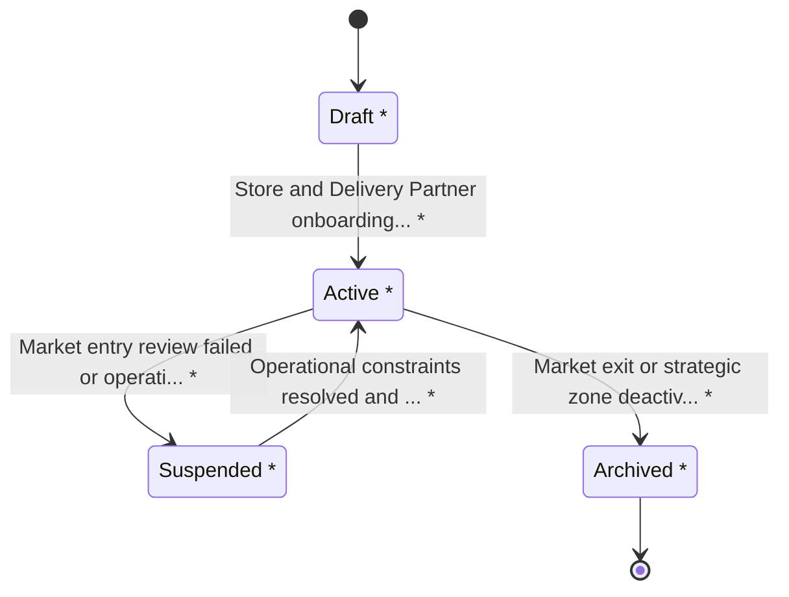

## Store Partner Agreement

Source: AI complete

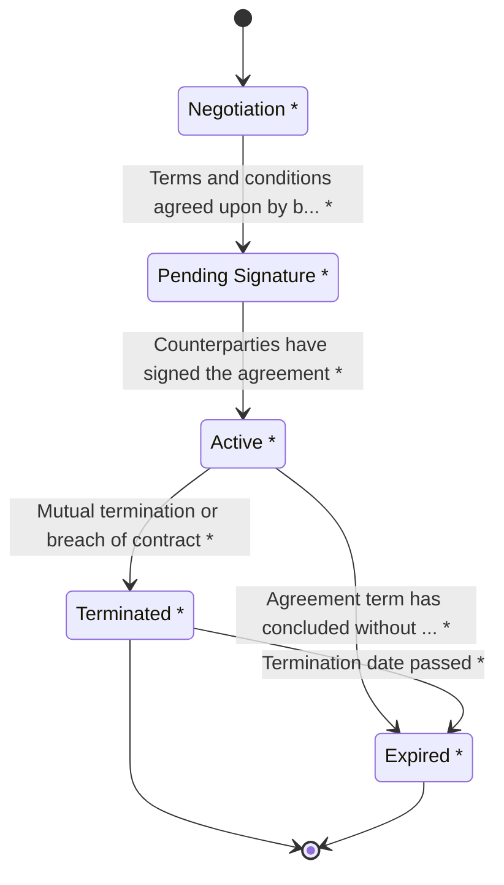

## Product Catalog

Source: AI complete

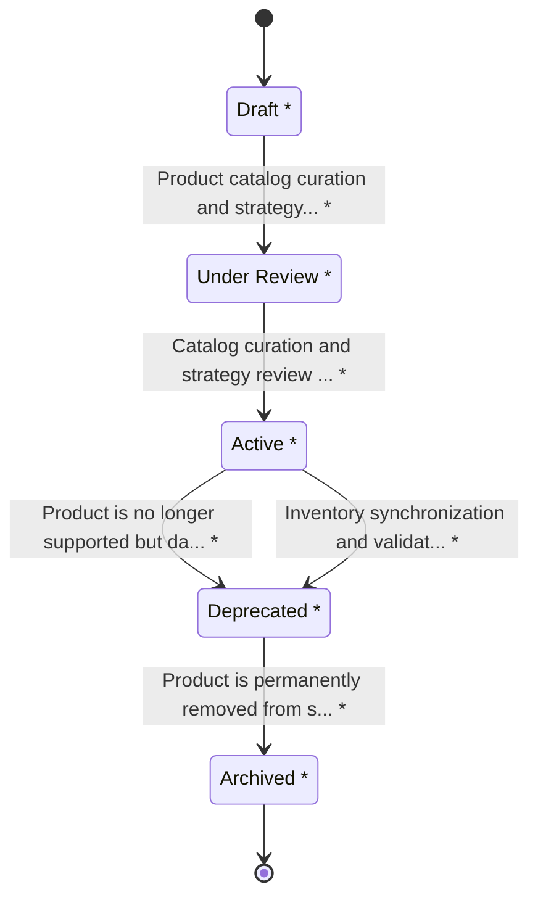

## Real-Time Inventory Snapshot

Source: AI complete

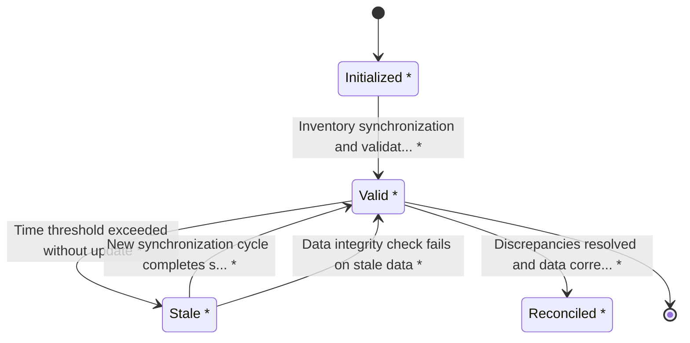

## Delivery Zone Map

Source: AI complete

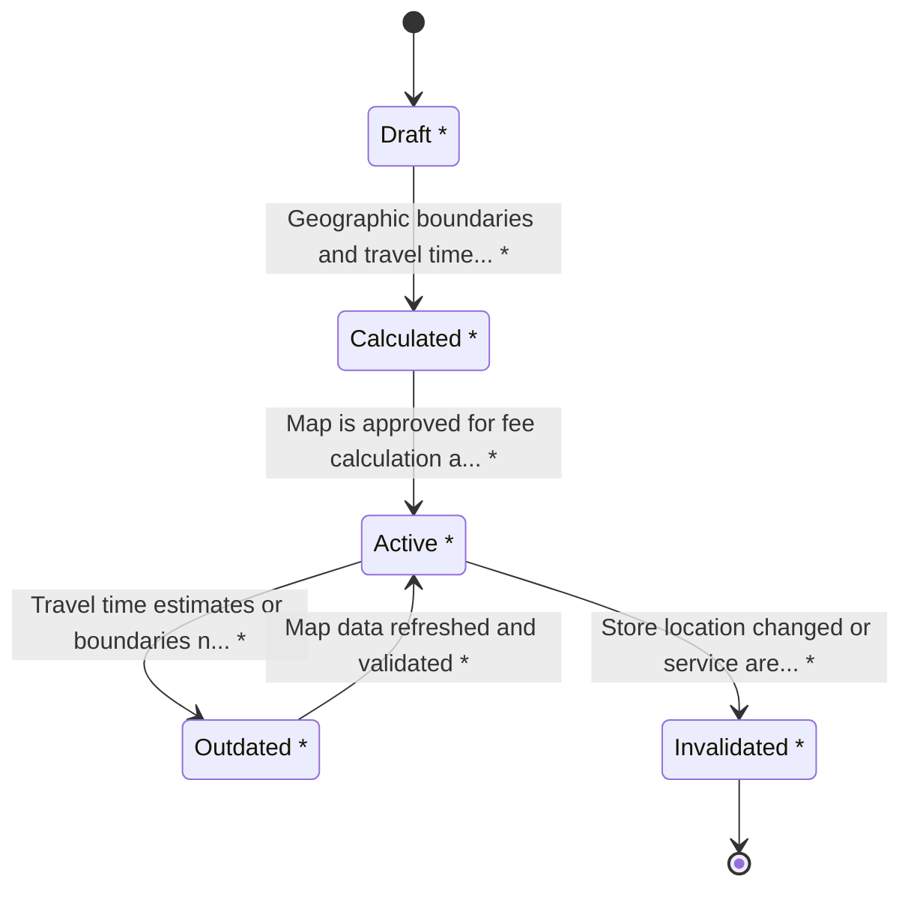

## Customer Profile

Source: AI complete

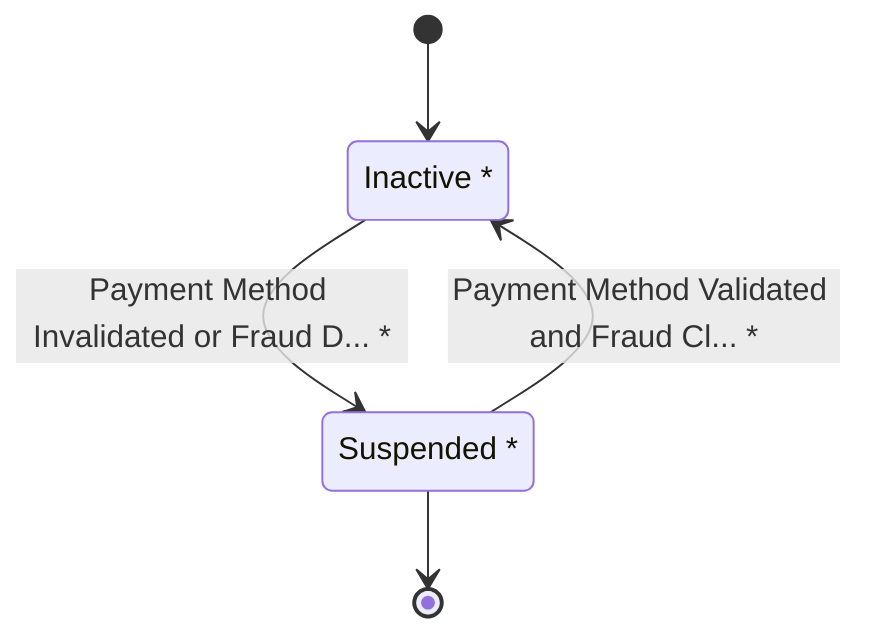

## Order Request

Source: AI complete

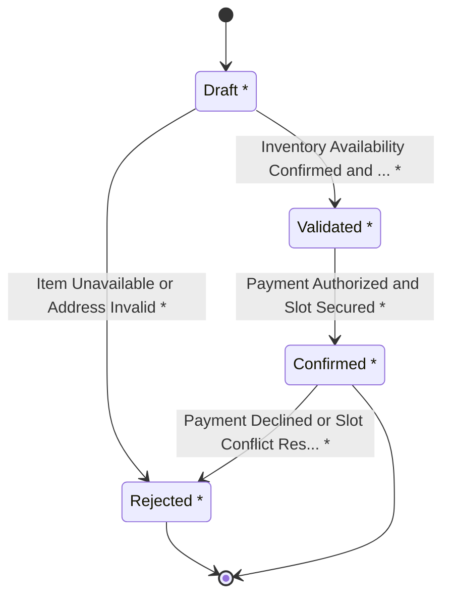

## Fulfillment Task

Source: AI complete

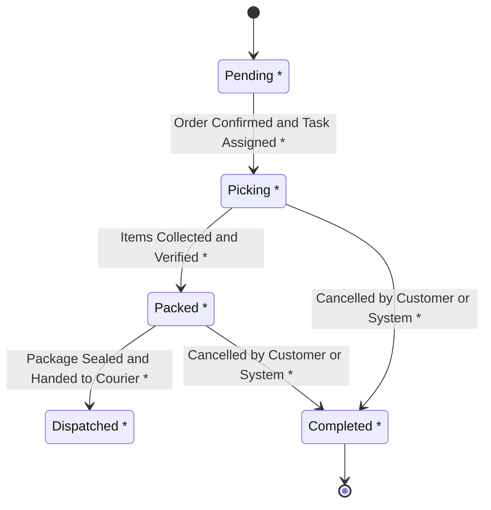

## Assigned Delivery Slot

Source: AI complete

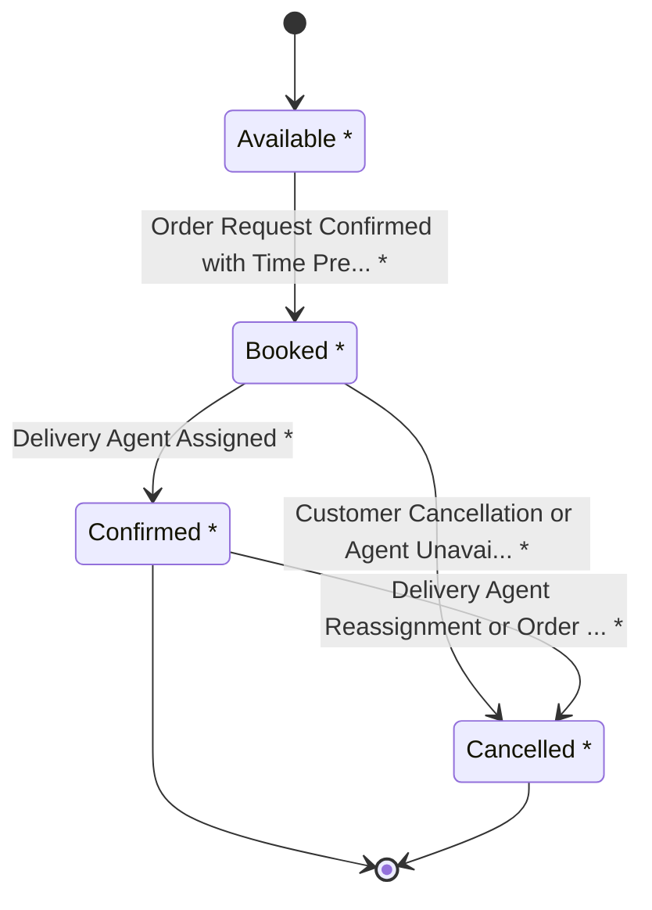

## Delivery Assignment

Source: AI complete

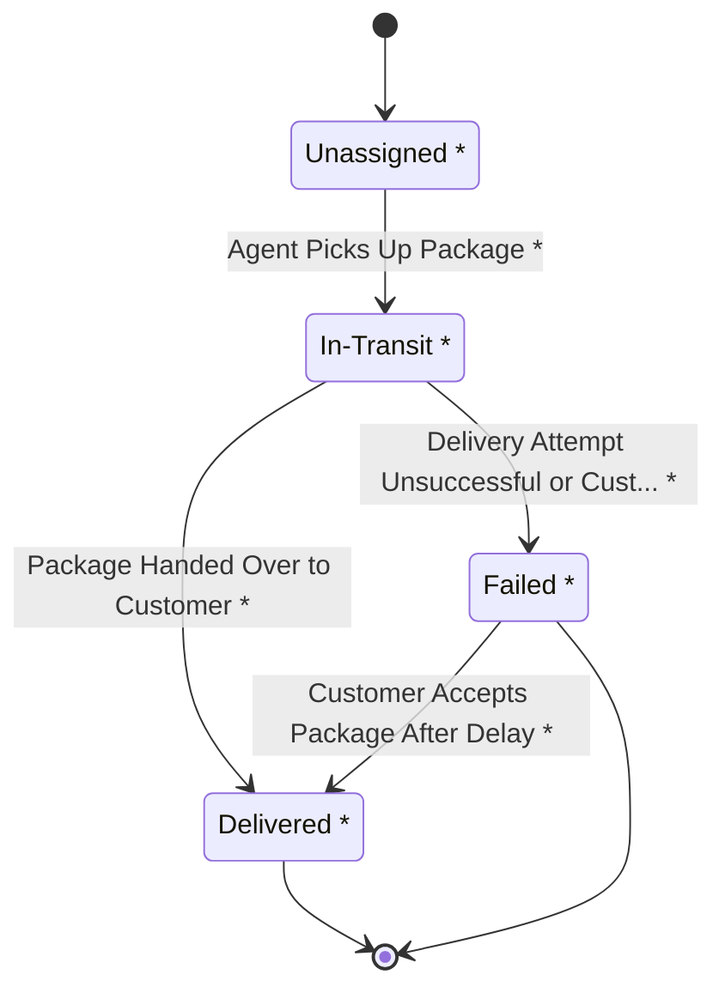

## Financial Transaction Record

Source: AI complete

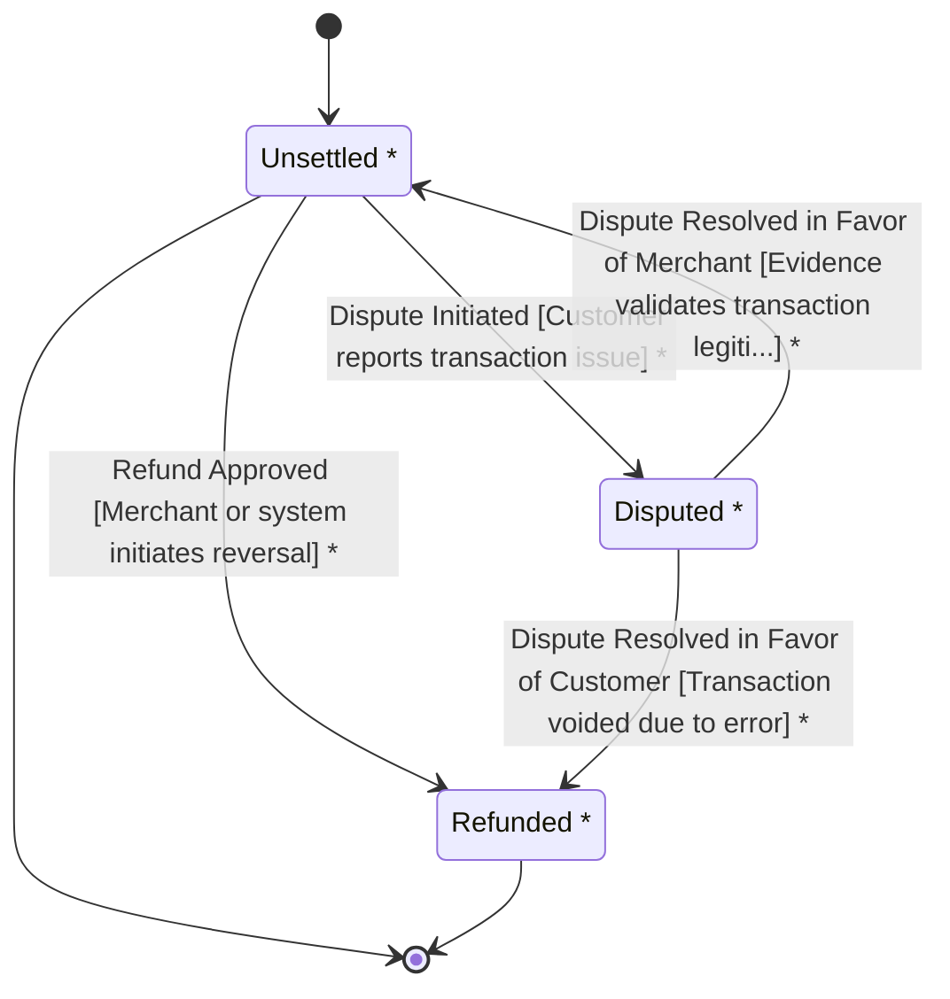

## Delivery Proof

Source: AI complete

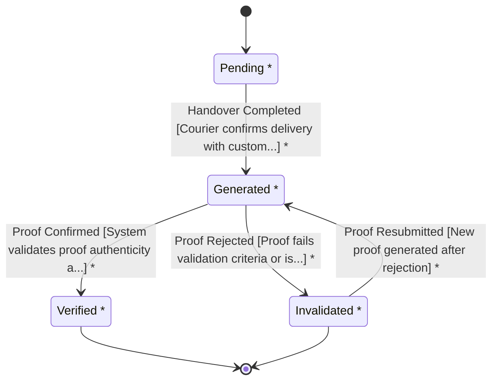

## Feedback Record

Source: AI complete

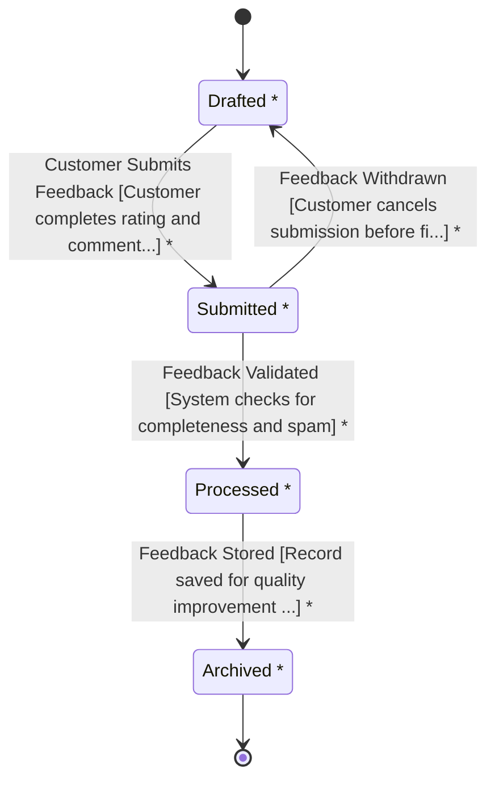

## Dispute Ticket

Source: AI complete

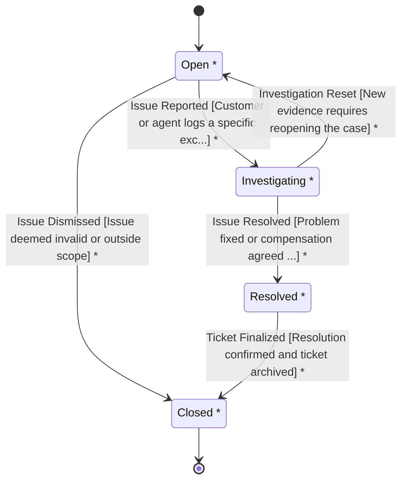

