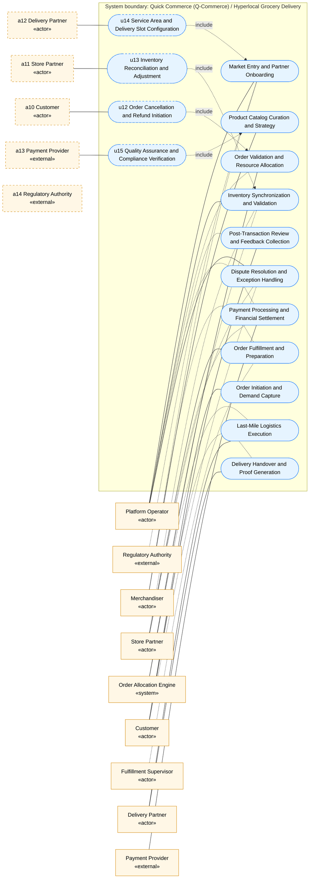
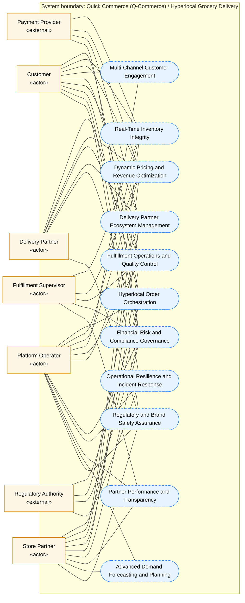

# Use Case Diagram

Actors, system boundary and functional capabilities.

Dashed outlines and elements marked * were added by the AI model (inferred); solid ones come from the repositories.

Generated 2026-11-16T09:47:55.699Z by 8.5.2.DiagramsAI.js using unsloth/Qwen3.5-9B-GGUF. Sources: knowledge base (10 actors, 14 business objects, 11 activities, 11 lifecycle stages, 20 information requirements), requirements schema (62 functional, 28 business requirements), business_rule_discovery (142 rules after merging 168 raw rules, ingestion run 3).

| Unit | Covers | Source | New elements |
|---|---|---|---|
| USECASE-1 | Use cases from business activities | AI | 17 |
| USECASE-2 | Functional capabilities | AI | 11 |

## USECASE-1: View 1: business activities

Focus: Each use case is something an actor wants to achieve with the system. Add the actors, use cases, links and include/extend relations that are missing.

## USECASE-2: View 2: functional capabilities (grouped by the AI)

Focus: Group the business requirements into functional capabilities.

