# State Machine Diagrams

Lifecycle of each business object: states, transitions, guards and abnormal endings.

Dashed outlines and elements marked * were added by the AI model (inferred); solid ones come from the repositories.

Generated 2026-11-16T09:47:55.699Z by 8.5.2.DiagramsAI.js using unsloth/Qwen3.5-9B-GGUF. Sources: knowledge base (10 actors, 14 business objects, 11 activities, 11 lifecycle stages, 20 information requirements), requirements schema (62 functional, 28 business requirements), business_rule_discovery (142 rules after merging 168 raw rules, ingestion run 3).

| Unit | Covers | Source | New elements |
|---|---|---|---|
| STATE-1 | Service Area Definition, Store Partner Agreement, Product... | baseline (not generated yet) | 0 |
| STATE-2 | Customer Profile, Order Request, Fulfillment Task and 2 more | baseline (not generated yet) | 0 |
| STATE-3 | Financial Transaction Record, Delivery Proof, Feedback Re... | baseline (not generated yet) | 0 |

## Store Partner Agreement

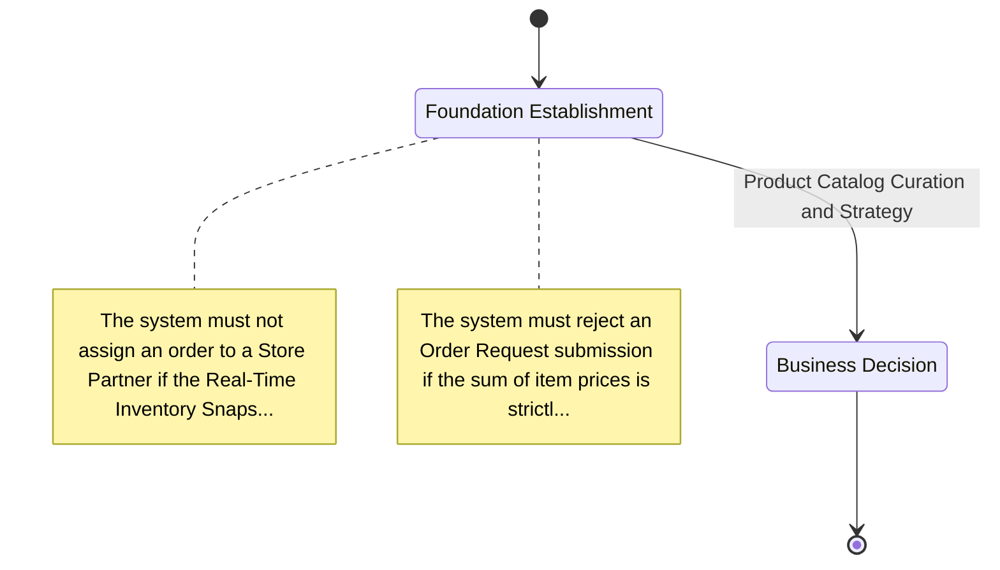

## Product Catalog

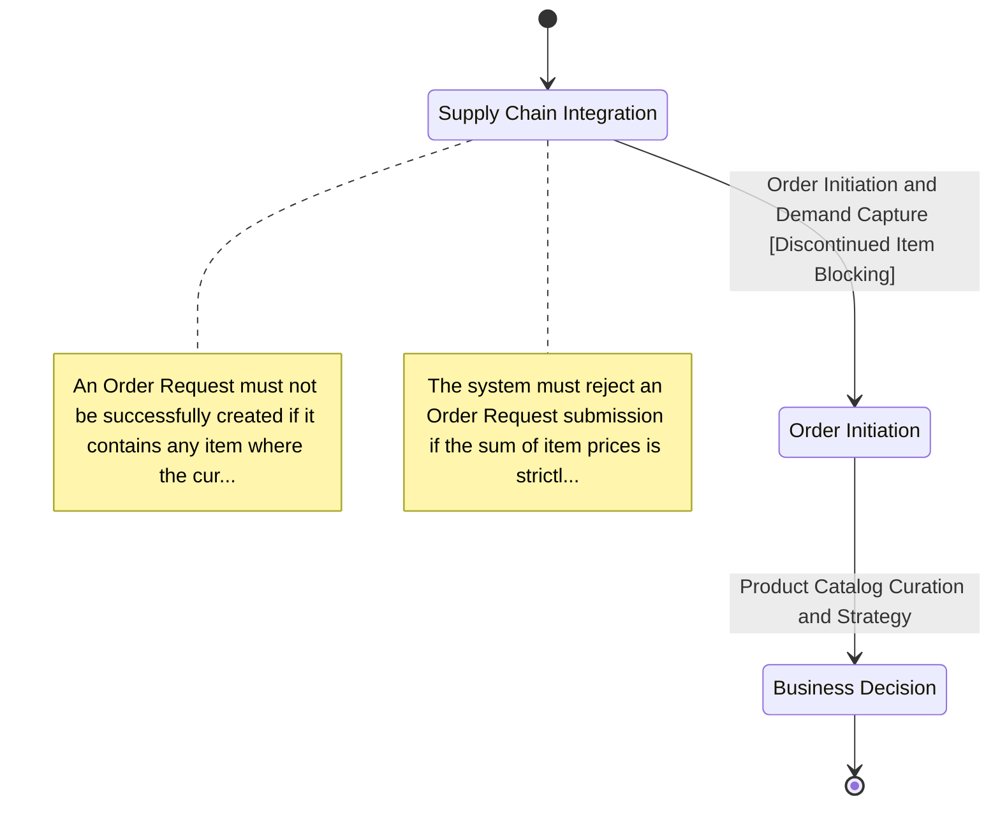

## Real-Time Inventory Snapshot

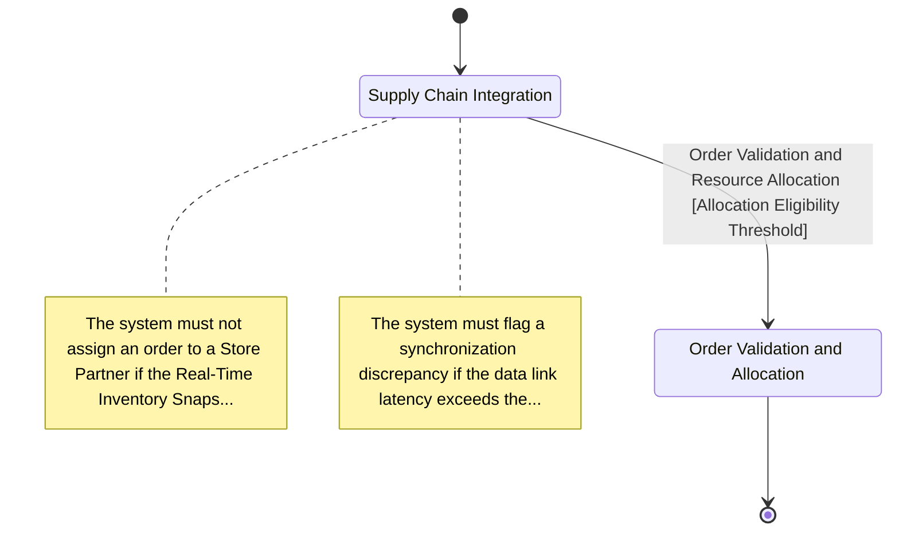

## Delivery Zone Map

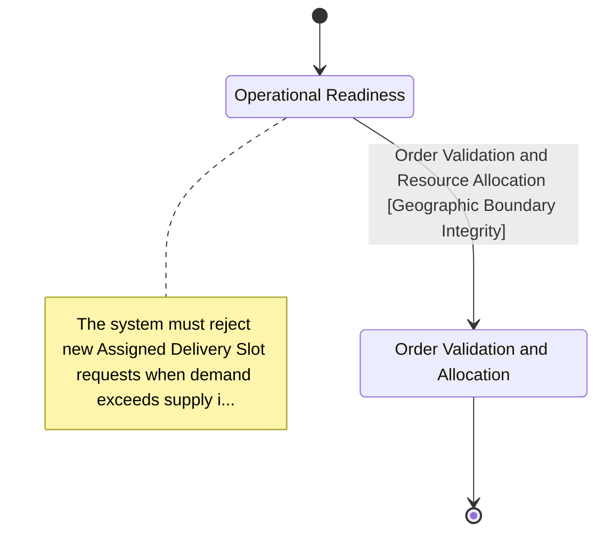

## Customer Profile

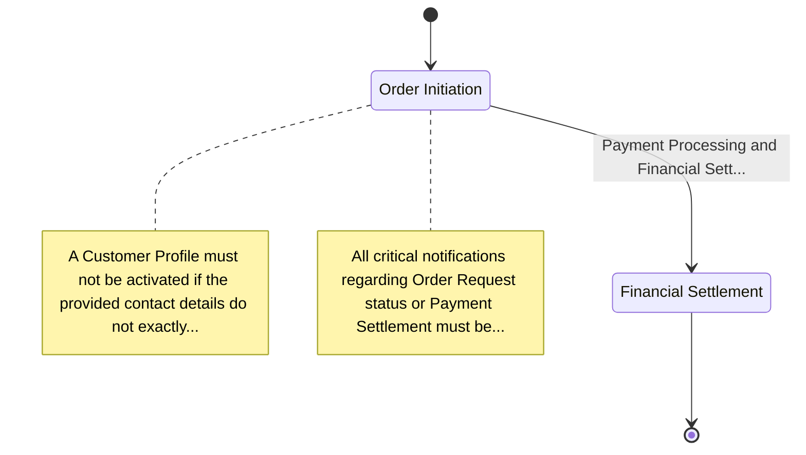

## Order Request

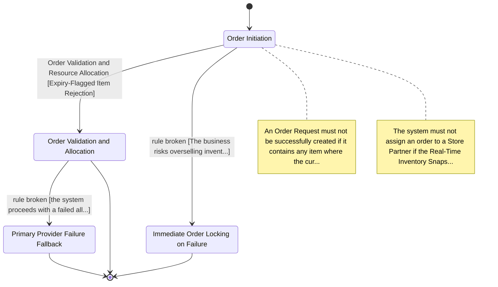

## Fulfillment Task

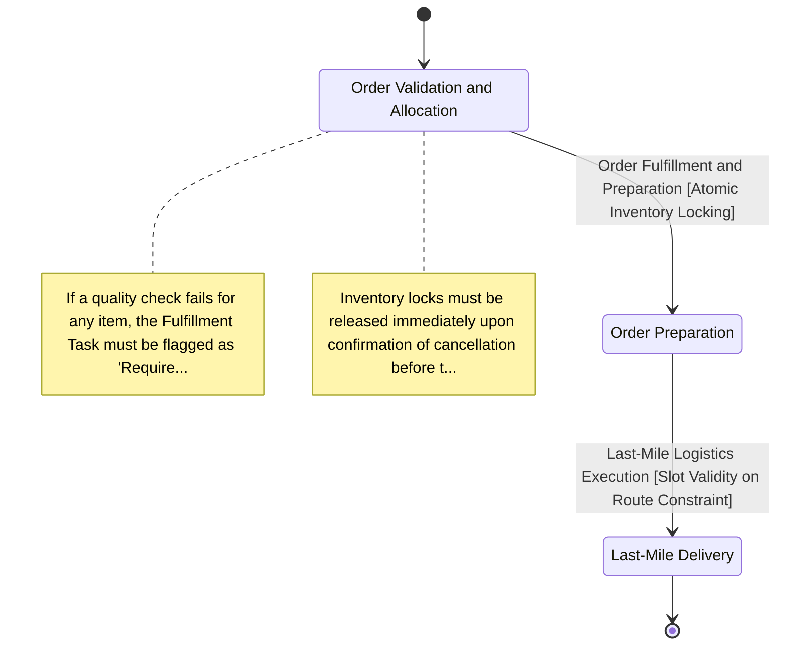

## Assigned Delivery Slot

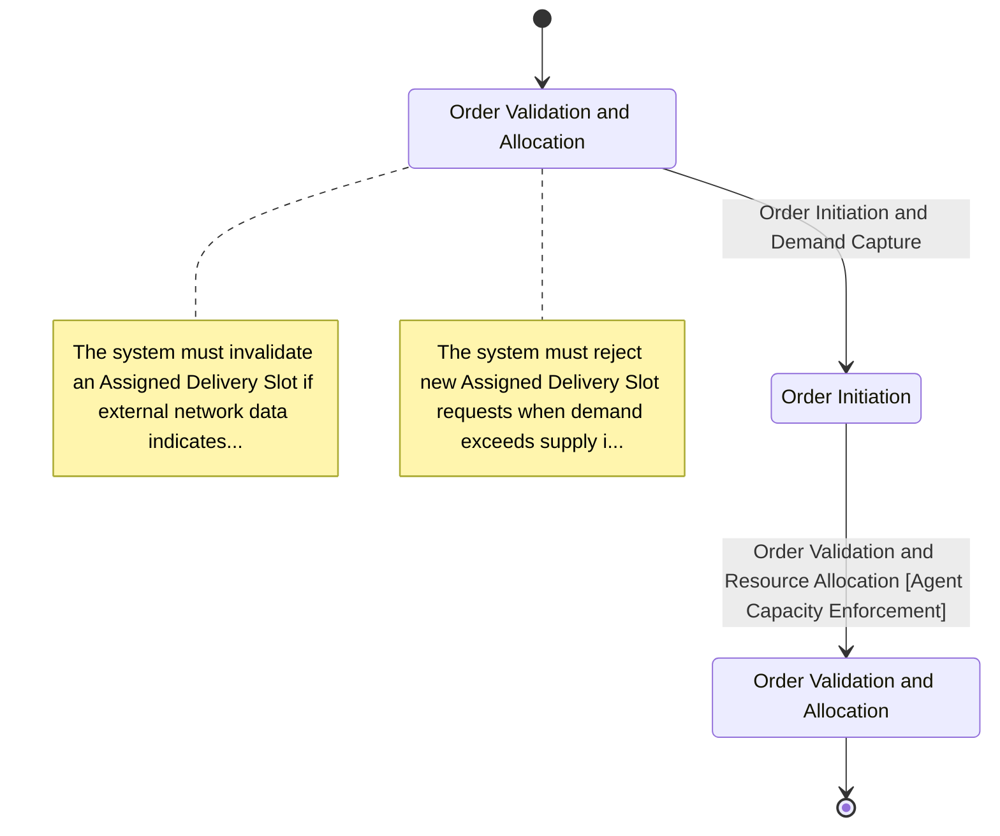

## Delivery Assignment

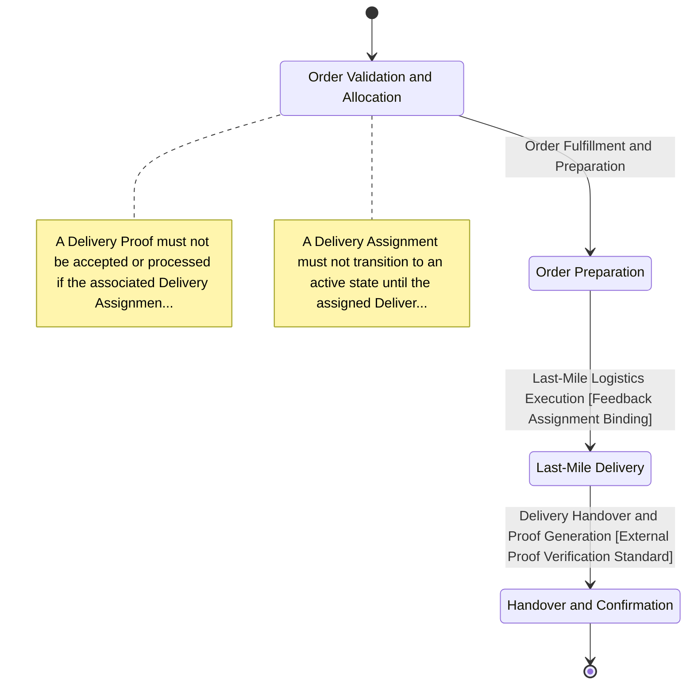

## Financial Transaction Record

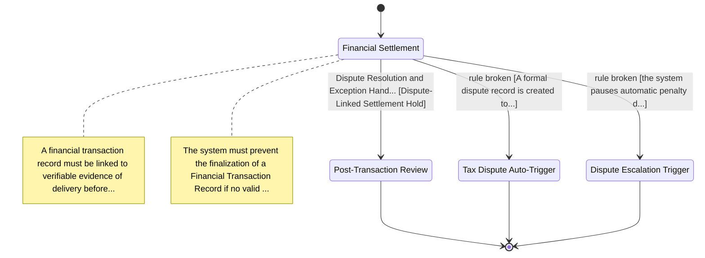

## Dispute Ticket

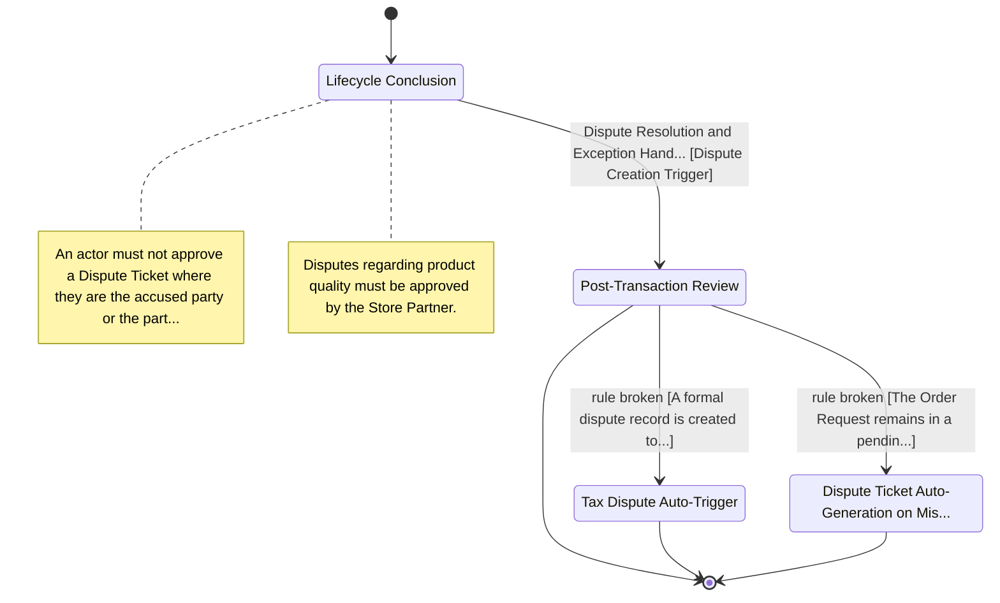

