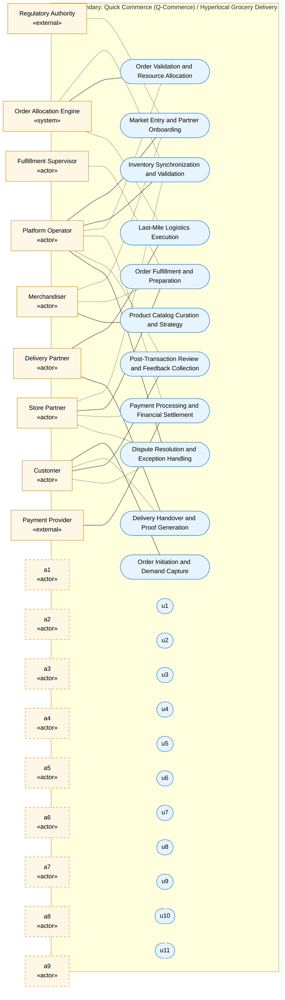
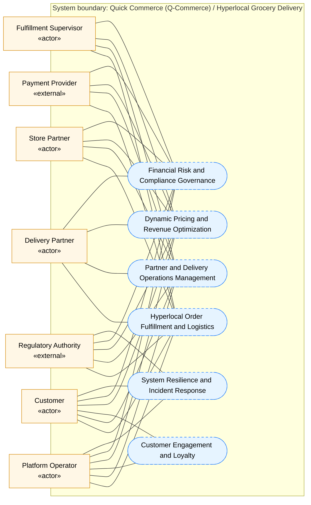

# Use Case Diagram

Actors, system boundary and functional capabilities.

Dashed outlines and elements marked * were added by AI. Solid elements come from the repositories.

Generated 2026-11-17T12:19:00.495Z by 8.0.13.DiagramsAI.js using unsloth/Qwen3.5-9B-GGUF. Sources: knowledge base (10 actors, 14 business objects, 11 activities, 11 lifecycle stages, 20 information requirements), requirements schema (62 functional, 28 business requirements), business_rule_discovery (142 rules after merging 168 raw rules, ingestion run 3).

| Unit | Covers | Source | New elements |
|---|---|---|---|
| USECASE-1 | Use cases from business activities | AI complete | 20 |
| USECASE-2 | Functional capabilities | AI complete | 6 |

## USECASE-1: View 1: business activities

Focus: Identify actor goals, use cases, actor associations and valid include/extend relationships.

## USECASE-2: Functional capabilities

Focus: Group business requirements into coherent functional capabilities.

