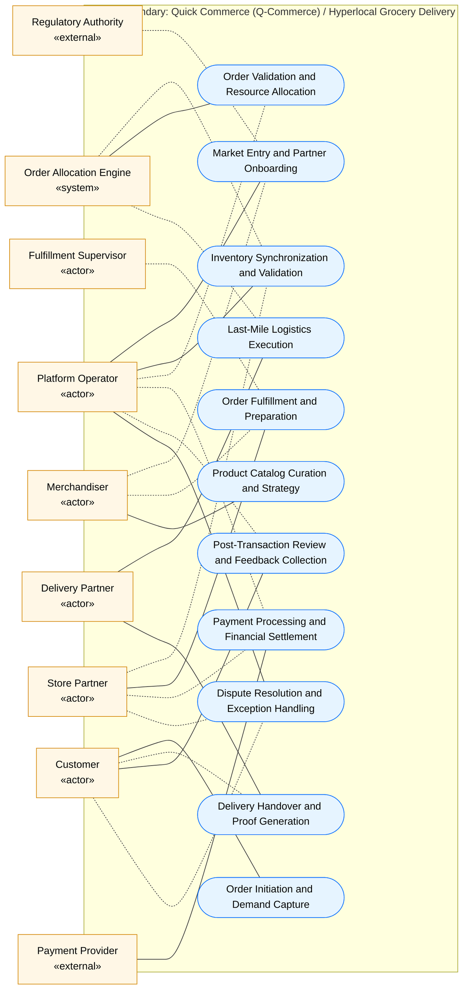

# Use Case Diagram

Actors, system boundary and functional capabilities.

Solid line: primary actor. Dotted line: supporting actor. Actors sit outside the system boundary; use cases sit inside it.
Mermaid has no native use case diagram, so this is a flowchart that follows UML use case conventions.

Generated 2026-11-19T07:25:23.325Z by 8.5.1.DiagramsDeterministic.js (no AI). Sources: knowledge base (10 actors, 14 business objects, 11 activities, 11 lifecycle stages, 20 information requirements), requirements schema (62 functional, 28 business requirements), business_rule_discovery (142 rules after merging 168 raw rules, ingestion run 3).

## View 1: business activities

## View 2: business requirements as capabilities

```mermaid
flowchart LR
  a_a1["Customer<br/>«actor»"]:::actor
  a_a2["Delivery Partner<br/>«actor»"]:::actor
  a_a3["Store Partner<br/>«actor»"]:::actor
  a_a4["Platform Operator<br/>«actor»"]:::actor
  a_a5["Fulfillment Supervisor<br/>«actor»"]:::actor
  a_a6["Payment Provider<br/>«external»"]:::actor
  a_a7["Regulatory Authority<br/>«external»"]:::actor
  subgraph SYS["System boundary: Quick Commerce (Q-Commerce) / Hyperlocal Grocery Delivery"]
    u_u1(["Ultra-fast delivery of fresh perishables"]):::uc
    u_u2(["Unified Digital Marketplace Interface"]):::uc
    u_u3(["Optimize last-mile logistics via algorithmic routing"]):::uc
    u_u4(["Measure orders fulfilled within target timeframes"]):::uc
    u_u5(["Track inventory discrepancies and overselling incidents"]):::uc
    u_u6(["Monitor revenue efficiency against operational costs"]):::uc
    u_u7(["Real-time Store Partner Performance Dashboard"]):::uc
    u_u8(["Delivery Partner Financial Transparency Portal"]):::uc
    u_u9(["Customer Self-Service Loyalty and Subscription Portal"]):::uc
    u_u10(["Dynamic Pricing Engine for Demand-Based Fees"]):::uc
    u_u11(["Real-Time Inventory Reconciliation"]):::uc
    u_u12(["Continuous Financial Risk Mitigation"]):::uc
    u_u13(["Regulatory Compliance for Food Safety and Labor Laws"]):::uc
    u_u14(["Proactive Risk Analytics for Brand Protection"]):::uc
    u_u15(["Dynamic Tax Calculation and Collection"]):::uc
    u_u16(["Mandatory Partner Compliance Validation"]):::uc
    u_u17(["Rapid Isolation of System Outages"]):::uc
    u_u18(["Guarantee immediate dispute resolution and fraud mitigation"]):::uc
    u_u19(["Immutable Audit Trail for Operational Anomalies"]):::uc
    u_u20(["Dynamic Micro-Fulfillment Network Scaling"]):::uc
    u_u21(["Automated Quality Assurance and Dispute Resolution"]):::uc
    u_u22(["Flexible Revenue and Settlement Management"]):::uc
    u_u23(["Predictive Analytics for Demand and Inventory Optimization"]):::uc
    u_u24(["Automated fallback routing and vendor diversification"]):::uc
    u_u25(["Third-Party Vendor SLA Enforcement"]):::uc
    u_u26(["Defer Advanced Predictive Inventory Models"]):::uc
    u_u27(["Proactive Perishable Inventory Management"]):::uc
    u_u28(["Multi-channel delivery status notifications"]):::uc
  end
  a_a1 --- u_u1
  a_a2 --- u_u1
  a_a3 --- u_u1
  a_a4 --- u_u1
  a_a1 --- u_u2
  a_a3 --- u_u2
  a_a4 --- u_u2
  a_a2 --- u_u3
  a_a4 --- u_u3
  a_a4 --- u_u4
  a_a1 --- u_u4
  a_a2 --- u_u4
  a_a3 --- u_u4
  a_a4 --- u_u5
  a_a3 --- u_u5
  a_a1 --- u_u5
  a_a5 --- u_u5
  a_a4 --- u_u6
  a_a6 --- u_u6
  a_a2 --- u_u6
  a_a3 --- u_u7
  a_a4 --- u_u7
  a_a5 --- u_u7
  a_a2 --- u_u8
  a_a4 --- u_u8
  a_a6 --- u_u8
  a_a7 --- u_u8
  a_a1 --- u_u9
  a_a4 --- u_u9
  a_a4 --- u_u10
  a_a1 --- u_u10
  a_a2 --- u_u10
  a_a3 --- u_u10
  a_a3 --- u_u11
  a_a4 --- u_u11
  a_a1 --- u_u11
  a_a6 --- u_u11
  a_a6 --- u_u12
  a_a4 --- u_u12
  a_a3 --- u_u12
  a_a1 --- u_u12
  a_a7 --- u_u12
  a_a7 --- u_u13
  a_a4 --- u_u13
  a_a3 --- u_u13
  a_a2 --- u_u13
  a_a4 --- u_u14
  a_a1 --- u_u14
  a_a3 --- u_u14
  a_a2 --- u_u14
  a_a7 --- u_u15
  a_a6 --- u_u15
  a_a4 --- u_u15
  a_a7 --- u_u16
  a_a3 --- u_u16
  a_a2 --- u_u16
  a_a4 --- u_u16
  a_a4 --- u_u17
  a_a7 --- u_u17
  a_a1 --- u_u17
  a_a6 --- u_u18
  a_a5 --- u_u18
  a_a4 --- u_u18
  a_a1 --- u_u18
  a_a3 --- u_u18
  a_a7 --- u_u18
  a_a7 --- u_u19
  a_a4 --- u_u19
  a_a5 --- u_u19
  a_a2 --- u_u19
  a_a4 --- u_u20
  a_a3 --- u_u20
  a_a2 --- u_u20
  a_a7 --- u_u20
  a_a4 --- u_u21
  a_a1 --- u_u21
  a_a2 --- u_u21
  a_a3 --- u_u21
  a_a5 --- u_u21
  a_a6 --- u_u22
  a_a3 --- u_u22
  a_a4 --- u_u22
  a_a5 --- u_u22
  a_a4 --- u_u23
  a_a3 --- u_u23
  a_a4 --- u_u24
  a_a2 --- u_u24
  a_a1 --- u_u24
  a_a4 --- u_u25
  a_a6 --- u_u25
  a_a2 --- u_u25
  a_a3 --- u_u25
  a_a4 --- u_u26
  a_a3 --- u_u26
  a_a3 --- u_u27
  a_a5 --- u_u27
  a_a4 --- u_u27
  a_a1 --- u_u28
  a_a4 --- u_u28
  a_a2 --- u_u28
  classDef actor fill:#fff7e6,stroke:#d48806,color:#000
  classDef actorInf fill:#fff7e6,stroke:#d48806,stroke-dasharray:5 5,color:#000
  classDef uc fill:#e6f4ff,stroke:#1677ff,color:#000
  classDef ucInf fill:#e6f4ff,stroke:#1677ff,stroke-dasharray:5 5,color:#000
```

## Traceability: business requirement to functional requirements

| Business requirement | Functional requirements |
|---|---|
| BR-001 Ultra-fast delivery of fresh perishables | FR-001, FR-006 |
| BR-002 Unified Digital Marketplace Interface | FR-054, FR-062 |
| BR-003 Optimize last-mile logistics via algorithmic routing | FR-003, FR-028, FR-047 |
| BR-004 Measure orders fulfilled within target timeframes | FR-054 |
| BR-005 Track inventory discrepancies and overselling incidents | FR-001, FR-007, FR-011, FR-032, FR-033, FR-039 |
| BR-006 Monitor revenue efficiency against operational costs | FR-005, FR-025, FR-045 |
| BR-007 Real-time Store Partner Performance Dashboard | FR-005, FR-039, FR-059 |
| BR-008 Delivery Partner Financial Transparency Portal | FR-016, FR-017, FR-043 |
| BR-009 Customer Self-Service Loyalty and Subscription Portal | FR-009, FR-048, FR-051 |
| BR-010 Dynamic Pricing Engine for Demand-Based Fees | FR-012, FR-029, FR-045, FR-047 |
| BR-011 Real-Time Inventory Reconciliation | FR-001, FR-002, FR-004, FR-022, FR-034, FR-039, FR-055 |
| BR-012 Continuous Financial Risk Mitigation | FR-026, FR-027, FR-038, FR-039, FR-044 |
| BR-013 Regulatory Compliance for Food Safety and Labor Laws | FR-008, FR-017, FR-020, FR-023, FR-053 |
| BR-014 Proactive Risk Analytics for Brand Protection | FR-050, FR-051, FR-059, FR-060, FR-061 |
| BR-015 Dynamic Tax Calculation and Collection | FR-030, FR-040, FR-042 |
| BR-016 Mandatory Partner Compliance Validation | FR-008, FR-010, FR-020, FR-053 |
| BR-017 Rapid Isolation of System Outages | FR-001, FR-020, FR-031 |
| BR-018 Guarantee immediate dispute resolution and fraud mitigation | FR-005, FR-013, FR-019, FR-021, FR-026, FR-027, FR-031, FR-035, FR-036, FR-037, FR-039, FR-042, FR-043, FR-061 |
| BR-019 Immutable Audit Trail for Operational Anomalies | FR-015, FR-020, FR-042 |
| BR-020 Dynamic Micro-Fulfillment Network Scaling | FR-014, FR-050, FR-053 |
| BR-021 Automated Quality Assurance and Dispute Resolution | FR-007, FR-021, FR-049, FR-057, FR-059, FR-061 |
| BR-022 Flexible Revenue and Settlement Management | FR-005, FR-025, FR-027, FR-039, FR-041, FR-043, FR-056 |
| BR-023 Predictive Analytics for Demand and Inventory Optimization | FR-001, FR-046, FR-058 |
| BR-024 Automated fallback routing and vendor diversification | FR-028, FR-029, FR-047 |
| BR-025 Third-Party Vendor SLA Enforcement | FR-050, FR-053 |
| BR-026 Defer Advanced Predictive Inventory Models | FR-002, FR-057 |
| BR-027 Proactive Perishable Inventory Management | FR-006, FR-018, FR-024 |
| BR-028 Multi-channel delivery status notifications | FR-052 |

