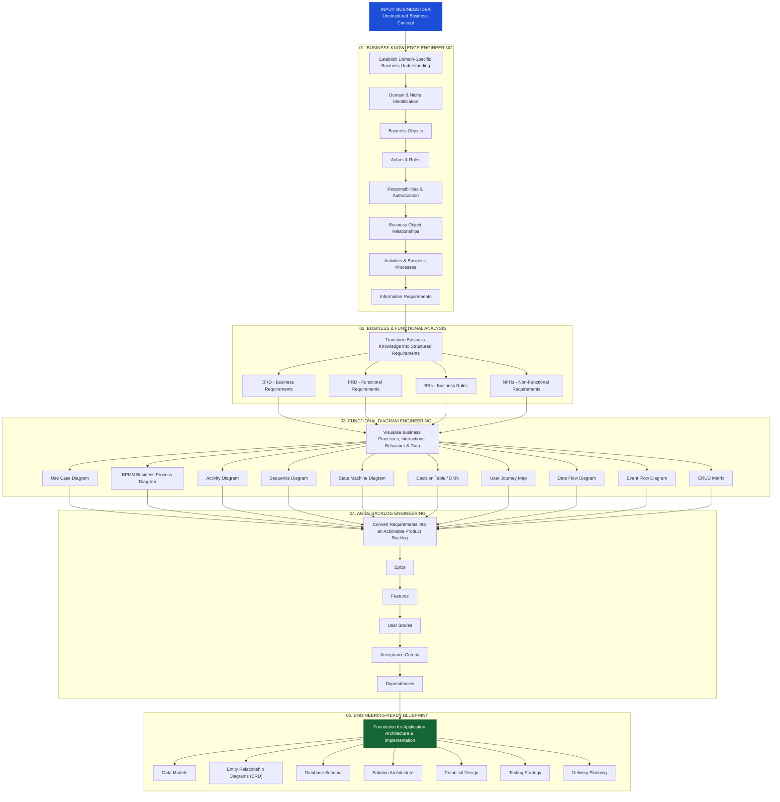

### Badges
[](https://github.com/matt212/Nodejs_Postgresql_VanillaJS_Fastify/actions/workflows/node.js.yml)

[](https://github.com/matt212/Nodejs_Postgresql_VanillaJS_Fastify/actions/workflows/codeql-analysis.yml)

[](https://github.com/matt212/Nodejs_Postgresql_VanillaJS_Fastify/actions/workflows/cloneCount.yml)

 [](https://github.com/matt212/Nodejs_Postgresql_VanillaJS_Fastify/issues)


### Tech stacks


<details>
 <summary id="problem-statement">🚄 Problem Statement </summary><blockquote>

 
<!--<table class="tg">
<thead>
  <tr>
    <td class="tg-0pky">Who<br></td>
    <td class="tg-0pky">Who has the problem?<br></td>
    <td class="tg-0pky"> Any Dev or Dev Team building project from Scratch or Migrating Existing Piece <br></td>
  </tr>
</thead>
<tbody>
  <tr>
    <td class="tg-0pky">What</td>
    <td class="tg-0pky">What is the problem?</td>
    <td class="tg-0pky">Conventional scaffolding / boilerplate does not cater to all  Key outcomes pointers</td>
  </tr>
  <tr>
    <td class="tg-0pky">Where</td>
    <td class="tg-0pky">When/Where the problem is occurring?</td>
    <td class="tg-0pky">During any project execution stage and even in planning phase  Team Has to spend a lot time and energy to plan, discuss and execute the project key outcomes mentioned as part of *solution statement*  mentioned above and thus planning and execution are pain points.</td>
  </tr>
  <tr>
    <td class="tg-0pky">Why</td>
    <td class="tg-0pky">why is it important to address?</td>
    <td class="tg-0pky">It is important to address because it would save time , energy of team members which in turn cascades  to finances, deadlines and other Factors.  </td>
  </tr>
</tbody>
</table>
 -->
 </details>


<details open>

<summary id="project-statement" href="#project-statement">
🚀 Solution Statement- Key Outcomes
</summary><blockquote>
   
  <details>
 <summary id="Objective">🍨 Objective </summary><blockquote>


</details>
   
<details>
 <summary id="mandates">🍰 Mandates </summary><blockquote>


</details>
    
<details>
 <summary id="Conventional-Levels">🍦 Features/Functionalities : Conventional Levels</summary><blockquote>


</details>

<details>
 <summary id="Advanced-Levels">🍧 Features/Functionalities : Advanced Levels</summary><blockquote>


</details>
</details>
<details>
 <summary id="scope-statement">🎫 
 Scope Statement
 </summary><blockquote>


</details>
<details>
 <summary id="AI"> 🚧 Work in Progress — Next Release - AI-Driven Business Idea to Application Engineering
 </summary><blockquote>

# Complete Platform Lifecycle

Transforming an unstructured business idea into an engineering-ready application blueprint through AI-powered business knowledge engineering, requirements analysis, functional modelling and Agile backlog generation.



---

## 01. Business Knowledge Engineering

Establish a comprehensive understanding of the business before defining application requirements.

- Domain and niche identification
- Business object identification and classification
- Business actor identification and role definition
- Actor responsibilities and authorization
- Business object relationships and dependencies
- Business activities and operational processes
- Information requirements identification

## 02. Business & Functional Analysis

Transform structured business knowledge into formal business and application requirements.

| Deliverable | Description |
|---|---|
| BRD | Business Requirements Document |
| FRD | Functional Requirements Document |
| BRs | Business Rules |
| NFRs | Non-Functional Requirements |

## 03. Functional Diagram Engineering

Translate business knowledge and requirements into visual representations of processes, interactions, behaviour and data.

**Diagram types:**

1. Use Case Diagram
2. BPMN Business Process Diagram
3. Activity Diagram
4. Sequence Diagram
5. State Machine Diagram
6. Decision Table / DMN
7. User Journey Map
8. Data Flow Diagram
9. Event Flow Diagram
10. CRUD Matrix

## 04. Agile Backlog Engineering

Transform business and functional requirements into structured, actionable Agile delivery artefacts.

**Backlog hierarchy:**

`Epics → Features → User Stories → Acceptance Criteria → Dependencies`

## 05. Engineering-Ready Blueprint

Establish the technical foundation required to progress towards application architecture, implementation and delivery.

- Data Models
- Entity Relationship Diagrams (ERD)
- Database Schema
- Solution Architecture
- Technical Design
- Testing Strategy
- Delivery Planning

---

## Overall Platform Vision

```text
Business Idea
     |
     v
Business Knowledge Engineering
     |
     v
Business & Functional Analysis
     |
     v
Functional Diagram Engineering
     |
     v
Agile Backlog Engineering
     |
     v
Engineering-Ready Blueprint
     |
     v
Application Implementation & Delivery
```

**Core Objective:** Transform an unstructured business idea into a structured, traceable and engineering-ready application blueprint through AI-assisted business understanding, requirements engineering, functional modelling and Agile product backlog generation.


</details>


<details>
<summary id="Platform-Setup" href="#Platform-Setup">
📡  Platform Setup 
</summary>
<blockquote>
   
<details>

<summary id="sh-file-Setup" >
🍕sh file Setup
</summary>

> *`chmod +x ./app/utils/serverSetup/primarySetup.sh `*

> for MacOS *`chmod +x ./app/utils/serverSetup/primarySetupMacOS.sh`*

> *`sed -i -e 's/\r$//' ./app/utils/serverSetup/> primarySetup.sh`*

> for MacOS*`sed -i '' -e 's/\r$//' "./app/utils/serverSetup/primarySetupMacOS.sh"`*


>*`chmod +x ./app/utils/serverSetup/secondarySetup.sh`*

>*`sed -i -e 's/\r$//' ./app/utils/serverSetup/secondarySetup.sh`*

>for MacOS *`sed -i '' -e 's/\r$//' "./app/utils/serverSetup/secondarySetup.sh"`*


>*`bash ./app/utils/serverSetup/primarySetup.sh`*

> for MacOS *`bash ./app/utils/serverSetup/primarySetupMacOS.sh`*

   

> _`Please note if you have node/postgres/redis server installed in your instance/machine. Please comment the install information in primarySetup.sh file and then run this file also run if redis error redis-server --daemonize yes `_
</details>
  
  <details>
<summary id="app-Setup" >
🍤app Setup
</summary>
  
> **node,postgres, redis and app dependencies  installation**

>*`bash ./app/utils/serverSetup/primarySetup.sh`*

>*`bash ./app/utils/serverSetup/secondarySetup.sh`*
</details>


<details>
<summary id="mocha-test-cases" >
🍔 mocha chai tests against 20,00,000 recordsets
</summary>

> _`npm run LoginEval or yarn LoginEval`_

> _`npm run ModuleEval or yarn ModuleEval`_
</details>

<details>
<summary id="app-Run" >
🍟 app Run
</summary>

>*`npm run app or yarn app `*
</details>


<details>
<summary id="app-Usage" >
🍩 app Usage
</summary>

>*`goto localhost:3012/employees`*

>*`username : krennic and  password:orson`*

>*`select birthdate from dropdown and select date range any from 1982 to till date`*

</details>


<details>
<summary id="app-SuperAdmin-Usage" >
 🍜 app SuperAdmin Usage
</summary>

>*`goto localhost:3012/black-squadron`*

>*`username : krennic and password:orson`*

>*`for any other controls other than textbox it is mandatory`*

>*`to enter PIPE "|" separator in textbox column for e.g genderid|gendername`*

</details>


<details>
<summary id="app-API-Documentation-Usage(Swagger)" >
 🍘 API Documentation Usage(Swagger)
</summary>

>*`goto localhost:3012/getAccessToken`*

>*`Click on Get AccessToken button and copy the newly generated Access Token`*

>*`goto localhost:3013/api-docs/`*

>*`Click on authorize and paste the access Token`*

</details>

</details>


<details open>
 <summary id="walkthrough-section">💈 Walkthroughs : Features/Functionalities </summary>
 <blockquote>
 <br/>
<details>
    <summary>🍇 Dynamic pivot operation from Postgres with highchart implementation (Redis Cached)
</summary>
 <br/>
 
 https://user-images.githubusercontent.com/1698139/182132755-e19fdbb3-23f3-422e-ac54-4f2e78d3a2c3.mp4
 
</details>

<br/>
<details>
 <summary >🍊 Node.js stream based CSV download for more than 2 million recordsets from PostgresSQL with socket.io as progress feature</summary>
<br/>

https://user-images.githubusercontent.com/1698139/182214015-847cced0-95a7-46ad-a9c2-c359e5dcb4de.mp4 

</details>
<br/>

<details>
 <summary >🍑 Automated Swagger for each Module created By build in scaffoding accessed at 
 <br/> http://localhost:3013/api-docs/ </summary>
<br/>
  
  `yarn enable-swagger`
  
  https://user-images.githubusercontent.com/1698139/182231396-1a483aed-7856-4302-beba-2fd879ee87d0.mp4 
</details>
<br/>

<details>
 <summary >🍐 Basic dashboard operation</summary>
<br/>

https://user-images.githubusercontent.com/1698139/182218607-456a32d1-1239-4a98-b0a5-30ea2dc4da4a.mp4

</details>
<br/>
<details>
 <summary >🍓 Boilerplate walkthrough with multi control(Radio and Checkbox-Data from respective db tables) with Automated mocha test Cases</summary>
<br/>


</details>
<br/>

<details>
 <summary >🍏 Boilerplate walkthrough with multi control(Radio-Data from respective db table) with Automated mocha test Cases</summary>
<br/>


</details>
<br/>
</details>


</details>
<details open>

<summary id="project-timelines" href="#project-timelines">
🤖 Deliverables Timeline
</summary><blockquote>
   
  <details>
 <summary id="Obj2022">🥑 2022 </summary><blockquote>


</details>
   
<details>
 <summary id="Obj2021">🌽 2021 </summary><blockquote>


</details>
    
<details>
 <summary id="Obj2020">🍄 2020</summary><blockquote>


</details>

</details>

#### 
 <details>
 <summary id="release-section">🍫 Releases</summary><blockquote>


- ### `Release notes 23 July 2022`

  >Optimized Dynamic Multi Column , Multi Select  filter from 5 secs to 16 ms for 2   million rows . 
  >[My stack overflow solution](https://stackoverflow.com/a/73085784/1333794)
   


- ### `Release notes 21 July 2022`

  >base and pivot Operation optimized
  
  >incremental load (pagination section loaded after report rendered) for base report
  
  >incremental load (pagination section loaded after report rendered) for pivot report   


- ### `Release notes 19 July 2022`

  >github actions
  >Integrated CI-workflows with redis, postgres for automation mocha test cases
  >
  >[Github Action - Automation mocha test cases](https://github.com/matt212/Nodejs_Postgresql_VanillaJS_Fastify/runs/7475512509?check_suite_focus=true )
   
- ### `Release notes 18 July 2022`

  >Implemented basic dark theme   


- ### `Release notes 17 July 2022`

  >Implemented Redis based Server-Side Caching for Pivot Operations  


- ### `Release notes 1 July 2022`

> **Superadmin scaffolding/ boilerplate Access URL**
 > *http://localhost:3012/black-squadron*
 
 > _`username : krennic and password:orson`_

 >`for any other controls other than textbox it is mandatory `

 >` to enter PIPE "|" separator in textbox column for e.g genderid|gendername` 


- ### `Release notes 11 Feb 2021`

  >boilerplate for multiselect integration with radio and checkboxes completed 

- ### `Release notes 09 Feb 2021`

  >Applied in  boilerplate multi and single select Dynamic SQLConstruct with 360 degree coverage 

- ### `Release notes 06 Feb 2021`

  >for boilerplate multi and single select static mapping for edit and default rendering case scenarios completed
  
- ### `Release notes 29 Jan 2021`

  >validations applied for bolierplate dynamic radio button and checkboxes with 

- ### `Release notes 27 Jan 2021`

  >applied multi control for radio scaffolding 
 
- ### `Release notes 20 Jan 2021`

  >For rbac test cases modularized

  > `yarn mroleEval`

  > `yarn userroleEval`

- ### `Release notes 9 Jan 2021`

  >For rbac user-Role Mapping  module migrated to fastify with its 35 mocha chai test cases respectively 

  > `yarn mroleEval`

  > `yarn userroleEval`

- ### `Release notes 22 Dec 2020`
  >Dynamic Bolierplate generation completed for dataType Strings , Integers and BigInt data types config based
  
  >For rbac modname,muser modules migrated to fastify with their respective 43 and 63 mocha chai test cases
  
  >For rbac role module migrated to fastify with its 43 mocha chai test cases
  > `yarn ModEval`
  > `yarn roleEval`
 
- ### `Release notes 21 Dec 2020`
  > 73 **Modular** Mocha test cases against 20,00,000 recordset with 360 coverage including schema,NaN,Undefined,Multi Column Search,Multi Select,Pivot X and Y for pageSize and pageNo  payload Validations
  
  > `yarn ModuleEval`

- ### `Release notes 20 Dec 2020`
  > 73 **Modular** Mocha test cases against 20,00,000 recordset with 360 coverage including schema,NaN,Undefined,Multi Column Search,Multi Select,Pivot X and Y for pageSize and pageNo  payload Validations
  > `yarn ModuleEval`

- ### `Release notes 11 Dec 2020`
  > basic login tests are written and can view and evaluated by running below command
  > `yarn LoginEval`

- ### `Release notes 10 Dec 2020`
  > run `yarn perfgraph`
  > in new shell run autocannon `yarn customAutocannon`
  > when autocannon bench is completed go back to perfgraph shell and stop the shell (ctlrl+C)
  > it will generate graph html link in same perfgraph shell

- ### `Release notes 7 Dec 2020`
  > made date filter optional with code refractoring by introducing `disableDate=true` arguement in API payload.
</details>


  </details>

 <details>
 <summary id="project-statement">
 🚁 Project Statement </summary><blockquote>


<!-- 


 -->

</details>

<details open> 
<summary id="Code-Flow" href="#code-flow"> 🛰️ Architecture 
</summary><blockquote>
<details>
<summary id="Server-Side-Code-Flow" href="#Server-Side-Code-Flow"> 🌯 Server Side 
</summary><blockquote>

<details> <summary id="route-structure-module-operations">🥐 Route Structure Module Operations </summary>

 
</details>


<details> <summary id="module-view-ejs">🥗 Module View (EJS) Render </summary>

 
</details>


<details> <summary id="module-load-operations">🍲 Module Load Operations </summary>

 
</details>


<details> <summary id="multipurpose-features-operations">🍟 Multipurpose Features Operations </summary>

 
</details>


<details> <summary id="groupby-operations">🧆 Groupby Operations </summary>

 
</details>


<details> <summary id="create-operations">🥞 Create Operation </summary>

 
</details>


<details> <summary id="update-operations">🥨 Update Operations </summary>

 
</details>


<details> <summary id="upload-operations">🥖 ETL Upload Operations </summary>

 
</details>


<details> <summary id="download-operations">🥐 ETL Download Operations </summary>

 
</details>

<details> <summary id="api-cache-operations">🍳 Api Cache Operations</summary>

 
</details>

<details> <summary id="api-cache-drilldown">🥙 Api Cache Operations-Drilldown</summary>

 
</details>


</details>
<!--client side -->
<details> 

<summary id="Client-Side-Code-Flow" href="#Client-Side-Code-Flow"> 🛸 Client Side 
</summary><blockquote>


<details > <summary id="view_structure_and_page_operations">✈️ View Structure and Page Operations </summary>

 
</details>
<details> <summary id="page_load_and_date_range_operations">🛩️ Page Load and Date Range Operations </summary>

 
</details>
<details> <summary id="sort_and_pagination_operations">
🛶 Sort and Pagination Operations </summary>

 
</details>
<details> <summary id="Filter_operations">🪂 Filter Operations </summary>

 
</details>
<details> <summary id="create_and_update_Operations">⛵ Create and Update Operations </summary>

 
</details>
<details> <summary id="Field_validations">⛴️ Field Validations </summary>

 
</details>
<details> <summary id="event_listners">🚤 Field Validations-Event listeners </summary>

 
</details>
<details> <summary id="app_module-actionFunctions">🤿 App Module-ActionFunctions </summary>

 
</details>

<details > <summary id="pivotoperations">🛷 Pivot Operations </summary>

 
</details>


<details> <summary id="etl-upload-operations">🏝️ ETL upload Operations </summary>

 
</details>


<details> <summary id="etl-download-user-actions">🍱 ETL download user Actions</summary>

 
</details>


<details> <summary id="etl-download-operations">🍣 ETL download Operations</summary>

 
</details>

</details>
<details>
<summary id="DB-Side-Code-Flow" href="#DB-Side-Code-Flow"> 🌯 Database Side
</summary><blockquote>

<details> <summary id="RBAC-operations">🥐 RBAC-ERD </summary>


</details>
<details> <summary id="RBAC-CaseScenarios">🍄  RBAC-Case Scenarios </summary>


</details>
</details>
</details>
<details open> 
<summary id="Release-Flow" href="#Release-Flow"> 🍍 Release Flow 
</summary><blockquote>

<details > <summary id="nodejs-web-app-Env-pt1">🥥 Nodejs Web App Env Release Mechanism Pt-1 </summary>

 
</details>
<details> <summary id="nodejs-web-app-Env-pt2">🍒 Nodejs Web App Env Release Mechanism Pt-2 </summary>

 
</details>
<details> <summary id="how-to-release-node-app">
🍌 How to Release Node App </summary>

 
</details>


</details>


<details open> 
<summary id="Performance" href="#Performance"> 🌶️ Performance  
</summary><blockquote>

<details > <summary id="normal_mode">🧄 Normal Mode (API against 2 Million Rows )[requests:2000, concurrent:100] </summary>


https://user-images.githubusercontent.com/1698139/182044366-3edb4b47-a7f0-4330-83fd-b2a3ea773117.mp4

</details>
<details> <summary id="cluster_mode">🥑 Cluster Mode (API against 2 Million Rows )[requests:2000, concurrent:100]</summary>

https://user-images.githubusercontent.com/1698139/182044831-87c0a025-0168-413b-a96f-b278ade5489f.mp4

</details>

</details>

  
<br/>


#### 🍱Reach out to me 🍝 🍤

[](https://www.linkedin.com/in/rizwan-patel/)
<a href="mailto:captainprice212@gmail.com?"></a>